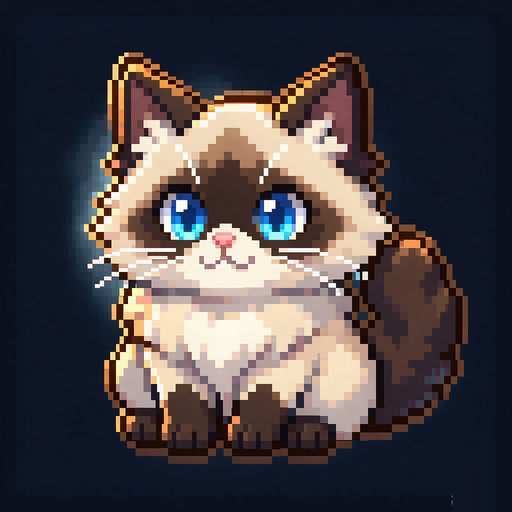

<p align="center">
  
</p>

<h1 align="center">可爱的喵助手</h1>

<p align="center">
在自己电脑上跑的 <b>2D 游戏美术生成器</b>。<br>
写一句话，得到能直接进游戏的像素角色、走路帧、图标和精灵图。
</p>

---

## 这是什么

做 2D 游戏总要一堆图：主角立绘、怪物、走路帧、道具图标、UI 素材。自己画太慢，
外包又贵，用在线 AI 画出来的图还得手动抠背景、缩尺寸、对齐脚底、拼成精灵图——
一圈折腾下来，真正画的时间还没处理图的时间多。

**这个工具把"画"和"处理"连成了一条流水线**：左边写好描述 → 生成 → 抠成透明底 →
缩成像素尺寸 → 打包成一张精灵图。全程在你自己的电脑上跑，不联网、不上传、不排队。

它是一个画布式的工作台：每个步骤是一个卡片（节点），用线把卡片连起来，数据就顺着线流下去。
像搭积木一样搭出你要的流程，搭好的整套流程还能存成模板反复用。

> 一句话区分：**ComfyUI 是万能引擎，这个是专为"2D 游戏素材"调好的一条产线**。
> 你不需要懂采样器、不需要装几十个插件，装好就能出能用的图。

## 能做什么

| 你想做的事 | 具体能力 |
|---|---|
| **画一个新角色** | 文生图。描述越具体越好，中文可以直接写 |
| **改造一张现有图** | 图生图：把原图当参考，用一句话告诉它改什么 |
| **只改局部** | 局部重绘：涂一块区域，只重画这一块，别处一个像素都不动 |
| **去掉背景** | 抠图：一键透明底，自动去白边。也可以直接生成透明底图（更干净） |
| **缩小成像素风** | 转像素：保留轮廓、限定色数、对齐网格，不是简单缩小 |
| **把立绘变成走路帧** | 姿态序列：给骨架图，生成同一个角色做同一组动作 |
| **换衣服、换脸** | 换装 / 换脸：给两张图，保留身份和姿势只换你要的部分 |
| **画面不够大** | 扩图：往上下左右扩展画布，边缘自然接上 |
| **拼成游戏用的精灵图** | 精灵图打包 + GIF/APNG 动效，还能直接导出 Godot 4 的 `tres`/`tscn` |
| **手动摆姿势** | 骨骼编辑：拖关节摆姿势，或者从照片自动提取 |

这些都能串起来：**图生成 → 抠图 → 转像素 → 打精灵图**，一条线跑完。

## 需要什么

| | 要求 |
|---|---|
| 系统 | Windows 10/11（`start.bat`），macOS / Linux 也可以（`start.sh`） |
| 显卡 | **NVIDIA 独显，建议 24GB 显存**（RTX 4090 实测：单张 768×768 约 10 秒，峰值占用 11.4GB）<br>16GB 能跑，但跑不了大图；没有独显会慢到没法用（一张几分钟） |
| 磁盘 | 约 **60GB**（模型权重 51GB + 依赖和产物） |
| 软件 | Python 3.11+、Node 18+（`start.bat` 会自动检查，缺什么会告诉你装什么） |

## 装起来：三步

**第 1 步 · 装 Python 依赖**

```bash
python -m venv .venv
# Windows:
.venv\Scripts\activate
# macOS / Linux:
source .venv/bin/activate

# torch 要从 PyTorch 官方源装（PyPI 上的 Windows 版本是纯 CPU 的）
pip install torch==2.6.0+cu124 torchvision==0.21.0+cu124 \
    --index-url https://download.pytorch.org/whl/cu124

pip install -r requirements.txt
```

**第 2 步 · 放模型权重**

下载 `Qwen-Image-2.1`（ModelScope 或 HuggingFace 上的官方仓库），解压成这个结构
（**关键是 `model_index.json` 要在这个位置**）：

```
models/checkpoints/qwen-image-2.1/
├── model_index.json
├── transformer/            # 主模型
├── text_encoder/           # 文本编码器（看得懂中文的就是它）
├── vae/
├── processor/              # 内含 tokenizer
└── scheduler/
```

放好之后跑一次（生成 fp8 缓存，省显存也更快；只需一次，十几分钟）：

```bash
python tools/make_qwen_fp8.py
```

**第 3 步 · 启动**

```bash
start.bat          # Windows：双击，或在命令行里运行
./start.sh         # macOS / Linux
```

它会自动检查环境 → 构建前端（第一次要一两分钟）→ 起服务 → 打开浏览器。
看到 `http://127.0.0.1:8000` 出现在浏览器里就成功了。

常用参数：

```bash
start.bat --check              # 只体检，不启动
start.bat --port 8010          # 8000 被占用时换端口
start.bat --rebuild            # 强制重建前端
start.bat --no-build           # 跳过构建（前端没改过时更快）
```

## 第一次用：5 分钟做一张透明底角色

1. **左侧栏找到「节点」分组**，点「图生成」右边的 `+`，画布上出现一张卡片。
2. **在提示词框里写你要的东西**，中文就行：
   ```
   一只白色的小猫骑士，红色披风，蓝色眼睛，正面全身，手持小剑
   ```
3. 尺寸保持 **768 × 768**，步数 **16**，点卡片上的「生成」。
   （第一次会加载模型，等 1~2 分钟；之后每张约 10 秒）
4. **抠背景**：左侧再加一个「抠图」节点，从图生成节点的输出端口**拖一条线**到它的输入端口，
   它会自动跑，得到透明底 PNG。
5. **下载**：点卡片里的图 → 全屏预览 → 点右上角「⭳ 下载」。

想直接生成透明底的图（比"生成后再抠"更干净，尤其白毛角色），
在图生成节点里勾上「**透明底**」再生成。

> 小技巧：把常用的整套流程存成**模板**（项目菜单 → 存为模板），
> 下次新建项目一键套用，不用重新连线。

## 出图不好看怎么办

先别怀疑模型，按这个顺序查：

1. **描述写具体**。"一只猫" 不如 "白色布偶猫，蓝色眼睛，正面全身，纯色背景"。
   它不懂的形容词（可爱、好看）没什么用，名词和构图词才有用。
2. **透明底 + 白毛角色**：一定勾「透明底」。白毛白底再去抠，很容易把身体一起抠掉。
3. **缺手缺脚 / 多一条腿**：把「候选」调到 2（显存够的话），它会多生成几张，
   用质量闸门挑最好的一张。24GB 卡上建议保持 1，否则时间翻倍。
4. **腿的姿势不对**（给了骨架图但它没照着摆）：这是当前模型的已知短板——
   参考图里的站姿会盖过骨架。换一张站姿更接近的参考图，或者改用「序列帧替换」节点。
5. **提示词写得越长越好吗**：不一定。太长的描述会稀释重点。
   但**工具本身不会截断你的提示词**，写多少它就发多少，慢一点而已。

## 界面上有什么

| 位置 | 说明 |
|---|---|
| **左侧栏** | 项目列表、节点列表（点 `+` 加节点）、提示词收藏、设置。可折叠 |
| **画布** | 拖空白处平移，滚轮缩放（以光标为中心）。点节点选中，拖右边缘改宽度 |
| **节点卡片** | 参数都在卡片里，每个参数名都有 tooltip（悬停看"做什么 / 影响什么 / 推荐值"） |
| **顶栏** | 当前项目名、显卡状态、缩放控制 |
| **右上角 GPU** | 绿色=显卡可用，红色=没连上（这时候点生成会报错） |

所有东西都**自动保存**（改完约 400 毫秒后写到本地磁盘），关掉浏览器再开还在。

## 常见问题

**生成要多久？**
RTX 4090 上 768×768 / 16 步约 **10 秒**。第一次要加载模型（1~2 分钟）。
1024×1024 会慢一倍多，而且精灵最后要缩到 32~128 像素，那些细节看不见，不划算。

**能做非人形吗？**（史莱姆、机械、道具）
能。质量闸门会自动识别"这不是人形"，不再反复补提，省时间。

**中文提示词会不会效果差？**
不会。文本编码器原生支持中文，官方示例本身就是几百字的中文描述。

**我的图和项目存在哪？**
全在本地 `assets/projects/<项目id>/` 下面（图、上传的原图、蒙版、项目定义）。
不上传任何地方。备份就拷这个目录。

**能商用吗？**
模型权重和生成内容的许可取决于 `models/checkpoints/qwen-image-2.1/LICENSE`，
请自行阅读后判断。本项目自己的代码只做流程编排。

**和 ComfyUI / WebUI 比怎么样？**
这个工具**不依赖 ComfyUI**，一条命令起来，界面只放"做 2D 素材"用得上的东西。
代价是灵活性不如 ComfyUI（不支持自定义节点、没有几十种采样器）。
如果你要的是"把游戏素材做出来"，它更省事；如果你要"试验各种模型组合"，用 ComfyUI。

**报错 "端口 8000 已被占用"**
`start.bat --port 8010`。

**报错 "Qwen-Image-2.1 权重缺失"**
回到「第 2 步」，检查 `models/checkpoints/qwen-image-2.1/model_index.json` 是否存在。

## 项目里都有什么

```
2d-game-meow/
├── start.bat / start.sh     一键启动（体检 → 构建前端 → 起服务）
├── app.py                   HTTP 服务（FastAPI）：提交任务、查进度、取图
├── workflows/               真正干活的部分
│   ├── engine.py            模型加载、显存管理、LoRA
│   ├── generate.py          各个工作流（文生图/重绘/抠图/姿态…）
│   ├── presets.py           提示词契约（自动补"全身/纯背景"这类约束）
│   ├── pixelfy.py           像素化、网格对齐、色板量化
│   ├── matte.py             抠图
│   ├── projectstore.py      项目存取（原子写，防丢）
│   └── projectio.py         项目导入导出（.mproj 单文件）
├── web/                     前端（React + Vite，零 UI 库）
│   ├── src/                 源码
│   ├── public/icon.png      应用图标
│   └── smoke.mjs            无浏览器冒烟测试（345 项）
├── models/                  模型权重（不提交到 git）
├── assets/                  你的项目和产物
├── templates/               项目模板（.mproj）
├── tests/                   Python 测试（345 条）
└── tools/                   实验与分析脚本（基准测试、验证）
```

## 想深入了解

- **[changelog.md](changelog.md)** — 完整技术手记：每条结论背后的实测数据、踩过的坑、
  为什么这么设计。**代码注释里写的「见 README」指的是这份**。
- **[docs/PLAN-QWEN-ONLY.md](docs/PLAN-QWEN-ONLY.md)** — 这个模型能做什么、明确做不到什么，
  以及绕不过去时怎么绕。
- **跑测试**：
  ```bash
  pytest tests/test_api.py tests/test_projects.py -q      # 接口与项目
  pytest tests/test_matte.py tests/test_pixelfy.py -q     # 抠图与像素化
  cd web && npm run smoke                                 # 前端（345 项，不用显卡）
  ```
  全量测试会加载两次模型，约 3 分钟；按改动挑子集跑更快（对照表在 changelog 的「测试」章节）。

---

<p align="center">
<sub>单底模：Qwen-Image-2.1 · 单卡串行 · 全本地运行</sub>
</p>
