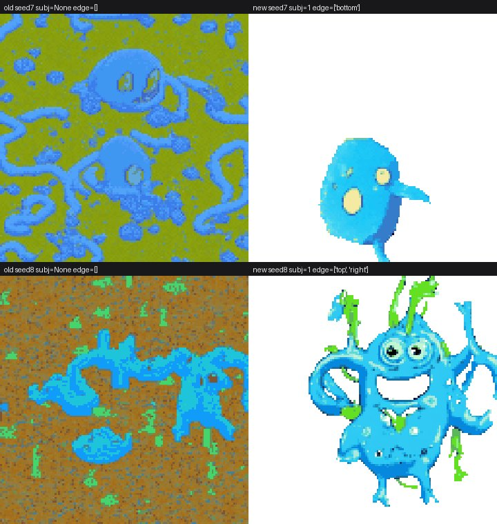
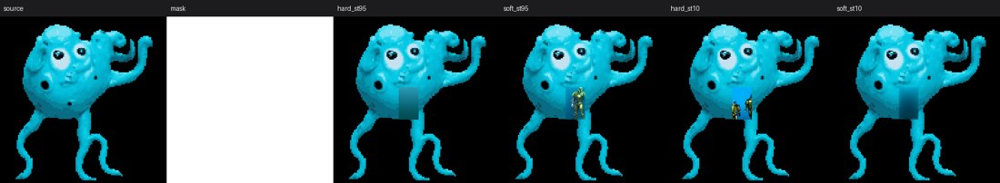
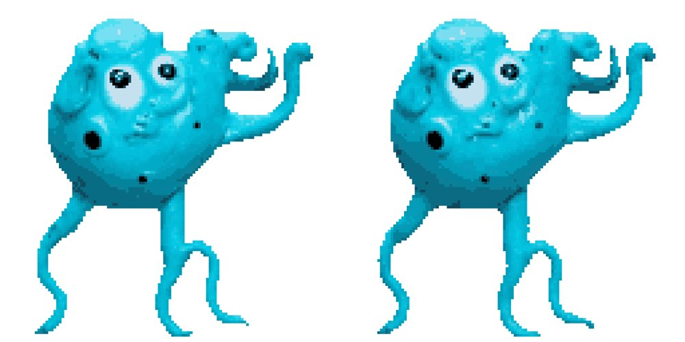
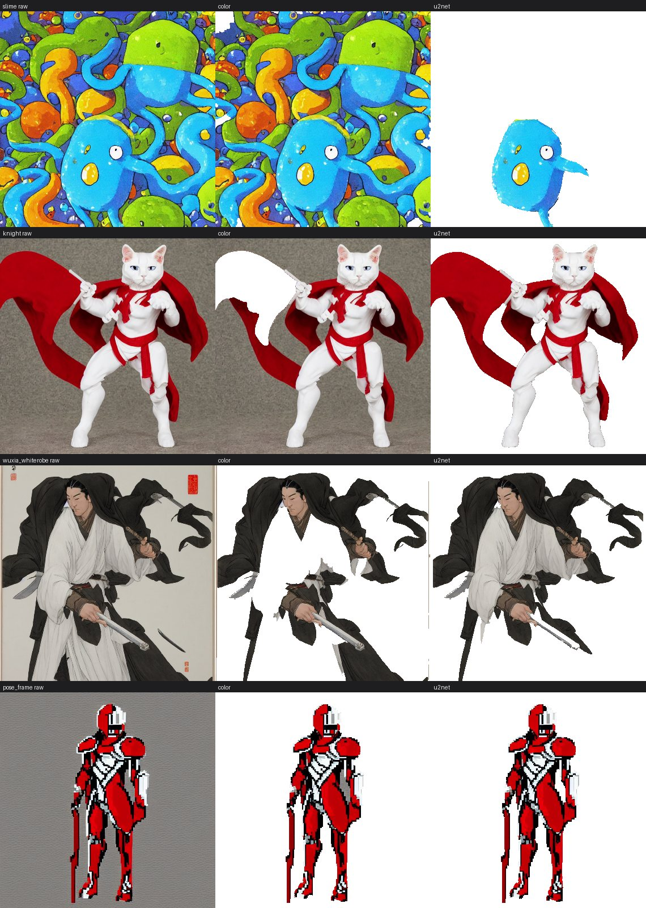

# 2D Game Asset Pipeline（SD1.5 本地版）

单卡 RTX 4090 上的本地 2D 游戏资产生成工作台。**全栈 SD1.5**：文生图、图生图、局部重绘、
姿态驱动→精灵帧、精灵图打包。代码化推理（diffusers，不依赖 ComfyUI）+ FastAPI 服务。

设计基线来自资料库文档 `RTX4090_2D_Game_Pipeline` v1.1；本仓库把其中的 SDXL 部分收敛为 SD1.5，
原因与实测结论见文末「版本选型」。

---

## 现状

| 模块 | 状态 |
|---|---|
| 引擎层（懒加载 / 显存守卫 / LoRA 热切换） | 已完成，实测通过 |
| W1 文生图 / W2 图生图 | 已完成，实测通过 |
| W3 局部重绘 | 已完成，实测通过 |
| W4 姿态驱动 → 逐帧对齐 → 精灵图打包 | 已完成，实测通过（8 帧走路序列） |
| **W4 批量候选 + 质量闸门**（关节数不足自动补提、按分数挑帧） | 已完成，实测通过 |
| **画布「图生图」节点**（w2：选源图 / 重绘幅度 / 链式重绘 / raw 源图） | 已完成，实测通过 |
| **画布「局部AI重绘」节点**（w5：笔刷选区 / 裁剪重画 / 支持 LoRA / 选区外逐点不变） | 已完成，实测通过 |
| 后处理（像素化 / 16 色量化 / 锚点对齐 / 打包） | 已完成并自测（28px 漂移 → 0） |
| IP-Adapter 角色身份锁定 | 已接通，效果待调（见「实测」） |
| FastAPI 服务（单卡串行队列 + 资产索引） | 已完成 |
| 抠图 / 去白边（纯色连通域 + u2net 语义分割 + 抠空自动回退） | 已完成，实测通过 |
| 游戏动效导出（GIF/APNG + Godot 4 + 通用 JSON） | 已完成，实测通过 |
| **底模自选（SD1.5 / SDXL 1.0）** | 已完成，实测通过 |
| LoRA 选装（Civitai 精选 + 注册表 + 节点下拉） | 已完成，实测通过 |
| **LoRA 训练**（自包含训练循环 + CLI + 面板） | 已完成，实测通过 |
| 姿态提取（YOLOX 检测 + RTMPose 回归 → OpenPose 骨架） | 已完成，实测通过 |
| W5 视频驱动（Wan2.2 TI2V-5B，替代 MimicMotion） | 已完成，实测通过 |

## 实测数据

稳态耗时（`python tools/bench.py`，每次跑前预热，排除模型加载）。RTX 4090 24GB，fp16，DPM++ 2M Karras。

| 用例 | 耗时 | 峰值显存 |
|---|---|---|
| 冷启动加载 SD1.5 | 1.59s | — |
| W1 文生图 512² / 25 步 | **0.70s** | 2.61GB |
| W1 文生图 512×768 / 25 步 | **0.99s** | 2.91GB |
| W1 文生图 768² / 25 步 | **1.58s** | 3.36GB |
| W1 文生图 512² / 8 步（草稿档） | **0.30s** | 2.61GB |
| W2 图生图 512² / strength 0.45 | **0.44s** | 2.61GB |
| W2 图生图 512² / strength 0.65 | **0.50s** | 2.61GB |
| W3 局部重绘 512² / 25 步 | **0.75s** | 4.64GB |
| W4 姿态驱动 1 帧 512² | **1.17s** | 7.36GB |
| W4 姿态驱动 8 帧 512² | **8.07s（1.01s/帧）** | 7.36GB |
| W4 8 帧 + IP-Adapter 0.85 | **9.71s（1.21s/帧）** | 10.59GB |

两点说明：

1. **单工作流峰值只有 2.6–3.6GB**；表里 7.36GB 是同一个 Engine 里 txt2img 与 ControlNet 两套
   pipeline 同时常驻的结果（省掉反复加载，代价是多占 4GB）。
2. **产线估算**：一个角色的走/跑/待机/攻击四套动作（各 8 帧）≈ **32 秒**；
   一个 20 角色的关卡 ≈ 11 分钟。瓶颈不在推理，在挑帧与修瑕疵。

## 姿态提取（W4 的入口）

```
图片 / GIF / 视频 / 精灵图
        ↓  YOLOX-L（onnx, 640×640，person 类）
   人体检测框 → 扩成正方形 ×1.25 → 缩到 288×384
        ↓  RTMPose（dw-ll_ucoco_384.onnx, SimCC 头）
   17 个 COCO 关键点 → 补 neck → 重排为 OpenPose-18 → 按官方配色渲染
        ↓
   ControlNet OpenPose 条件图
```

```bash
# 单图 / 精灵图（按网格切）/ 视频（每 3 帧取一帧）
python tools/pose_from_image.py sprite.png          -o assets/pose
python tools/pose_from_image.py sheet.png --grid 8x1 -o assets/pose
python tools/pose_from_image.py walk.mp4  --step 3   -o assets/pose
```

两个实现细节值得记：

1. **不用 controlnet_aux 的 DwposeDetector**：它依赖 mmpose + mmdet + mmcv（Windows 编译极痛），
   而且要 .pth 不是 onnx。这里直接用 DWPose 官方导出的两个 onnx 自己串链路。
2. **检测器可换**：`--detector auto|yolox|torchvision|none`。`auto` 优先 YOLOX，
   权重不在时退到 torchvision FasterRCNN（权重来自 download.pytorch.org，国内可达），
   两者都没有则整图回归——实测整图模式对人形精灵也能出 17/18 个关节，只是比例偏差更大。

实测（CPU，512² 输入）：

| 模式 | 单帧耗时 | 可见关节 |
|---|---|---|
| 整图回归（无检测） | 26ms | 17/18 |
| YOLOX 检测 + 裁剪 | 515ms | 17/18 |

检测的价值在**构图不规整**的输入（人物偏在一角、多人、画面留白多）；精灵图本来就占满画面时，
整图模式又快又够用。

## 画质：为什么差，以及怎么调

用户连续反馈「生成质量差」，实测下来是三个叠加的原因，按影响从大到小：

### 1. 默认分辨率太低（已修）

同一 prompt / 同一 seed 的对比：

| 分辨率 | 结果 |
|---|---|
| 512² + pixel 4 / palette 16 | 糊、抗锯齿边缘、连「猫」都读不出、没有骑士元素 |
| **768² + pixel 6 / palette 32** | 有胡须、眼高光、猫耳、披风褶皱，明显可辨认 |
| 1024² | **崩**：SD1.5 超出训练分辨率会重复肢体，实测出 3~4 个猫头叠在一起 |

所以默认值已经改成 **768² / 30 步 / cfg 7.0 / pixel 6 / palette 32**（`QUALITY_PRESETS`）。
768 ÷ 6 = 128 有效像素，正好是精灵尺寸。

### 2. SD1.5 本身的能力上限（换底模可解，见下一节）

同一句 "cat knight with katana"：

- **SD1.5**：画得出「猫 + 红袍」，但**画不出刀、画不出铠甲**——拟人角色拿武器这种
  复合概念超出它的能力，肢体与躯干也会糊成一团。
- **SDXL 1.0**：猫头、耳朵、口鼻、深色铠甲、红披风、握在爪子里的剑**全部到位**。

这不是调参能救的差距。要这种题材，就换底模。

### 3. 像素画的散落杂色（已做清洗，但未根除）

SDXL 的像素风出图，量化到 32 色后角色周围会冒出一粒粒红 / 青 / 橙的点。
排查时有个反直觉的发现：**它们不是独立小块**——实测 1024² 图上 25 个前景块，
最小的也有 2368px，压根没有孤立小块。所以面积过滤和形态学开运算都拿它们
没办法（那两种手段只动 alpha，而这里要动的是**颜色**）。

做了两层处理（`clean_iso` 与 `strip_fringe`，产线默认各 1 次）：

- **`strip_fringe`**：把「紧贴背景、颜色被背景混过」的一圈剥掉。
  原先只有色键后端走这一步，语义分割后端没走 —— 这才是白点的主要来源，
  补上之后残留从 30~40 个降到 15~20 个。
- **`clean_isolated`**：4 邻域判定的孤立点，主体内部的改成邻居色，
  飘在外面且 5×5 邻域只有自己的直接删。**5×5 那层保护不能省**：像素画的
  1px 斜向轮廓四邻同样全透明，只看 4 邻域会把整条对角线吃掉（实测踩过）。

残留的十来个点生成模型自身的噪声，继续加码会开始伤细节，就此打住。

### 4. 预设契约要选对

- 像素 LoRA 必须配 `preset=pixel`，配 `sprite` 会出彩色色块怪物（见下节）。
- 武侠 LoRA 必须配 `preset=wuxia`（压印章与水墨背景），且抠图要用 u2net。

## 底模：SD1.5 / SDXL 1.0（可自选）

```bash
# 权重（SDXL 约 6.5GB，fp16 变体，走代理从 HF 直下）
mkdir -p models/checkpoints/sdxl && ...   # 见 tools/fetch_modelscope.py
```

| 项 | SD1.5 | SDXL 1.0 |
|---|---|---|
| 原生分辨率 | 512²（768² 是甜点，1024² 会崩） | **1024²** |
| W1 文生图实测 | 768²/30 步 ≈ 1.8s / 3.4GB | **1024²/30 步 ≈ 4.5s / 10.5GB** |
| W4 姿态驱动实测 | 512²/25 步 ≈ 1.2s / 3.6GB | **1024²/28 步 ≈ 9.1s / 13.2GB** |
| W3 局部重绘实测 | 512²/25 步 ≈ 0.75s / 4.6GB | **768²/10 步 ≈ 5.5s / 8.8GB**（base 权重） |
| ControlNet | OpenPose/Canny/Tile 三套 | **三套都已装**（xinsir 版，各 2.4GB） |
| IP-Adapter | ✅ | ✅ 已装（666MB，与 SD1.5 **共享** ViT-H encoder） |
| W3 局部重绘 | ✅ 有专用 inpaint 权重 | ✅ 走 base 权重（无官方 inpaint 微调版） |
| LoRA | 3 个精选 | **2 个可用**（见下） |

**切换方式**：WebUI 左栏「设置 → 底模」。切换后 LoRA 列表会按 `base` 字段自动过滤——
SD1.5 的 LoRA 装在 SDXL 上完全无效且会静默出废图，所以直接不让你选。

W3 在 SDXL 下用 `StableDiffusionXLInpaintPipeline` + **base 权重**：SDXL 没有官方
inpaint 微调版，这是唯一可行路径。管线对 4 通道 UNet 是支持的（把 mask 与被遮图
拼进 latent 只发生在 9 通道 UNet 上），所以不用额外下权重；质量略逊于 SD1.5 那套
专用权重，换来的是 1024² 分辨率。选区外逐点不变的承诺两个底模都成立。

> **IP-Adapter 的坑**：HF 上 `sdxl_models/image_encoder` 是 **ViT-bigG**
> （hidden 1664 / projection 1280），而 `ip-adapter_sdxl_vit-h` 要的是 **ViT-H**
> （1280 / 1024）——和 SD1.5 完全同一个。用错会报
> `mat1 and mat2 shapes cannot be multiplied (2x1280 and 1024x8192)`。
> 所以权重并列放在 `ipadapter/models/`，两个底模共用一份 encoder（省 2.5GB）。

### SDXL 版 LoRA（实测）

| LoRA | 体量 | 判定 |
|---|---|---|
| **Pixel Art XL** | 163MB | ✅ 可用。SDXL 最高人气像素风（dl 119741 / ♥6288），无触发词，靠 prompt 里的 `pixel art` 生效 |
| **Ink Art XL** | 102MB | ✅ 可用。水墨线稿，触发词 `ink art` |
| 水墨风格 ink wash | 68MB | ❌ **LoKr 格式**（key 是 `lokr_w1`），diffusers 的 `load_lora_weights` 不支持 |

> LoKr / LoHa / LyCORIS 这类变体加载时会抛一堆「keys have not been correctly renamed」，
> 用户根本看不懂。引擎已把它翻成人话：「大概率不是标准 LoRA」，并把管道状态卸干净。

### SDXL 版 ControlNet（W4 才能吃 1024）

```
models/controlnet/sdxl_openpose/     # xinsir/controlnet-openpose-sdxl-1.0，2.4GB
```

SD1.5 与 SDXL 的 ControlNet **形状不同、不能混用**——代码里按 `model` 分开取，
拿错会直接 shape 不匹配崩掉，所以是显式报错而不是静默降级。

实测 W4 + SDXL（4 帧走路，1024²）：

- 四帧**角色完全一致**（红发、红袍、深色腰带、靴子），SD1.5 做不到这个稳定性
- 姿态**跟随骨架**，全身在画面内
- 已知瑕疵：剑柄握持偶有偏移、个别帧有细微尺寸漂移

SDXL 三条 ControlNet 与 IP-Adapter 的实测（1024²）：

| 组合 | 耗时 | 峰值显存 |
|---|---|---|
| W4 + OpenPose + IP-Adapter（2 帧） | 20s | 14.83GB |
| W4 + Canny 形状迁移（1 帧） | 12s | 12.99GB |
| W4 + Tile 高清放大（1 帧） | 32s | **21.94GB**（接近 24GB 上限，别再叠加别的） |

`poseswap` 新增 `controlnet="openpose|canny|tile"` 参数，三个底模无关地通用。

## 挑帧：批量候选 + 质量闸门（W4）

逐帧出图的老问题不是「画得丑」，而是**偶尔会出废帧**：没画出手、腿糊成一坨、
脚被画布切掉。这类帧人眼一秒能挑出来，但自动化管线以前只能照单全收，打包出来的
走路循环里突然抽一帧——不逐帧看根本发现不了。

`poseswap` 现在默认开闸门（`gate=True`）：

```
每帧 -> 生成 candidates 个候选（种子 seed, seed+1000, ...）
     -> 每个候选打一次分（workflows/quality.py）
     -> 取分数最高的一个
     -> 若最高分那个没过闸门，再补提最多 gate_retries 次
     -> 仍不过就留最好的那个，并在 meta 里记 passed=false
```

**分数量什么**（全部从产物图上直接量，不看生成过程）：

| 信号 | 含义 | 权重 |
|---|---|---|
| `points` | 姿态模型在**生成图**上重新检出的人形关节数（0~18）。手断了、画成两个半身，点数立刻掉 | +10/点 |
| `coverage` | 抠图后前景占比。偏大=半身/糊成一坨，偏小=人太小（像素化后没细节） | +5 落在区间内 |
| `edges` | 贴边（被画布切断）。精灵要对齐脚底，脚被裁掉则对齐必跳 | −8/条边 |
| `drift` | 与上一帧的 alpha 质心偏移（按对角线归一化）。帧间跳太远播放会抖 | −20×偏移 |

闸门判据是 `points >= gate_min_points（默认 8）` 且无贴边。**没有姿态模型时判定为
「无法判定」而不是「不合格」**，闸门自动关闭并告警——否则会拿不到判据还无限重提。

```python
g.poseswap(eng, pose_images=poses, prompt="...", matte=True,
           candidates=2, gate=True, gate_min_points=8, gate_retries=2)
# meta 里能查到：attempts（总生成次数）、gate_passed（过闸门帧数）、
#               frame_scores（每帧的 points/coverage/edge/drift/score/attempts）
```

代价：闸门每帧多几十毫秒（姿态模型跑 CPU，4090 上单帧约 10ms 量级），比重新出
一帧便宜两个数量级。`candidates=1, gate_retries=0` 就退化成原来的行为。

实测（2 帧走路，512²/20 步，`candidates=2, gate_retries=2, matte=True`）：
共 6 次生成、7.15s、峰值 3.33GB，两帧都过闸门（各 18/18 关节、无贴边）。
第 2 帧前 3 个候选都没过（关节断掉/贴边），第 4 次才拿到合格帧——这正是以前
会被人眼退掉、但自动管线照单全收的废帧。

## 画质：一轮代码 review 改了什么

不是「调参玄学」，每条都有对照实验（`python tools/ab_quality.py`，同 seed 只改一个变量）。

**① 正向后缀被静默丢弃（真 bug）**
`presets.build` 原来只对**负向词**做 77 token 截断，正向是 `用户描述 + 后缀` 直接丢给
CLIP。用户主体描述一写长，被丢掉的恰好是后缀（`flat plain background` / `hard outline`），
于是背景变脏、边缘变糊——这就是「提示词越长越难看」的真实原因。现在先给后缀留预算，
超长的部分截主体。

**② 没有逗号的长文本会让负向词变成空串（真 bug）**
`fit` 按逗号分段累加，第一段就超预算时 `break` 得只剩空列表，返回 `""`——
用户粘贴一整串空格分隔的负向词，等于什么都没写。现在退化成按词截断。

**③ 像素化降采样：LANCZOS → BOX**
LANCZOS 有负瓣，色块交界处会振铃出「过冲色」（黑线旁边冒一圈更亮的边），这些假色
再被量化，就成了多出来的脏色阶。实测同一张图：LANCZOS 用满 32 色且边缘发毛，
BOX 只用到 30 色，格子单色率 1.0（有测试钉住）。

**④ clip_skip 自实现（上游参数在本机会崩）**
diffusers 0.41 的 `clip_skip=` 分支写死 `text_encoder.text_model.final_layer_norm`，
本机 transformers 5.21 把 `CLIPTextModel` 摊平了（没有 `text_model` 这层）——
一传就 `AttributeError`。`workflows/clip.py` 自己算 embeds 再喂管道：
`clip_skip=1` 与管道默认**逐元素一致**（有测试），`2` 跳过最后一层（与默认的
余弦相似度 0.79，是实打实另一个向量）。节点「更多设置 → 跳过层」可选，
LoRA 注册表也能声明推荐值。

视觉上（`docs/img/clip_skip_ab.jpg`）：`cs1` 偏光泽渐变（高档 3D 感，但渐变多、
量化后杂色多），`cs2` 偏平涂 + 硬描边（更适合转像素）。代价是 `cs2` 下多主体
略多（2/3 vs 3/3），所以**默认仍是 1**，需要时手动开。

**⑤ 触发词实测有害（改数据，不是改代码）**
`px_illustrious` 注册的触发词是 `pixelart`，UI 上有「+ 填入」按钮。三个种子实测：

| 用法 | 主体数 | 单主体率 |
|---|---|---|
| 不加触发词 | 1 / 1 / 1 | **3/3** |
| 加 `pixelart` | 5 / 3 / 2 | **0/3** |

加了触发词反而把画面变成一整个「史莱姆图案墙」。注册表已把触发词清空并写明原因。
同一个 LoRA 一定会画彩色/纹理底，所以注册表新增 `matte: true`——选中它时节点自动
勾上抠图（以前默认不勾，出来就是蓝底图，没法直接用）。

同一 seed 的成品对照（上排旧用法：加触发词、不抠图；下排新默认）：



左列 seed 7、右列 seed 8。旧用法整幅变成「史莱姆图案墙」，新默认是单只、透明底、
像素块干净的成品。`meta.subjects` 也印证：旧用法数不出主体（没抠图），新默认 1 个。

**⑥ 多主体写进产物 meta**
SD1.5 画小体型角色（史莱姆尤甚）爱复制一份，负向词压不住，于是不猜、直接量：
抠图后 `foreground_blobs` 数面积 ≥400px 的前景块，写进 `meta.subjects`；节点里
`subjects > 1` 直接黄字提示换种子。这是**下界**（u2net 只分割显著主体，一整墙
史莱姆可能只剩 1 块），所以 1 不代表干净，但 >1 基本确实脏。

**⑦ 抠图后端：量过了，默认不动，补了防呆**
原本怀疑「像素画该用色键，因为 u2net 边缘软」。四个样本量下来两个结论：
alpha **都是二值**（中间 alpha 占比 0，边缘硬度假设不成立）；色键在像素 LoRA 的
彩色底上几乎抠不动（前景 0.90~0.98），在白袍角色上会把袍子抠碎（3 块）。所以
`auto` 继续走 u2net。真正该修的是另一件事：u2net 会**静默抠空**（草稿档只剩
0.44% 前景 → 交出一张空精灵），现在按前景占比做合理性检查并回退色键，
`matte_used` / `matte_fallback` 记进 meta。

## LoRA：装什么、怎么用

`models/lora/*.safetensors` + 同目录 `loras.json`（标签 / 触发词 / 推荐强度）。
启动后 `GET /loras` 直接列出，节点里「更多设置 → LoRA」可选，选中会自动带出触发词
和匹配的提示词契约。

### 精选结论（全部实跑验证，不是看描述选的）

| LoRA | 体量 | 来源人气 | 判定 |
|---|---|---|---|
| **px_illustrious**（像素游戏素材） | 36MB | dl 55382 / ♥5357 | ✅ **像素风首选** |
| **wuxia_v2**（武侠） | 96MB | dl 17267 / ♥2793 | ✅ **武侠首选** |
| paseer_wuxia（武侠线稿） | 144MB | dl 2533 / ♥507 | ⚠️ 纯线稿，当形状底稿用 |
| px_toolkit（2D 像素工具包） | 36MB | dl 53451 / ♥5140 | ❌ 背景污染 + 多主体，隐藏 |
| guofeng（工笔重彩） | 72MB | dl 18595 / ♥2416 | ❌ 手部崩坏，隐藏 |
| xuer_wuxia | 144MB | dl 8871 / ♥1005 | ❌ 出的是真人摄影风，隐藏 |

> 人气高 ≠ 适合产线。上面三个 ❌ 的下载量都不低，实测才知道不行。
> 隐藏项保留文件（`"hidden": true`），前端不显示，便于复现判断。

### 两条必须记住的用法

**1. 像素 LoRA 要配 `preset=pixel`，绝不能配 `sprite`**

`sprite` 契约里写着 `16-bit pixel art`，而像素 LoRA 已经把风格学进去了，重复要求
会让画面在「插画」和「像素」之间打架——实测套 sprite 契约出的是彩色色块怪物。
正确组合：

```python
txt2img(prompt="pixelart, knight in armor holding sword", preset="pixel",
        lora="px_illustrious", lora_scale=0.75,
        width=512, height=576, pixel=4, palette=24, matte=True)
```

**2. 武侠 LoRA 会给画面盖印章、画水墨背景**

必须靠 `preset=wuxia` 的负向词压（`seal / signature / ink splatter / paper texture`），
而且这类图必须用 **u2net 语义分割**抠图——纯色键控会把白袍和脸一起抠掉（实测第一帧
脸直接消失）。另外 `wuxia_v2` 的产出**偏半身**（训练集如此），要全身走 W4 姿态驱动，
让骨架锁结构、LoRA 只给风格。

## LoRA 训练

自包含训练循环（`workflows/train.py`），不依赖 diffusers 的 examples 脚本，
产出直接是 `Engine.apply_lora` 能加载的格式，训完立刻出现在下拉里。

```bash
# 数据集：图片 + 同名 .txt（每张一句 caption）；没有 .txt 时用 --caption 兜底
dataset/my_knight/
  knight_01.png
  knight_01.txt   ->  "mk_knight, a knight in plate armor, pixel art, white background"
  ...

python tools/train_lora.py --data dataset/my_knight --name mk_knight \
    --caption "mk_knight, pixel art game sprite, white background" --steps 400
```

WebUI 顶栏「训练 LoRA」同一个功能，有进度条、loss、显存与可训练参数量。

**实测（RTX 4090 24GB，fp32 UNet + gradient checkpointing，512 分辨率 batch 1）**

| 项 | 数值 |
|---|---|
| 可训练参数 | rank8 → 1.59M；rank16 → 3.19M |
| 耗时 | 约 **0.34s/步**（60 步 25s / 420 步 143s） |
| 峰值显存 | **4.67GB** |
| 产出体积 | rank8 → 6.2MB；rank16 → 13MB |

**三个坑（都写进代码注释了）**

1. `save_lora_weights` 的第一个参数是**目录**不是文件，且文件名写死
   `pytorch_lora_weights.safetensors`。直接传文件路径会得到一个同名目录，产物「消失」。
2. 直接传 `unet_lora_layers=unet` 会把**整个 fp32 UNet（3.3GB）**存进去且格式不对。
   必须 `get_peft_model_state_dict(unet)` + `convert_state_dict_to_diffusers()` 只取 LoRA 层。
3. 触发词必须写进 `loras.json`，否则训完也没人知道该写什么词唤出它（等于白训）。

**关于样本量**：实测 6 张图 + 420 步只能学到「像素风的大致色块分布」，出图仍会跑形。
角色 LoRA 建议 15~30 张同一角色不同姿势，风格 LoRA 20~40 张，配合
`plan_steps()` 自动按样本数算步数（下限 100、上限 2000）。

## WebUI（画布 · 文生图 / 图生图）

React 18 + Vite + TS，**零 UI 库、零画布库**（与 pixelforge 同思路），构建产物 157KB / gzip 51KB。

**一条命令启动**（自动体检 → 按需构建前端 → 起服务 → 开浏览器）：

```bash
./start.sh                  # Git Bash / macOS / Linux
start.bat                   # Windows 双击或命令行
```

| 参数 | 作用 |
|---|---|
| `--port 8010` | 换端口 |
| `--rebuild` / `--no-build` | 强制重建前端 / 跳过构建 |
| `--check` | 只体检（Python、依赖、CUDA、权重、前端、端口），不启动 |
| `--dev` | 只起 API，前端另开 `cd web && npm run dev`（:5173 代理） |

体检项与实际输出：

```
✓ Python：.venv/Scripts/python.exe（Python 3.13.14）
✓ 依赖齐全（torch / diffusers / transformers / fastapi / uvicorn）
✓ CUDA 可用（NVIDIA GeForce RTX 4090）
✓ 权重就绪（14 个文件）
✓ 前端产物是最新的
```

手动方式：

```bash
cd web && npm ci && npm run build     # 构建
cd .. && python app.py                # FastAPI 同时托管 dist 与 API → http://127.0.0.1:8000
cd web && npm run dev                 # 或开发模式（:5173，代理到 8000）
npm run smoke                         # 无浏览器渲染冒烟（jsdom，185 项断言）
```

> `start.bat` 刻意保持**纯 ASCII**：cmd.exe 按 OEM 代码页解析 .bat，中文注释会切断命令行
> （实测把 `setlocal` 切成 `ld`）。中文提示只留在 `start.sh`。

**布局**（参考了 InvokeAI 的「队列可见/参数分层」、SD.Next 的「折叠压制参数面」、pixelforge 的视觉与画布机制）：

```
┌ 顶栏：品牌 · GPU · 缩放 [− 100% + 1:1 适应] ┐
├───────────────────────────────────────────┤
│ ┌节点列表┐   ┌─ 图生成卡 ────┐  ┌─ 图生图卡 ─────┐
│ │图生成 +│   │ 提示词 / 尺寸   │  │ 源图 ▾ / 重绘   │
│ │图生图 +│   │ 更多设置 ▸     │  │ 提示词 / 更多 ▸ │
│ └────────┘   │ [生成] 预览     │  │ [生成] 预览     │
│              │ ↳ 图生图        │  └────────────────┘
│              └────────────────┘                   │
└───────────────────────────────────────────────────┘
```

**设计决策**

| 项 | 做法 | 理由 |
|---|---|---|
| 节点 | 两种：**图生成**（w1 文生图）与 **图生图**（w2），参数与结果同卡 | 生成与结果是一件事，拆两张卡会让每次生成多一次连线 |
| 图生图的源 | 卡片里选「画布上已出过图的节点」，或在生成节点下方点 **↳ 图生图** 自动接上 | 源图必须落到磁盘绝对路径（后端直接 `Image.open`），所以走节点引用而不是上传 |
| 源图用哪张 | 优先用上游的 **raw**（后处理之前的原图），次选成品 | 拿已经像素化到 128 有效像素的成品回炉，模型只会把色块重新糊成插画 |
| 双视图 | 出图后可切「只看图」，卡片只剩画面 + 种子徽标 | 画布上做对比时，参数是噪音 |
| 新建节点 | 节点列表**拖拽到落点**，或点 **+** 放到原点 (0,0) | 拖拽处落点用 `(client - viewport)/zoom` 换算成世界坐标 |
| 复制/删除 | 卡头按钮 + `Ctrl/Cmd+D` 复制、`Delete` 删除 | 输入框内不拦截按键 |
| 画布 | 自研 viewport(overflow hidden) + world(translate/scale) + 视差点阵网格 | 不上 react-flow：它会把节点模型绑死在库里；InvokeAI 的 README 已现身说法 dockview 之痛 |
| 持久化 | localStorage 防抖 400ms 保存 nodes + viewport | 刷新不丢布局 |
| 画布平移 | **拖空白处**（或空格 / 中键）；滚轮以光标为锚点缩放 | 节点多了全靠它 |
| 左边栏 | 菜单式层级：**项目** / 节点 / 提示词收藏 / 设置，各自可折叠，整条可收起成图标条 | 原来两张浮层卡片会互相挤压、占满画布左上角 |
| 项目 | 每个项目一套独立节点+视口，存 localStorage 的 `meow.projects.v2` | 不同关卡/不同素材线各画各的，互不干扰；老存档自动迁移 |
| 训练入口 | 顶栏「训练 LoRA」浮层面板，有进度条/loss/显存 | 不用切命令行 |
| **提示词语言** | 节点内固定提示「SD1.5 只支持英文」；输入含中日韩字符时实时转红警告 | 实测中文被拆成字节级乱 token（'背剑侠客' → `è ĥ Į å ī`），模型只会瞎猜甚至把乱码当文字画出来 |
| **提示词收藏** | 提示词框右上角 ☆ 收藏，左栏「提示词收藏」列出，点条目填入选中节点 | 常用提示词不必反复输入；按文本去重、可删除、localStorage 持久化 |

### 项目：每个项目是一套独立画布

左栏最上面是「项目」分组。一个项目 = 一套自己的节点 + 自己的视口 + 自己的连线，
切项目就是整套换掉，**互不干涉**（A 项目的节点不会漏到 B 项目）。

- **新建**：分组里的「+ 新建项目」，得到一个空画布，顶栏副标题会显示当前项目名。
- **切换**：点项目名即切换；当前项目高亮，条目上写着「N 个节点 · 当前」。
- **改名**：双击项目名，变成输入框，Enter 确认、Esc 取消。
- **删除**：点项目右边的 ✕ → 弹确认框：
  - 「仅从列表移除」：只从列表里去掉，项目内容留在 localStorage；
  - 「真删（含文件）」：把这个项目里**所有节点的产物**（PNG / sidecar / raw）
    一起从磁盘删掉，不可恢复。
- **最后一个项目不能删光**：删光了会自动补一个空的「我的项目」。

存储：全部项目存在 `localStorage` 的 `meow.projects.v2` 一个键里（原子读写，
不会出现「切了一半」的中间态）。老存档 `meow.canvas.v1`（只有一份 nodes+viewport
的时代）会自动迁移成第一个项目「我的项目」，不丢用户已有的画布。

**产物也隔离**：每个项目的文件都在自己的目录里：

```
assets/
├── index.jsonl                  全局索引（每条带 scope 字段）
├── projects/
│   ├── p1a2b3/                  项目 A 的产物
│   │   ├── w1_..._0000.png      成品
│   │   ├── w1_..._0000.png.json sidecar
│   │   ├── w1_..._0000_raw.png  后处理之前的原图
│   │   └── uploads/             本项目拖进来的本地图
│   └── p4d5e6/                  项目 B 的产物
└── uploads/                     历史遗留（项目功能之前上传的）
```

- 生成时前端带上 `scope`（项目 id），后端把产物写进 `assets/projects/<scope>/`。
- **跨项目引用会被后端拒绝**：拿 A 项目的图去 B 项目做图生图，直接报
  「源图不属于当前项目」。同项目内引用不受影响。
- 上传（拖进来的本地图）也进本项目目录：`/upload?project=<id>`。
- 资产清单可按项目过滤：`GET /assets?project=<id>`。
- **真删项目 = 删整个目录**（`DELETE /assets` 传 `projects/<id>`），产物、上传、
  帧序列一起清掉，索引里的条目同步摘掉。
- 产物在子目录里之后，`/files/<basename>` 取不到了——后端在结果里直接给
  `url`（相对 assets 的路径），前端用它显示。

> 历史文件（项目功能之前生成的，还在 `assets/` 根目录）仍可访问，也能当图生图的源，
> 它们属于「公共区」；但它们不会被任何项目的新产物覆盖或混进去。

### 抠图节点：去背景 / 换背景

左栏「节点」组多了一个**抠图**（紫色标题）。它**不用模型**——纯图像处理，
所以不占显存、瞬间出结果。

**源图两种来法**（都支持）：

1. **连线**：从任意节点（生成节点 / 图片节点 / 另一个抠图节点）的 ⤢ 拉一条线过来；
2. **直接加图**：把本机图片**拖到这个节点上**，它就成为源（不用先建图片节点）。

**三种背景方式**：

| 方式 | 结果 |
|---|---|
| 透明（去背景） | 产物是带 alpha 的 PNG，背景全没了 |
| 纯色 | 前景叠到指定颜色上（带取色器） |
| 换背景图 | 前景叠到**另一张图**上（背景图从画布上的图片节点里选，cover 裁切不拉伸） |

指定了背景时会**额外**存一份 `<name>_cut.png`（透明底前景），回头想换别的背景
直接拿它再走一次就行。

抠图节点的产物也是一张图，可以：点开全屏预览 / 下载 / 当别的节点的源（再接一个
图生图继续改）/ 继续连线给下一个抠图节点。

后端对应 `POST /generate` 的 `workflow: "wbg"`：

```bash
curl -X POST http://127.0.0.1:8000/generate -H "Content-Type: application/json" -d '{
  "workflow": "wbg",
  "params": {"init_image": "D:/.../assets/projects/p1/xxx.png", "bg_color": "#204080"}
}'
```

### 局部重绘节点（w3）

左栏「节点」组里的**局部重绘**（粉色标题）：源图 + 笔刷选区 + 提示词，
只重画涂出来的区域，**选区外像素逐点不变**（后端羽化蒙版向内收缩后贴回，
这条承诺有测试钉着）。

**源图**：连线接过来，或把本机图片直接拖到节点上。
**蒙版**：点「✎ 绘制蒙版」打开全屏笔刷，涂出要重绘的区域（白色 = 重绘区）。

笔刷是照着 pixelforge 的 MaskEditor 移植的，那边已经踩过一轮坑，几个关键经验：

| 做法 | 为什么 |
|---|---|
| **三层画布**：图 / 蒙版 / 覆盖 | 覆盖层是半透明红（给眼睛看），擦除时用 `destination-out` 只擦自己，下面的图不动 |
| **撤销用「操作列表 + 全量重放」**，不存 ImageData 快照 | 1024² 的快照是 4MB/步，撤 20 步就是 80MB；操作列表每步几十字节，重放一张图几毫秒 |
| **笔刷一律硬边** | 柔和边界交给后端的羽化（那边按像素算、可复现）；画布上做软笔刷只会得到不稳定的半透明，「选区外不变」也没法验证 |
| **覆盖层用不透明色 + CSS opacity** | 直接画 `rgba(0.4)` 的话，同一笔拖动时相邻线段会互相叠加（0.4→0.64→0.78…），看起来像「有的地方没涂上」 |
| 蒙版颜色/透明度记 localStorage | 换过一次颜色的人不希望每次重开又要再挑一遍 |
| **H 键临时隐藏蒙版** | 用原图核对「到底涂到哪了」 |

操作：画笔 / 橡皮 / 矩形框选，笔刷大小滑杆，滚轮缩放、空格拖动平移，
`Ctrl+Z` 撤销、`Ctrl+Shift+Z` 重做，「✕ 清空」重来。

蒙版存在**项目目录的 `masks/` 下、同名覆盖**（每个节点一份）——所以反复涂抹
不会攒出一堆垃圾文件。节点里只记路径与缩略图 URL。

后端对应 `POST /generate` 的 `workflow: "w3"`（`image` + `mask` 两个路径），
蒙版另有一个 `POST /mask` 端点负责存 PNG。

### 局部 AI 重绘节点（w5）

和上面的「局部重绘（w3）」并列的另一种做法：**裁剪「选区 + 上下文」→ 交给通用模型
重画 → 贴回原图**。左栏「节点」组里是「局部AI重绘」（绿色标题）。

**和 w3 的区别**（选哪个看场景）：

| | w3 局部重绘 | **w5 局部 AI 重绘** |
|---|---|---|
| 模型 | SD1.5 **专用 inpaint 权重** | **任意底模**（含 SDXL、像素 LoRA） |
| 分辨率 | 512 封顶 | 选区放大到 512~1024 再画 |
| 能挂 LoRA | ❌ | ✅ |
| 原理 | 管线原生 mask | 裁剪 → 图生图 → 贴回 |

所以：**像素素材改局部**必须用 w5（w3 的 inpaint 权重画不出像素风），
**大幅改写整块内容**用 w3 更省事。

**操作**：源图（连线或拖图）+ 笔刷蒙版（与 w3 共用同一个编辑器）+ 提示词 + 重绘幅度。

「更多设置」里的四项：

| 参数 | 默认 | 作用 |
|---|---|---|
| 上下文 | 0.35 | 选区外带多少上下文（按选区尺寸的比例）。越大模型看到的参照越多，也越容易改到选区外 |
| 外扩 | 8 px | 蒙版先外扩一圈，给模型「往哪长」的余地 |
| 羽化 | 4 px | 贴回时的边缘过渡。0 = 硬边（像素素材常用） |
| 接缝色彩校正 | 开 | 只在**边界带**做色彩校正。关掉的话模型新颜色可能和周围对不上 |
| 色板吸附 | 关 | 把重绘区里「接近源色」的杂色吸回源图色板（像素素材建议开） |

**「选区外的像素一个都不变」是逐像素可验证的硬承诺**（有测试钉着）：贴回的羽化
只向内——羽化权重 = 模糊(蒙版) × 二值蒙版，区域外的权重恒为 0。

**重绘幅度（strength）的实测含义**（像素素材，25 步，512² 源图）：

| strength | 效果 |
|---|---|
| 0.80 | **选区几乎没变**——模型保留原样，等于没重画 |
| 0.90 | 改动开始明显（默认值） |
| 0.95 | 改动最明显，但硬边会留矩形拼接痕 |
| 1.00 | 整块重画，风格漂移最大 |

所以默认给 **0.90**。另外实测：硬边（羽化 0）在重绘幅度大时会看到明显的矩形拼接
痕，**羽化 8px + 边界色彩校正**能把接缝收掉（`docs/img/ai_repaint_ab.jpg` 的
hard / soft 两组对照）。



上面这组对照还暴露了一个坑：**透明底素材送模型时必须把透明区填白**，不能直接
`convert("RGB")`——那样透明区会变黑，模型会把背景也当成内容重画，出来的选区
周围带一圈脏边。

两个踩过的坑（都写进注释了）：

- **送模型前必须转 RGB**。RGBA 图进 VAE 会变成 4 通道，UNet 首层按 4 通道卷积，
  激活尺寸直接爆炸——实测 512² 报 `Tried to allocate 36.00 GiB` 当场 OOM。
- **约束条款必须写英文**。SD1.5/SDXL 的 CLIP 只认英文，中文会被拆成乱 token；
  而且整句约束有 100+ token，必然在 77 的上限处被截断（实测后半段被整段砍掉，
  等于约束根本没生效）。

后端对应 `POST /generate` 的 `workflow: "w5"`：

```bash
curl -X POST http://127.0.0.1:8000/generate -H "Content-Type: application/json" -d '{
  "workflow": "w5",
  "params": {"image": "D:/.../assets/projects/p1/src.png",
             "mask": "D:/.../assets/projects/p1/masks/mask_x.png",
             "prompt": "give the knight a golden helmet",
             "context": 0.35, "expand": 8, "feather": 4, "palette_snap": true}
}'
```

### 全屏预览与下载

图在卡片里只是缩略图，看不清像素细节。三种方式进全屏（灯箱）：

- **点缩略图**（参数视图下方的预览图）
- **点卡头的 ⤢ 按钮**
- 图片节点的本地图直接点图

灯箱是全屏遮罩，显示原图（`image-rendering: pixelated`，像素画放大不糊），顶部有文件名和
**「⭳ 下载」**按钮。三种关闭方式：点背景、按 `Esc`、点「✕ 关闭」。

下载走 `GET /files/<相对路径>?download=1`——后端会带上
`Content-Disposition: attachment; filename="xxx.png"`，浏览器直接存盘而不是内联打开。
不带 `download=1` 时是内联显示（预览用）。

### 删除：确认框 + 真删

删节点不再是一按就消失。点 ✕ 或按 `Delete` 会弹确认框，三个出口：

| 出口 | 行为 |
|---|---|
| 取消 | 什么都不做 |
| 仅移除节点 | 只从画布拿掉，**磁盘文件留着**（后悔了还能在 assets 里找回） |
| 真删（含文件） | 调 `DELETE /assets`，把产物、sidecar、raw 一起删掉，**不可恢复** |

几个细节：

- **被引用时禁掉真删**：如果这些文件还被别的节点当源图，弹窗会说明「还有 N 个节点
  把它当源图」，并把真删按钮置灰——否则会默默把下游图生图节点变成「没有源的节点」。
- **删除会断开连线**：删掉的节点如果被别的节点连着，那些节点的源会被清空（不悬空）。
- **索引同步清理**：真删会把 `assets/index.jsonl` 里对应的条目摘掉，`/assets` 不会
  再列出已经不存在的文件。
- **路径穿越被拒**：后端只允许删 `assets/` 目录内的文件，`../` 一律跳过（返回
  `skipped`，前端能看到「哪几条没删掉」）。

### 图片节点、拖本地图、连线

- **把本机图片拖进画布** → 变成一个「图片」节点（黄色标题）。图片会先 POST 到
  `/upload` 存进 `assets/uploads/`，画布存的是磁盘绝对路径 + 展示 URL 两份：
  前者给图生图当 `init_image`，后者给 `` 显示。
- **拖到图生图节点上**（而不是空白处）→ 直接成为那个节点的源，不用先建节点。
- **图片节点可以自由改变展示大小**：右下角有拖拽手柄（按原图比例缩放），
  也可以直接改「宽」输入框（60~900px）。高度按原图比例自动算。
- **连线**：每个节点卡头右侧有一个青色连接点，从这里拖一条线到图生图节点上，
  就把它设成了源（画布上会画一条贝塞尔曲线）。图生图节点也可以在卡片里用下拉换源。
  只有图生图节点能接源——文生图没有「底图」这回事。

### 图生图节点（w2）

用途：拿一张已有图**改内容不改构图**——换配色、加装饰、把草稿修成成品、把半身补成全身。

- 建节点：左栏「图生图 +」，或在任意已出图的节点下方点 **↳ 图生图**（自动接上源图、
  自动带过去提示词，落在源节点右边 340px）。
- 卡片里可以直接换源（下拉列出画布上所有出过图的节点），**重绘幅度** 0.15~0.90：
  0.3 只动细节，0.55 默认（明显改内容又不丢构图），0.85 基本重画。
- 尺寸随源图，卡片里没有宽高输入（后端也不接受，传了会被 diffusers 忽略）。
- 后处理与 W1 完全同一套（抠图 / 像素化 / 量化 / 去孤立点），所以图生图出来的也是
  成品精灵，不是「半成品再手工处理」。
- **没有源图时生成按钮是禁用的**，不会提交一个必然失败的任务。
- 产物同样多存一份 `<name>_raw.png`，可以继续往下接第二个图生图节点（链式重绘）。

实测（同 seed，左=文生图，右=以左的 raw 为源的图生图 strength=0.45）：构图、轮廓、
像素块完全保持，只在细节上重画——这正是图生图该有的样子（要大改就把幅度调到 0.7+）：



## 抠图 / 动效导出

```python
r = poseswap(eng, pose_images=poses, prompt="blue robot",
             pixel=4, palette=16, matte=True,          # 出透明底
             export="assets/export/robot", anim_name="walk", fps=10)  # 出 Godot 工程包
```

导出产物（`export_godot`）：图集 PNG、`SpriteFrames.tres`（每帧一个 AtlasTexture）、
`AnimatedSprite2D.tscn`（`texture_filter = 1` 最近邻、`autoplay` 已开、
`offset.y = -cell_h/2` 脚底对齐）、引擎无关 JSON、GIF/APNG 预览、zip 包。
全是确定性文本生成，同输入逐字节可复现。

抠图两个后端（`matte_backend="auto"` 默认有分割模型就走第二个）：

| 后端 | 耗时 | 适用 | 实测短板 |
|---|---|---|---|
| `color`（连通域色键） | **0.02s/帧** | 平坦纯色背景的精灵 | 白袍/浅色角色贴白底会被误抠（实测把脸抠没） |
| `u2net`（isnet-general-use, 170MB） | 1.6s/帧 | 复杂背景、水墨装饰、浅色主体 | 慢 80 倍 |

同一张武侠图对比：`color` 把背后的圆形水墨装饰整个留下、底部黑块也在；
`u2net` 只留人，脸、剑、衣摆全在。**武侠 / 立绘类一律走 u2net。**

像素画也一样——这条是量过的（`python tools/ab_matte.py`，768² 四个样本）：

| 样本 | `color` 前景占比 / 连通块 | `u2net` 前景占比 / 连通块 | IoU |
|---|---|---|---|
| 像素 LoRA 史莱姆（彩色纹理底） | 0.98 / 1（几乎没抠） | **0.12 / 1**（只留主体） | 0.13 |
| 像素 LoRA 白猫骑士（灰底） | 0.91 / 1（脸被当背景抠没） | **0.41 / 1** | 0.33 |
| 武侠白袍（白底） | 0.35 / **3**（袍子被抠碎） | **0.42 / 1** | 0.63 |
| W4 姿态帧（灰底） | 0.195 / 1 | 0.191 / 1 | **0.97** |



每行三联：原图 / `color` / `u2net`。第二行最能说明问题——`color` 把白猫的**脸和身体
当背景抠掉**（只剩红披风），`u2net` 完整保留。

两个后端的 alpha **都是二值**（中间 alpha 占比 0）——所以「u2net 边缘软、不适合
像素画」的假设不成立，`auto` 继续默认 u2net 是对的。

但 u2net 会**整张抠空**：草稿档（256²/8 步）实测只剩 0.44% 前景，下游贴边检测 /
主体计数 / 像素化全拿到空数据，最后交出一张空精灵且不报错。现在 `matte_auto`
会检查前景占比，落在 1%~95% 之外就回退色键并取更合理的那份，同时把
`matte_used` / `matte_fallback` 写进产物 meta。

抠图三个要点：

1. 只抠**与画面边界连通**的同色区域——否则白猫肚子贴着白底会被一起吃掉。
2. 去白边要**迭代**：混色边通常 1–3px 厚，单次膨胀只剥掉最外一圈（实测残留 184 像素 → 迭代 3 次后 0）。
3. alpha 一律二值。像素素材要硬边，半透明会引入新的脏边。

## W5 视频驱动（Wan2.2 而非 MimicMotion）

选 Wan2.2 TI2V-5B 而不是 MimicMotion，理由很实际：Wan 已在盘上（pixelforge 的 37GB），
MimicMotion 要另下 ~16GB（代理 480KB/s ≈ 9 小时）。MimicMotion 的优势是「真人动作驱动」，
等有明确需求再单独接。

```bash
python tools/video.py t2v "pixel art cat knight walking, flat background" -o assets/clip
python tools/video.py i2v assets/cat.png "the same character walking" -o assets/clip
```

实测（4090 24GB，bf16 + enable_model_cpu_offload）：

| 项 | 数值 |
|---|---|
| 加载 | 23–30s |
| 25 帧 384² / 10 步 | **26.8–30.6s（1.22s/帧）** |
| 峰值显存 | **10.7GB** |

比预期省：pixelforge 记的 19GB 是 fp8+offload；bf16 + 仅 offload 实测 10.7GB 就够。
注意视频底座要和 SD1.5 分开跑（先 `eng.free()`），否则两套权重抢显存。

**一个坦诚的限制**：人体姿态模型对**非人形角色**（四足/怪物）几乎无效——实测把生成的
四足生物视频喂进去，5 帧里只有 3 帧能提够关节。W5 用在人形角色上才顺。

## 测试

```bash
python -m pytest tests -q        # 208 个用例，约 180s（含 SDXL 慢用例）
# 全套超过 2 分钟会被超时杀掉，分批跑：
#   pytest tests --ignore=tests/test_models.py   # 197 个，约 105s
#   pytest tests/test_models.py                  # 11 个，约 60s
```

| 文件 | 覆盖 | 用例数 |
|---|---|---|
| `tests/test_postprocess.py` | 锚点、逐帧对齐、打包几何、色板上限、alpha 二值化、裁边、**像素块单色性**、**前景块计数** | 11 |
| `tests/test_generate.py` | **局部 AI 重绘（选区外逐点不变 / 约束条款是英文 / 蒙版尺寸不匹配报错）**、**抠图三种模式（透明/纯色/换背景图）**、同 seed 逐像素一致、不同 seed 相异、色板生效、**重绘选区外不变**、序列帧数、**闸门重提与批量挑帧**、**clip_skip 生效与 meta 记录**、主体数上报、**图生图后处理与 raw 留存**、**项目隔离（产物分目录 + 跨项目引用被拒）**、显存回收、缺权重报错 | 18 |
| `tests/test_controlnet.py` | Canny conditioning 生效、Tile 放大结构相关性 > 0.5、像素块均匀性 | 3 |
| `tests/test_api.py` | **w5 队列往返**、**未知 workflow 报错**、**wbg 队列往返**、**蒙版端点（同名覆盖/拒绝非 PNG）**、全部端点、队列串行性、**w2 队列往返（含 raw 留存）**、**上传端点（坏文件/空文件/文件名清洗/进项目目录）**、**真删（连带 sidecar/raw、索引清理、路径穿越防护、索引不可删）**、**资产按项目过滤**、**下载的 Content-Disposition**、400/404 | 22 |
| `tests/test_pose.py` | 检测器切换、18 点完整性、关节在画面内且头高于髋、骨架渲染、双后端一致性、引擎内的姿态提取器单例、精灵图切片 CLI | 7 |
| `tests/test_quality.py` | 前景占比/质心/漂移、**贴边检测**（含未抠图时整体失效）、无模型时「无法判定」、关节数影响排序与闸门 | 11 |
| `tests/test_io_paths.py` | 视频抽帧、GIF、精灵图切片（含空格子）、CLI 错误码、非 8 倍数尺寸重绘、cols 夹取、环境自检 JSON、LoRA 空接口 | 11 |
| `tests/test_presets.py` | 契约拼接与优先级、77 token 预算、**长提示词不丢后缀**、**无逗号文本不截成空串**、中文 token 估算、下载器过滤 | 12 |
| `tests/test_repaint.py` | **选区外逐点不变**、硬边完全替换、**色彩校正不把中心拉回原色**、**色板吸附保留远色**、蒙版运算、尺寸对齐、**RGBA 进 VAE 会炸**、**透明底填白** | 16 |
| `tests/test_clip.py` | **clip_skip=1 与管道默认逐元素一致**、cs2 换向量、越界值夹取、无 text_encoder 时报错 | 4 |
| `tests/test_fetch.py` | Range 分块拼接、断点续传、**拒绝非 206 响应**（防 429 错误体污染）、超长残留文件重置 | 5 |
| `tests/test_stability.py` | 连续 20 次推理显存不涨、`free()` 释放 pipeline 与 ControlNet、跨进程同 seed 一致、PNG 结构、sidecar 一致 | 5 |
| `tests/test_matte.py` | 背景估计、连通域不误抠内部同色区、去白边生效、alpha 二值、容差方向、裁边、真实生成图抠图、**u2net 抠空自动回退**、**强制后端不回退** | 13 |
| `tests/test_anim.py` | GIF/APNG 帧数、索引几何、Godot tres 分区序列、tscn 像素设置（最近邻/autoplay/脚底偏移）、导出确定性 | 9 |
| `tests/test_video.py` | numpy/PIL 帧兼容、mp4 落地、模型路径校验、Wan 真实生成（`RUN_WAN=1`） | 6 |
| `tests/test_lora.py` | 注册表扫描/元数据/坏 JSON 容错、名称解析、去碎屑、贴边占比判定、武侠契约预算 | 13 |
| `tests/test_train.py` | 数据集读取与兜底、步数规划、**端到端 6 步真训练**（导出的体积上限、可被 scan/apply_lora 认出）、`/train` 全流程 | 9 |
| `tests/test_models.py` | `/models` 只列出本机已装的、未知底模报错、**W3+SDXL 走 base 权重且选区外不变**、**SDXL 忽略 clip_skip**、SDXL 真实生成、**W4+SDXL 端到端**、SDXL 版 IPA 与三条 ControlNet | 11 |
| `tests/test_denoise.py` | `strip_fringe` 剥白边/迭代/不误伤主体、`clean_isolated` 内部改色/外挂删除/**斜向轮廓不被吃** | 9 |

已知限制：骨架质量决定成败——实测 8 帧序列里有 2 帧只提取到 8/18 个关节（手臂与身体重叠），
这两帧生成时会自由发挥，出现朝向漂移。产线上应当在提取后按「可见关节数」筛帧；
W4 侧对应的兜底是上面那套**质量闸门**（生成后再检一遍，点数不够就补提）。

测试过程中修掉的两个真 bug：**inpaint 不传 width/height 时 diffusers 默认输出 512×512**（与源图不符，
贴回时 `images do not match`）；**composite 的羽化是双向扩散**（会把选区外像素一起吃掉），
改为先腐蚀再模糊。

## 目录

```
2d-game-meow/
├── app.py                  FastAPI 服务入口
├── workflows/
│   ├── engine.py           pipeline 懒加载、显存守卫、LoRA 热切换
│   ├── generate.py         w1/w2/w3/w4 四个工作流
│   ├── quality.py          帧质量评分（关节数 / 占比 / 贴边 / 漂移）——挑帧与闸门
│   ├── repaint.py          局部 AI 重绘的图像运算（裁剪 / 羽化 / 接缝校正 / 色板吸附）
│   ├── clip.py             自实现 clip skip（上游参数在 transformers 5.x 下会崩）
│   └── postprocess.py      像素化、调色板量化、锚点对齐、精灵图打包
├── tools/
│   ├── fetch_weights.py    权重下载（走 hf-mirror）
│   ├── smoke.py            逐阶段测速/测显存
│   ├── make_pose.py        COCO-18 骨架图生成 / 渲染
│   ├── pose_from_image.py  从图片 / 视频 / 精灵图批量提骨骼
│   ├── video.py            文生视频 / 图生视频 CLI
│   ├── fetch_ranged.py     按 Range 分块下载（抗限流断流）
│   ├── bench.py            稳态基准
│   ├── ab_repaint.py       局部 AI 重绘 A/B（重绘幅度 / 羽化 / 色板吸附，同源单变量）
│   ├── ab_quality.py       画质 A/B（采样档 / 后处理档 / 背景干净度，同 seed 单变量）
│   ├── ab_matte.py         抠图后端 A/B（色键 vs u2net：占比/白边/连通块/IoU）
│   └── check_env.py        环境自检
├── models/                 权重（checkpoints / controlnet / ipadapter / loras / ...）
└── assets/                 产物 + sidecar(.json) + index.jsonl
```

## 环境（本机实测）

| 项 | 值 |
|---|---|
| GPU | RTX 4090 24GB（驱动 621.01 / CUDA UMD 13.5） |
| CPU / RAM | i9-13900KF 24C32T / **31.8GB** |
| OS | Windows 11 26300 |
| Python | 3.13.14，torch 2.6.0+cu124（`cuda.is_available()=True`） |
| 注意力 | torch SDPA（Windows + py3.13 无 xformers 轮子） |
| 模型源 | `HF_ENDPOINT=https://hf-mirror.com`（huggingface.co 直连不可达） |

安装：

```bash
python -m venv .venv
.venv/Scripts/python -m pip install torch==2.6.0+cu124 torchvision==0.21.0+cu124 \
    --index-url https://download.pytorch.org/whl/cu124
.venv/Scripts/python -m pip install -r requirements.txt -i https://pypi.tuna.tsinghua.edu.cn/simple
```

## 快速开始

```bash
# 1) 拉权重（魔搭，约 12.6GB：底座 4.0 + inpainting 2.2 + IP-Adapter 2.4 + ControlNet 4.0）
python tools/fetch_modelscope.py            # 全部
python tools/fetch_modelscope.py sd15       # 只拉某一段
python tools/fetch_modelscope.py --list     # 先看清单

# 2) 环境自检 + 分阶段实测（写 assets/_bench.json）
python tools/check_env.py
python tools/make_pose.py          # 生成 COCO-18 骨架帧（无 DWPose 时用）
python tools/smoke.py w1
python tools/smoke.py w3
python tools/smoke.py w4 --pose-file assets/_pose_walk_00.png --no-ipa

# 3) 起服务
python app.py            # http://127.0.0.1:8000/docs
```

提交任务：

```bash
curl -X POST http://127.0.0.1:8000/generate -H "Content-Type: application/json" -d '{
  "workflow": "w1",
  "params": {"prompt": "pixel art cat knight, red cape, katana, front view",
             "width": 512, "height": 768, "steps": 25, "pixel": 4, "palette": 16}
}'
```

上传一张本地图（画布「拖本地图进画布」走的就是它；请求体是**原始字节**，不是 multipart）：

```bash
curl -X POST "http://127.0.0.1:8000/upload?name=hero.png" \
     --data-binary @hero.png -H "Content-Type: image/png"
# -> {"path": "D:/.../assets/uploads/ab12cd34ef_hero.png",
#     "url": "/files/uploads/ab12cd34ef_hero.png", "w": 512, "h": 512, "format": "PNG"}
```

真删（连 sidecar 与 raw 一起删，并把索引里的条目摘掉）：

```bash
curl -X DELETE http://127.0.0.1:8000/assets -H "Content-Type: application/json" \
     -d '{"paths": ["D:/.../assets/w1_20261028_090000_0000.png"]}'
# -> {"deleted": [...], "skipped": [...], "not_found": [...], "count": 3}
```

`assets/` 之外的路径会被跳过（`skipped`），`index.jsonl` 不可删。

拿到 `path` 就能当图生图的源：`{"workflow": "w2", "params": {"init_image": "<path>", ...}}`。
校验：体积 ≤20MB、真能解码（坏文件 400）、格式白名单（PNG/JPEG/WEBP/BMP/GIF）、
磁盘名只用 ASCII（中文名要 URL 编码，会坑掉某些代理）。

## 设计约束（都是踩过的坑）

### 前端（这两条是用户实测报上来的）

1. **卡头按钮上不能启动拖拽**。`setPointerCapture` 会把后续 pointerup 重定向到卡头，
   浏览器按「pointerdown 与 pointerup 的最近公共祖先」派发 click —— 于是 click 落到卡头，
   「切回参数视图」永远点不动。修法：`e.target.closest('button, input, textarea, ...')`
   命中就直接 return，不抓手。
2. **画布平移不能靠 `data-bg` 判断**。`.canvas-grid` 是 `pointer-events:none`，点空白时
   事件目标是 `.canvas-viewport` 自己（没有 `data-bg`），判据永远不成立 → 画布完全拖不动。
   改成反向排除：不在节点/面板/控件上就算可拖。
3. **`.block` / `.fold-body select` 的样式漏了**，深色底上 LoRA 下拉几乎看不见。
   现在 `.fold-body` 里的 select 与 number 统一有边框、`color-scheme: dark`、深色 option。


1. **像素感由后处理保证，不靠提示词**。模型只会画出「看起来像像素」的糊图；
   必须走「提示词契约 → 网格吸附 → 共享调色板」三道关。
2. **逐帧生成必须做锚点回拉**。模型每帧会自己重新构图，角色在画面里上下漂移；
   按首帧脚底锚点做**整体整数平移**拉回，只平移不缩放（缩放会抹掉下蹲/抬腿的真实大小变化）。
3. **跨帧一致性靠固定 seed + 固定 LoRA + 固定文本**，不是靠提示词描述得详细。
4. **局部重绘只改选区**：羽化蒙版**向内**收缩后贴回，选区外像素逐点不变。
5. **单卡串行**：一个 worker 线程 + FIFO 队列，不做并发，避免两套 pipeline 抢显存。

## 版本选型：为什么全栈 SD1.5

| 能力 | SD1.5 | SDXL |
|---|---|---|
| 文生图 / 图生图 | 可行 | 画质与 prompt 遵循更好 |
| 局部重绘 | **更优**（专用 inpaint 权重，专为 512 训练） | inpaint 专模弱于自身基座 |
| 姿态 → 精灵帧 | **更优**（lllyasviel OpenPose v1.1，业界默认件） | 社区二次训练，边缘姿态更飘 |
| 视频驱动 | **唯一选项**（MimicMotion 底座即 SD1.5） | 无 |
| 权重体积 / 单步耗时 | 2GB / 基准 | 7GB / 慢 3–4 倍 |
| 授权 | CreativeML OpenRAIL-M | Community License（年营收 >$1M 需付费） |

关键判断：**游戏精灵的交付分辨率是 512–768，不是 1024**。SDXL 出 1024 再缩到 128 只会把细节噪声一起缩进去。
SD1.5 在 512 上「一次到位 + 16 色量化」更贴产线，且被视频模型绑死（MimicMotion 无 SDXL 版）。
