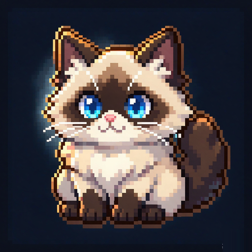
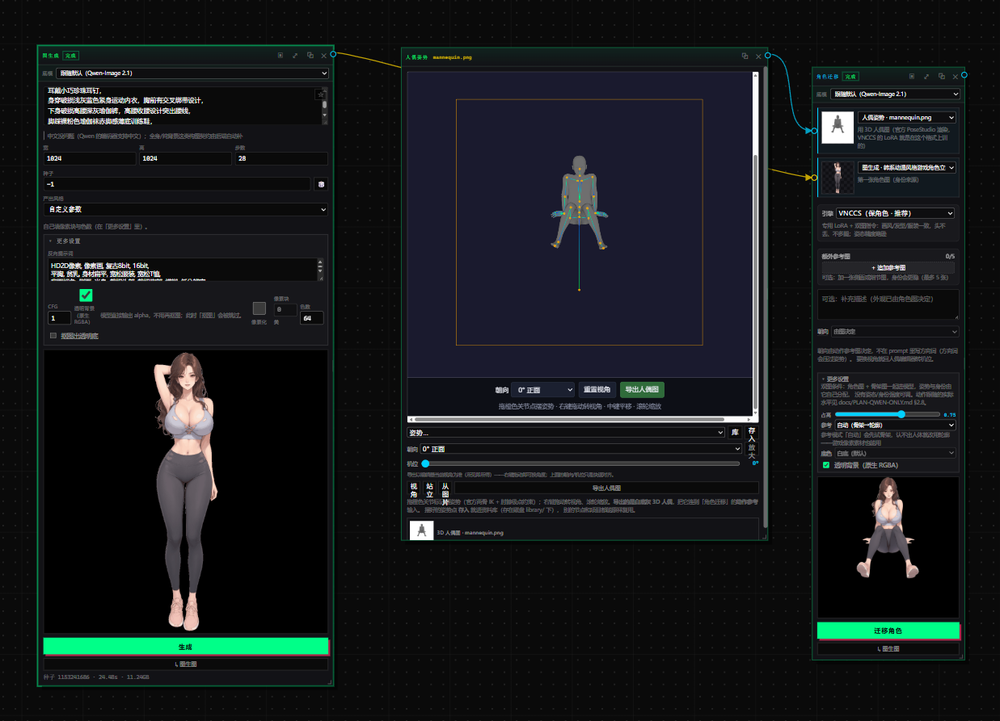

<p align="center">
  
</p>

<h1 align="center">可爱的喵助手</h1>

<p align="center">
在自己电脑上跑的 <b>2D 游戏美术生成器</b>。<br>
写一句话，得到能直接进游戏的像素角色、走路帧、图标和精灵图。
</p>

---

> ⚠️ **项目状态：雏形（Prototype）**
>
> 这个项目只是个**技术验证雏形**：界面和交互**尚未细节打磨**，许多地方还比较粗糙、
> 有占位符、流程也不够顺滑。它存在的意义是验证「本地跑 Qwen-Image 做 2D 游戏素材」
> 这条路能不能走通，**不是**一个开箱即用的成熟产品，别对它期望太高。
>
> 💡 **想要现成、完整、打磨过的体验，强烈推荐直接用官方 VNCCS：**
> 👉 **https://github.com/AHEKOT/ComfyUI_VNCCS**
>
> 本项目的人偶姿势 / 姿势迁移 / 人物一致性等能力，就是从 VNCCS 移植过来的
> （只保留了 Qwen-Image 单底模这一条路径）。如果你要的是「把游戏素材做出来」且
> 不想折腾，VNCCS 是更省事、更完整的官方选择；本项目更适合想看实现原理、
> 或想在单底模上自己改的人。

---

## 这是什么

做 2D 游戏总要一堆图：主角立绘、怪物、走路帧、道具图标、UI 素材。自己画太慢，
外包又贵，用在线 AI 画出来的图还得手动抠背景、缩尺寸、对齐脚底、拼成精灵图——
一圈折腾下来，真正画的时间还没处理图的时间多。

**这个工具把"画"和"处理"连成了一条流水线**：左边写好描述 → 生成 → 抠成透明底 →
缩成像素尺寸 → 打包成一张精灵图。全程在你自己的电脑上跑，不联网、不上传、不排队。

它是一个画布式的工作台：每个步骤是一个卡片（节点），用线把卡片连起来，数据就顺着线流下去。
像搭积木一样搭出你要的流程，搭好的整套流程还能存成模板反复用。

> 一句话区分：**ComfyUI 是万能引擎，这个是专为"2D 游戏素材"调好的一条产线**。
> 你不需要懂采样器、不需要装几十个插件，装好就能出能用的图。

## 能做什么

| 你想做的事 | 具体能力 |
|---|---|
| **画一个新角色** | 文生图。描述越具体越好，中文可以直接写 |
| **改造一张现有图** | 图生图：把原图当参考，用一句话告诉它改什么 |
| **只改局部** | 局部重绘：涂一块区域，只重画这一块，别处一个像素都不动 |
| **去掉背景** | 抠图：一键透明底，自动去白边。也可以直接生成透明底图（更干净） |
| **缩小成像素风** | 转像素：保留轮廓、限定色数、对齐网格，不是简单缩小 |
| **把立绘变成走路帧** | 姿态序列：给骨架图，生成同一个角色做同一组动作 |
| **换衣服、换脸** | 换装 / 换脸：给两张图，保留身份和姿势只换你要的部分 |
| **画面不够大** | 扩图：往上下左右扩展画布，边缘自然接上 |
| **拼成游戏用的精灵图** | 精灵图打包 + GIF/APNG 动效，还能直接导出 Godot 4 的 `tres`/`tscn` |
| **手动摆姿势** | 人偶姿势：官方 VNCCS PoseStudio 的 3D 人偶，拖关节摆姿势；也能从照片自动提姿势，或直接用库里现成的 191 个 |
| **让角色摆出你要的姿势** | 角色迁移：把人偶摆好的姿势套到自己的角色身上（保脸、保衣服） |

这些都能串起来：**图生成 → 抠图 → 转像素 → 打精灵图**，一条线跑完。

## 需要什么

| | 要求 |
|---|---|
| 系统 | Windows 10/11（`start.bat`），macOS / Linux 也可以（`start.sh`） |
| 显卡 | **NVIDIA 独显，建议 24GB 显存**（RTX 4090 实测：单张 768×768 约 10 秒，峰值占用 11.4GB）<br>16GB 能跑，但跑不了大图；没有独显会慢到没法用（一张几分钟） |
| 磁盘 | 约 **60GB**（模型权重 51GB + 依赖和产物） |
| 软件 | Python 3.11+、Node 18+（`start.bat` 会自动检查，缺什么会告诉你装什么） |

角色中心还有**四个可选权重**（AI 向导 / 表情批量 / 二次元风格 / 换装一致性），
不装其余功能照常用。要装就一条命令（会顺手转格式、校验文件）：

```
python tools/fetch_vnccs_weights.py                            # 全部（约 4.5GB）
python tools/fetch_vnccs_weights.py --only lora                 # 只要两个 LoRA（304MB）
python tools/fetch_vnccs_weights.py --endpoint https://hf-mirror.com   # 国内走镜像
```

## 装起来：三步

**第 1 步 · 装 Python 依赖**

```bash
python -m venv .venv
# Windows:
.venv\Scripts\activate
# macOS / Linux:
source .venv/bin/activate

# torch 要从 PyTorch 官方源装（PyPI 上的 Windows 版本是纯 CPU 的）
pip install torch==2.6.0+cu124 torchvision==0.21.0+cu124 \
    --index-url https://download.pytorch.org/whl/cu124

pip install -r requirements.txt
```

**第 2 步 · 放模型权重**

下载 `Qwen-Image-2.1`（ModelScope 或 HuggingFace 上的官方仓库），解压成这个结构
（**关键是 `model_index.json` 要在这个位置**）：

```
models/checkpoints/qwen-image-2.1/
├── model_index.json
├── transformer/            # 主模型
├── text_encoder/           # 文本编码器（看得懂中文的就是它）
├── vae/
├── processor/              # 内含 tokenizer
└── scheduler/
```

放好之后跑一次（生成 fp8 缓存，省显存也更快；只需一次，十几分钟）：

```bash
python tools/make_qwen_fp8.py
```

**第 3 步 · 启动**

```bash
start.bat          # Windows：双击，或在命令行里运行
./start.sh         # macOS / Linux
```

它会自动检查环境 → 构建前端（第一次要一两分钟）→ 起服务 → 打开浏览器。
看到 `http://127.0.0.1:8000` 出现在浏览器里就成功了。

常用参数：

```bash
start.bat --check              # 只体检，不启动
start.bat --port 8010          # 8000 被占用时换端口
start.bat --rebuild            # 强制重建前端
start.bat --no-build           # 跳过构建（前端没改过时更快）
```

## 第一次用：5 分钟做一张透明底角色

1. **左侧栏找到「节点」分组**，点「图生成」右边的 `+`，画布上出现一张卡片。
2. **在提示词框里写你要的东西**，中文就行：
   ```
   一只白色的小猫骑士，红色披风，蓝色眼睛，正面全身，手持小剑
   ```
3. 尺寸保持 **768 × 768**，步数 **16**，点卡片上的「生成」。
   （第一次会加载模型，等 1~2 分钟；之后每张约 10 秒）
4. **抠背景**：左侧再加一个「抠图」节点，从图生成节点的输出端口**拖一条线**到它的输入端口，
   它会自动跑，得到透明底 PNG。
5. **下载**：点卡片里的图 → 全屏预览 → 点右上角「⭳ 下载」。

想直接生成透明底的图（比"生成后再抠"更干净，尤其白毛角色），
在图生成节点里勾上「**透明底**」再生成。

> 小技巧：把常用的整套流程存成**模板**（项目菜单 → 存为模板），
> 下次新建项目一键套用，不用重新连线。

## 出图不好看怎么办

先别怀疑模型，按这个顺序查：

1. **描述写具体**。"一只猫" 不如 "白色布偶猫，蓝色眼睛，正面全身，纯色背景"。
   它不懂的形容词（可爱、好看）没什么用，名词和构图词才有用。
2. **透明底 + 白毛角色**：一定勾「透明底」。白毛白底再去抠，很容易把身体一起抠掉。
3. **缺手缺脚 / 多一条腿**：把「候选」调到 2（显存够的话），它会多生成几张，
   用质量闸门挑最好的一张。24GB 卡上建议保持 1，否则时间翻倍。
4. **腿的姿势不对**（给了骨架图但它没照着摆）：这是当前模型的已知短板——
   参考图里的站姿会盖过骨架。换一张站姿更接近的参考图，或者改用「序列帧替换」节点。
5. **提示词写得越长越好吗**：不一定。太长的描述会稀释重点。
   但**工具本身不会截断你的提示词**，写多少它就发多少，慢一点而已。

## 界面上有什么

| 位置 | 说明 |
|---|---|
| **左侧栏** | 项目列表、节点列表（点 `+` 加节点）、提示词收藏、设置。可折叠 |
| **画布** | 拖空白处平移，滚轮缩放（以光标为中心）。点节点选中，拖右边缘改宽度 |
| **节点卡片** | 参数都在卡片里，每个参数名都有 tooltip（悬停看"做什么 / 影响什么 / 推荐值"） |
| **顶栏** | 当前项目名、显卡状态、缩放控制 |
| **右上角 GPU** | 绿色=显卡可用，红色=没连上（这时候点生成会报错） |

所有东西都**自动保存**（改完约 400 毫秒后写到本地磁盘），关掉浏览器再开还在。

## 姿势编辑界面（源自 VNCCS PoseStudio）

> 本项目「角色迁移 / 姿势迁移」的姿势条件，来自 VNCCS 的 3D 人偶（骨架）编辑器。
> 下图是 ComfyUI 里的「人像编辑 / 骨架编辑」节点：中央是可拖拽的骨骼姿态，带调节框与手柄，
> 底部有「横向 / 0° 正视 / 垂直视角 / 导出人像」等按钮，导出即姿势条件图。
> 原理见 [`docs/人偶姿势-姿势迁移与人物一致性原理解析.md`](docs/人偶姿势-姿势迁移与人物一致性原理解析.md)。



### 动作从哪来（导入 glb / fbx 取帧）

手摆一个瑜伽/舞蹈姿势要很久，而且侧身、悬空的姿势很容易摆歪。节点里的
**导入动作** 可以直接读一段带骨骼动画的 3D 文件，拖滑块逐帧选，或者
**存入 N 帧** 一次把整条动作灌进姿势库。动画里的 3D 是文件自带的（骨长、
朝向、遮挡都真实），不用像「从图片提姿势」那样去猜深度。

**能读的骨架**（按骨名 + 层级自动对到人偶的 17 个锚点上）：

| 来源 | 命名 | 备注 |
|---|---|---|
| Mixamo | `mixamorig:Hips` / `LeftArm` / `LeftUpLeg` | 最省事，导出的 glb / fbx 直接能用 |
| Unreal / Manny | `pelvis` / `upperarm_l` / `thigh_l` | 引擎导出的资产常见这套 |
| VRM / VRoid | `J_Bip_C_Hips` / `J_Bip_L_UpperArm` | 虚拟形象通用 |
| KayKit / Quaternius | `hips` / `upper_arm_l` / `upper_leg_l` | CC0 素材包常用 |
| 其他标准人形 | 只认得出上臂 / 大腿也能靠**层级**补出肘膝腕踝 | 认不出时会给明确报错（缺哪几根） |

**去哪下**（都不需要本项目打包分发）：

- **Mixamo**（<https://www.mixamo.com>）：注册免费账号，挑动作 →
  Download 时选 **FBX Binary** 或 **glTF Binary (.glb)**，勾上 *Without Skin*
  可以只拿骨骼（文件小很多）。**动作可商用**，但**不要把它的模型/动作再分发**
  进仓库或产品包里。
- **Quaternius**（<https://quaternius.com>）与 **KayKit**
  （<https://kaylousberg.itch.io>）：**CC0**，连模型一起可以随便用，
  适合直接塞进游戏。它们的人形角色带 idle/walk/run 整套动作。
- **three.js 官方示例模型**（`three.js/examples/models/`）：
  `Soldier.glb`、`Samba Dancing.fbx` 是最好用的两个自测素材，
  仓库里的验证脚本就是用它们。

**注意**：

- 带 `.gltf` + `.bin` + 贴图的**散装**格式不行（要选 `.glb` 单文件）。
  `.fbx` 只支持二进制 FBX（ASCII 的不行）。
- 解析器是随包发布的本地副本，**断网也能导入**。
- 导入只取**动画**，不会把源模型/皮肤带进项目 —— 产物仍是白底灰人偶。

### 从一条动作到一整套帧

1. **看着播**：点 `▶` 从头播到尾（慢的时候自动跳帧，整段时长是对的）。
2. **抽帧 → 挑帧 → 存成「姿势集」**：填帧数（1~240，慢动作就填 30）→
   点「抽帧看看」，先把整条动作抽成一摞缩略图**给你看**（这一步不落盘）。然后：

   - **跳帧步长**：每 N 帧取 1，匀速动作一眼压掉 3/4；
   - **近似度过滤**：与上一张保留帧差异低于 N% 就当重复，把"连着几帧没动"
     压成一张（起步/定格/收势最有用）；
   - 两个滑杆**只改显示哪些**，不会动你已经勾好的帧 —— 满意了点「应用筛选」；
   - 点格子勾/取消，双击放大；「反选 / 清空 / 显示全部」在工具条上。

   最后取个名字，点「存为姿势集（N）」存到**本项目的** `poses/<名字>/` 下。
   同名会被拒绝，每次存都是新文件夹。
3. **「姿态批量」节点**（**单独一个节点**，不是角色迁移里的一项）：
   接一张角色图（下拉选或从上游节点拖线过来都行）→ 选姿势集 →
   **舞台上 `▶ 播` 一遍确认是这套动作** → 取个输出文件夹名 → 「全部生成」。
   产物落在 `pose_frames/<名字>/`，每帧默认出 1 个候选（可调到 4）。
   > 单张走「角色迁移」，整套走「姿态批量」—— 两种模式互斥，别混着用。
   > 出图后舞台变**左原始 / 右结果**并排，同一个 `▶` 两栏一起播。
4. **挑图**：**左原始 / 右结果**并排对照，一眼看出哪一帧没换好；哪张不满意就
   单独「重生成」—— **新图是追加的，旧的一张都不会删**，点哪个候选就用哪个。
   `▶` 能按顺序播一遍，判断这套动作连不连贯。
5. **交出去**：
   - **GIF**（原始帧、成片各能导一个）：帧墙上就有按钮，发给团队看动作连不连贯；
   - **Godot 4 工程包**：逐帧 PNG + `SpriteFrames(.tres)` + `AnimatedSprite2D(.tscn)`
     + 说明 + zip。解到工程根目录就能播，不用在引擎里手动拼。

两个文件夹都在**画布项目自己的目录**里（不是跨项目的资料库）：
`assets/projects/<项目>/poses/` 与 `.../pose_frames/`。
想找它们在磁盘上的位置，项目侧栏右键「在文件夹中显示」即可。

---

## 常见问题

**生成要多久？**
RTX 4090 上 768×768 / 16 步约 **10 秒**。第一次要加载模型（1~2 分钟）。
1024×1024 会慢一倍多，而且精灵最后要缩到 32~128 像素，那些细节看不见，不划算。

**能做非人形吗？**（史莱姆、机械、道具）
能。质量闸门会自动识别"这不是人形"，不再反复补提，省时间。

**中文提示词会不会效果差？**
不会。文本编码器原生支持中文，官方示例本身就是几百字的中文描述。

**我手上只有一张角色图，能自动填属性吗？**
能。角色中心 →「属性」页 →「从图片反推属性」。用本地 4B 模型（Qwen3.5）看图，
读出性别/年龄/种族/肤色/发型/瞳色/体型这些**看得见的**特征，约 20~40 秒。
读完会先列出来给你看，点「用这些属性」才写进角色——它不会替你做决定。

它是旁路：模型没装、装错版本、超时，都只会给一条提示，不影响手填和出图。

**怎么把这些帧接进游戏引擎？**
角色中心 →「素材」页底部「导出图集」：把这个角色的所有帧打成
`<角色目录>/Atlas/atlas.png` + `atlas.json`。

图集里所有帧统一到「最大宽高」的画布，**水平居中 + 底边对齐**——脚底固定在底部，
动画里角色才不会上下抖（按左上角拼的话，高一点的帧会让角色"跳"一下）。

`atlas.json` 是 TexturePacker Hash（Aseprite 能直接导入），另外多一层
`animations` 按「服装/表情」分好组。引擎侧建 sprite 用 `meta.canvas` 的尺寸
（**别按 `frame.w/h` 猜**），轴心 `meta.pivot = (0.5, 1.0)` 是底边中点。

**换衣服时上一套的袖子总残留怎么办？**
先点「服装」页的「换白内衣底图」。这是官方的预处理一步：把角色换成白色内衣，
得到一张干净底图（存成 `Underwear` 服装）。之后每套衣服都从这张底图出发，
新衣服就不会带着上一套的袖子/配饰残留。

**怎么一次出一整批姿势？**
角色中心 →「素材」页底部「多姿势批量」：选一个骨架帧目录（`/pose_dirs` 扫出来的，
人偶姿势导出的、或官方姿势库导出的都算），点「按这批姿势生成」。
整批**共用一个种子**（官方做法，不然同一套动作的衣服/发型会飘），
产出 `sprite_pose_0001..N`，跑的时候有进度条。

⚠️ 这是**整批替换**：这套服装现有的 Neutral 帧会被推进 `V1/`（能找回）。
表情那条是逐张追加，两者不一样。

**怎么给角色换一套衣服？**
角色中心 →「服装」页：挑一套服装（或「新建服装」填个名字），五个字段
（上装/下装/头饰/鞋/脸部穿戴物）可以直接写，也可以点「AI 拆服装」用一句话拆出来
（"赛博朋克护士，白大褂 + 荧光绿内衬 + 护目镜"）。

然后点「出换装底图」——这一步是**真的出一张图**（挂 Clothes Core LoRA，
约 1 分钟），不是只存描述。产物存成这套服装的
`Sprites/<服装>/neutral/sprite_pose_0001.png`，之后出姿势、出表情都从它出发。

**一套姿势要怎么换成好几个表情？动作会不会变？**
角色中心 →「表情」页：先点「检出脸框」看会在哪几张上改，再点表情卡多选，
最后「批量生成」。做法跟官方一样——把**脸框那块裁出来放大重画**，再按羽化蒙版
贴回原图，所以脖子、衣服、动作逐像素不变，只有脸变了。

一批要跑一会儿：1024² / 25 步一张约 1 分半（一张一张串行，单卡不并发），
界面上有进度条。跟着出两张图：`Sprites/<服装>/<表情>/` 是贴回后的整图，
`Faces/<服装>/<表情>/` 是单独那块脸。

**我的图和项目存在哪？**
全在本地 `assets/projects/<项目id>/` 下面（图、上传的原图、蒙版、项目定义）。
不上传任何地方。备份就拷这个目录。

**能商用吗？**
模型权重和生成内容的许可取决于 `models/checkpoints/qwen-image-2.1/LICENSE`，
请自行阅读后判断。本项目自己的代码只做流程编排。

**和 ComfyUI / WebUI 比怎么样？**
这个工具**不依赖 ComfyUI**，一条命令起来，界面只放"做 2D 素材"用得上的东西。
代价是灵活性不如 ComfyUI（不支持自定义节点、没有几十种采样器）。
如果你要的是"把游戏素材做出来"，它更省事；如果你要"试验各种模型组合"，用 ComfyUI。

**报错 "端口 8000 已被占用"**
`start.bat --port 8010`。

**报错 "Qwen-Image-2.1 权重缺失"**
回到「第 2 步」，检查 `models/checkpoints/qwen-image-2.1/model_index.json` 是否存在。

## 项目里都有什么

```
2d-game-meow/
├── start.bat / start.sh     一键启动（体检 → 构建前端 → 起服务）
├── app.py                   HTTP 服务（FastAPI）：提交任务、查进度、取图
├── workflows/               真正干活的部分
│   ├── engine.py            模型加载、显存管理、LoRA
│   ├── generate.py          各个工作流（文生图/重绘/抠图/姿态…）
│   ├── presets.py           提示词契约（自动补"全身/纯背景"这类约束）
│   ├── pixelfy.py           像素化、网格对齐、色板量化
│   ├── matte.py             抠图
│   ├── projectstore.py      项目存取（原子写，防丢）
│   └── projectio.py         项目导入导出（.mproj 单文件）
├── web/                     前端（React + Vite，零 UI 库）
│   ├── src/                 源码
│   ├── public/icon.png      应用图标
│   └── smoke.mjs            无浏览器冒烟测试（569 项）
├── models/                  模型权重（不提交到 git）
│   └── pose_keypoint/mediapipe/  「从图片提姿势」的 3D 模型（9MB，可选）
├── assets/                  你的项目和产物
├── templates/               项目模板（.mproj）
├── tests/                   Python 测试（608 条）
└── tools/                   实验与分析脚本（基准测试、验证）
```

## 想深入了解

- **[changelog.md](changelog.md)** — 完整技术手记：每条结论背后的实测数据、踩过的坑、
  为什么这么设计。**代码注释里写的「见 README」指的是这份**。
- **[docs/PLAN-QWEN-ONLY.md](docs/PLAN-QWEN-ONLY.md)** — 这个模型能做什么、明确做不到什么，
  以及绕不过去时怎么绕。
- **跑测试**：
  ```bash
  pytest tests/test_api.py tests/test_projects.py -q      # 接口与项目
  pytest tests/test_matte.py tests/test_pixelfy.py -q     # 抠图与像素化
  cd web && npm run smoke                                 # 前端（569 项，不用显卡）
  pytest tests/test_labels.py -q                         # 界面译文覆盖率（1 秒）
  ```
  全量测试会加载两次模型，约 3 分钟；按改动挑子集跑更快（对照表在 changelog 的「测试」章节）。
  **测试不会碰你的项目和模板**：产物、上传、模板全落在 `tests/_out/` 下，
  `conftest.py` 里有一条看守夹具，万一哪天隔离失效会直接报错而不是悄悄写脏。
- **改完界面想自己看一眼**：`python tools/serve_sandbox.py` 起一个沙盒实例
  （端口 8123，资产根在 `tests/_out/ui/`）。别对着 `start.bat` 启动的实例做试验——
  那边是你的真实项目，前端在「一个项目都没有」时会自动建一个占位项目。

---

<p align="center">
<sub>单底模：Qwen-Image-2.1 · 单卡串行 · 全本地运行</sub>
</p>
