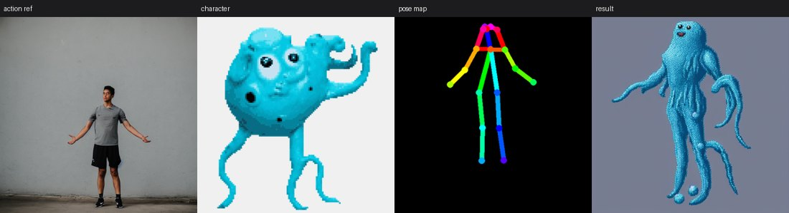
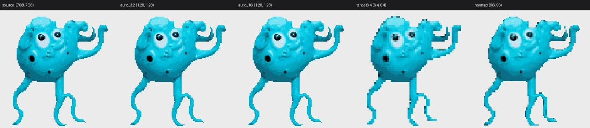

# 2D Game Asset Pipeline（Qwen-Image-2.1 本地版）· 完整手记与变更记录

> **这份文件是项目的完整技术手记**（原名 `README.md`）。
>
> - 想先知道"这是什么、怎么跑起来" → 看 [README.md](README.md)
> - 想知道"为什么这么做、实测数据是多少" → 就是本文
>
> **代码注释里写「见 README「底模」」之类，指的都是本文的章节**——
> 改名时没有去改那些注释（几百处，改了反而容易断链）。

单卡 RTX 4090 上的本地 2D 游戏资产生成工作台。**当前运行态是 Qwen-Image-2.1 单底模**：
文生图 / 图生图（指令改图）/ 角色迁移（双图条件）/ 原生透明底 / 像素化 / 精灵图打包。
代码化推理（diffusers，不依赖 ComfyUI）+ FastAPI 服务。

> **SD 时代已归档**：SD1.5 / SDXL / SDXL 动漫 / Refiner 底模、ControlNet、IP-Adapter、
> AnimateDiff、27 个 SD LoRA 全部移到 `models/_archive/sd/`（**没有删**）。
> 完整基线备份在 git tag `sd`。恢复方法见「底模」章节。
> SD 代码路径仍在仓库里，所以回滚只是搬回权重 + 改一个常量。

设计基线来自资料库文档 `RTX4090_2D_Game_Pipeline` v1.1；本仓库最初是全栈 SD1.5，
现在运行态换成 Qwen——两代的实测结论与取舍见文末「版本选型」与「Qwen 能做什么」。

---

## 现状

**底模只有 Qwen-Image-2.1**——SD 的代码与权重都已移除（见「底模」章节）。

| 模块 | 状态 |
|---|---|
| 引擎层（懒加载 / 显存守卫 / fp8 量化缓存 / cpu offload） | 已完成，实测通过 |
| W1 文生图 | ✅ 768²/16 步 ≈ 10s，峰值 11.4GB |
| W2 图生图（指令改图） | ✅ 源图当参考、提示词当指令；raw 原图一律落盘 |
| W3 局部重绘 | ⚠️ **近似实现**：整图指令改图 + 蒙版贴回（选区外逐点不变） |
| W5 局部 AI 重绘 | ⚠️ **近似实现**（同一机制，多一步色板吸附） |
| W4 姿态序列 | ⚠️ **近似实现**：骨架当参考 + 指令软引导；可选「两阶段」把姿态偏差 102px → 77px |
| W4 质量闸门 | ✅ 关节数 / 前景连通域 / 贴边三道判据；**非人形主体自动跳过补提**（每帧省 25~30s） |
| 画布「角色迁移」wpc | ✅ 双图条件（角色图 + 骨架/轮廓）；ref_mode 支持非真人素材 |
| 画布「序列帧替换」wss | ✅ 逐帧重绘 / 确定性换皮两模式，共享色板 |
| 画布「像素转换」wpx / 「转像素」topixel | ✅ 不跑模型，纯后处理（网格对齐 + 色板量化 + 轮廓描边） |
| 抠图 / 去白边 | ✅ 色键 + 语义分割 + 抠空自动回退 + **已有 alpha 直接复用** |
| 原生透明底（RGBA） | ✅ Qwen 的 VAE 第 4 通道（提示词冲突会自动清理） |
| **速度** | ✅ 单帧 **10.1s**（关真 CFG + 16 步，见 `docs/PLAN-QWEN-ONLY.md` §2.10） |
| 显存 | ✅ 峰值 **11.4GB**（transformer 与文本编码器各一份 fp8 缓存） |
| FastAPI + 资产索引 | ✅ 单卡串行队列、参数按签名过滤、产物落 projects/<scope>/ |
| 游戏动效导出 | ✅ GIF/APNG + Godot 4 tres/tscn |
| 骨骼编辑节点 | ✅ 拖关节 + 8 方向换视觉方向 + 从图片自动提姿势 |
| 视频（Wan2.2） | ⚠️ 有工具脚本，**没接画布路由** |
| LoRA / LoRA 训练 / ControlNet / AnimateDiff / Refiner / hires | ❌ 已随 SD 一起删除 |

## 实测数据

本机 RTX 4090 24GB / 32GB 内存，Qwen-Image-2.1（transformer 与文本编码器各一份
fp8 缓存），**单次前向（cfg=1.0）**，每次跑前预热、多次取中位数。

| 用例 | 耗时 | 峰值显存 |
|---|---|---|
| **文生图 768² / 16 步（默认档）** | **10.1s** | 11.4GB |
| 文生图 768² / 24 步 | 12.7s | 11.4GB |
| 文生图 768² / 24 步 + 真 CFG（cfg=4） | 21.1s | 11.4GB |
| 文生图 1024² / 16 步（立绘档） | 14.9s | ~13GB |
| 文生图 1024² / 24 步（立绘档） | 19.8s | ~13GB |
| 文生图 640² / 24 步 | 10.9s | 11.4GB |
| 文生图 512² / 24 步（**不推荐**，见下） | 8.9s | 11.4GB |
| 逐帧 w4（768²/16 步，含抠图与后处理） | 12.9s/帧 | 11.4GB |
| 逐帧 w4 两阶段（草图 + 换皮） | 25.8s/帧 | 11.4GB |
| 冷启动加载（两块 fp8 缓存） | ~20s | — |

**一帧的时间花在哪**（`tools/bench_qwen_profile.py`，768²/24 步中位数）：

| 段 | 耗时 | 占比 |
|---|---|---|
| **DiT 前向** | **18.84s** | **86%** |
| 文本编码 | 1.79s | 8% |
| VAE 解码 | 1.12s | 5% |
| 权重搬运（cpu offload） | 0.12s | 0.5% |

三个由此得出的结论：

1. **真 CFG 是最大的浪费**：`true_cfg_scale > 1` 且给了负向词时，管线每个 step
   跑**两遍** transformer（48 次 vs 24 次）→ 21.1s vs 13.6s。
   画质对照（6 个提示词）没掉，所以默认关掉（cfg=1.0，界面上的 CFG 仍可调）。
2. **步数下限是 16**（不是旧文档里的 24）：旧结论是在真 CFG 开着时测的，
   已经作废。**白/浅色主体**（白猫、白甲、幽灵）建议 20~24 步。
3. **不要低于 640²**：512² 上 DWPose 经常检不出关节（白猫骑士 0 个），
   质量闸门会误判。

完整拆账与实验脚本见 `docs/PLAN-QWEN-ONLY.md` §2.6 与 §2.10。

## 姿态提取（W4 的入口）

```
图片 / GIF / 视频 / 精灵图
        ↓  YOLOX-L（onnx, 640×640，person 类）
   人体检测框 → 扩成正方形 ×1.25 → 缩到 288×384
        ↓  RTMPose（dw-ll_ucoco_384.onnx, SimCC 头）
   17 个 COCO 关键点 → 补 neck → 重排为 OpenPose-18 → 按官方配色渲染
        ↓
   ControlNet OpenPose 条件图
```

```bash
# 单图 / 精灵图（按网格切）/ 视频（每 3 帧取一帧）
python tools/pose_from_image.py sprite.png          -o assets/pose
python tools/pose_from_image.py sheet.png --grid 8x1 -o assets/pose
python tools/pose_from_image.py walk.mp4  --step 3   -o assets/pose
```

两个实现细节值得记：

1. **不用 controlnet_aux 的 DwposeDetector**：它依赖 mmpose + mmdet + mmcv（Windows 编译极痛），
   而且要 .pth 不是 onnx。这里直接用 DWPose 官方导出的两个 onnx 自己串链路。
2. **检测器可换**：`--detector auto|yolox|torchvision|none`。`auto` 优先 YOLOX，
   权重不在时退到 torchvision FasterRCNN（权重来自 download.pytorch.org，国内可达），
   两者都没有则整图回归——实测整图模式对人形精灵也能出 17/18 个关节，只是比例偏差更大。

实测（CPU，512² 输入）：

| 模式 | 单帧耗时 | 可见关节 |
|---|---|---|
| 整图回归（无检测） | 26ms | 17/18 |
| YOLOX 检测 + 裁剪 | 515ms | 17/18 |

检测的价值在**构图不规整**的输入（人物偏在一角、多人、画面留白多）；精灵图本来就占满画面时，
整图模式又快又够用。

## 画质：为什么差，以及怎么调

用户连续反馈「生成质量差」，实测下来是三层叠加的原因，按影响从大到小：

### 1. 参数档位不对（已修）

**每个底模的推荐档位由后端给**（`engine.RECOMMEND`，经 `/models` 的 `recommend` 下发），
前端拿到就填，不自己拍。Qwen-Image-2.1 的推荐值是
**768² / 24 步 / cfg 4.0 / 不像素化（pixel=0, palette=0）**。

两条实测依据：

- **768² 而不是 1024²**：Qwen 是逐帧路线，1024² 的图 token 是 768² 的 1.78 倍——
  实测 768² 一帧 24~28s，1024² 约 45s；而精灵成品最后要缩到 32~128px，
  1024² 那点细节在缩图上根本看不见。**只有立绘档才用 1024²**（不缩图，笔触要留住）。
- **步数 16 起步**：旧结论「低于 16 步出糊块」是在真 CFG 开着时测的，已作废。
  现在 16 步（默认）已经稳定；**白/浅色主体**（白猫、白甲、幽灵）用 20~24 步，
  低步数下它们对比度不够、细节发白（详见 `docs/PLAN-QWEN-ONLY.md` §2.6）。

### 2. 底模能力上限（Qwen 能画复合概念了，短板换成了姿势）

同一句 "cat knight with katana"：

- **SD1.5**（已归档）：画得出「猫 + 红袍」，但**画不出刀、画不出铠甲**——拟人角色
  拿武器这种复合概念超出它的能力，肢体与躯干也会糊成一团。
- **Qwen-Image-2.1**：刀、铠甲、披风、面部表情都能到位，而且**直接就是像素风**
  （所以默认 `pixel=0`，再过一遍像素化反而把它的色阶优势抹平）。

**Qwen 现在的短板不在单张画质，而在逐帧的姿态贴合**：之前只能靠
「骨架图当参考 + 指令」软引导，实测腿部常被角色参考图的站姿覆盖（平均偏差
108px/768²，见 PLAN §2.8）。动作幅度要大，现阶段得接受「换一个姿势」而不是
「精确复制这个姿势」。

**ControlNet Union 已接通**（2026-10-30）：`alibaba-pai/Qwen-Image-2.1-Fun-Controlnet-Union`

它是**双流**（VACE 风格）：control block 是完整 Transformer block 的副本，
每步都重跑、吃 timestep 调制，所以 skip 随采样步变化（实测 U 型
0.352→0.273→0.393）。按「算一次复用」做会退化成常量偏置——8 步勉强能用、
24 步必崩，出图直接是骨架的彩色线段。

实测（**竖版 768×1024 / 40 步 / scale 1.0 / 几百字详述 prompt**）：完整角色，
有脸有发饰，姿态与骨架逐点对应。峰值显存 18.7GB（24G 卡够用，不需要 fp8 化）。

**这个分支对配置极敏感，三条要一起对**：
1. **画布必须匹配内容**——2D 角色是竖构图就用竖版（768×1024），
   用 768² 方形时模型会把人物撑满、把头顶出画面（表现为"有身体没头"）
2. **prompt 要详述**（头发颜色、发饰、服装、姿态、背景、光线），
   只写 "a 2D game character sprite" 会让模型直接照抄骨架画个线条人
3. 强度 scale 1.0 是官方值，竖版下完全正常

四个坑：条件 latent 要做 mean/std 归一化、control block 要**继承**而不是组合
（否则 key 多 `block.` 前缀）、`init_stream` 要加回 base hidden、
mask 通道填 0 而非 1（填 1 等于"保留空的 masked-image"，出全透明图）。
**有 control 时必须 `use_kv_cache=False`**。
细节见 `docs/PLAN-QWEN-ONLY.md` §2.15，验证脚本 `tools/verify_cn_portrait.py`。


**VNCCS PoseStudio：不用 ControlNet 的姿势迁移（2026-10-31）**

社区那个号称"完美保持角色一致性"的工作流，实际做法是**专用 LoRA + 双图指令**，
全流程没有一个 ControlNet 节点。指令是固定的一句：

```
replace the pose of <image 2> with the pose of <image 1>. keep the character of <image 2>
```

（`image 1` = 骨架、`image 2` = 角色图；25 步、cfg 1、LoRA 权重 1.0。）
LoRA 是 `MIUProject/VNCCS_PoseStudio_QI2.1`（152MB，ComfyUI 格式，
用 `tools/convert_lora.py` 转成 diffusers）。实测对比：

| | ControlNet Union | **VNCCS LoRA** |
|---|---|---|
| 画风 | ❌ 会变 | ✅ 与参考图一致 |
| 头部 | ❌ 方形画布下丢失 | ✅ 完整清晰 |
| 肢体 | ⚠️ 偶发多腿 | ✅ 正常 |
| 服装/发型 | ⚠️ 部分丢失 | ✅ 全保住 |
| 姿态精度 | ✅ 精确 | ⚠️ 能跟 |

**要保角色一致性走 VNCCS；只要结构、不在乎外观才用 ControlNet Union。**
验证脚本 `tools/verify_vnccs_pose.py`，细节见 `docs/PLAN-QWEN-ONLY.md` §2.16b。

**已接入产品**：
- **角色迁移节点**：「引擎」下拉默认 VNCCS（可切回旧版）+「额外参考图」列表，
  同一角色的正面/侧面/细节图一起喂（最多 5 张附加，后端上限 6 张）。
  载荷字段 `char_images`（数组，第一张同时写进 `char_image` 兼容旧客户端）
- **序列帧替换节点**：`engine=wvnccs` 逐帧挂 LoRA，**帧间角色不漂**（4 帧实测
  同一张脸同一套衣服）。原「引擎」下拉里的 AnimateDiff 与「显存档位」是 SD 时代
  的死选项，已换成 VNCCS / 旧版
- **姿态序列节点**（w4）：同样有引擎下拉，默认 VNCCS。VNCCS 需要角色图，
  没选时节点上会给出提示；两阶段模式在 VNCCS 下自动关闭
- **换装 / 换脸**：也可以给多张参考图（`outfits` / `faces`），指令会自动改成
  「这些是同一件服装 / 同一个人」，否则模型会拼出好几套衣服
- **透明底可用**：实测主体占比 16.6%、半透明 2.1%、背景 83% 全透
  （`tools/verify_vnccs_alpha.py`）。之前"VNCCS 不能配透明底"是错的，
  那是 ControlNet 路线的结论连坐过来的
- **朝向必须写进指令**（2026-10-31 实测）。骨架图分不清角度：白底骨架 90° 不加
  方位词会被画成**正面**，加一句 `side view, facing right` 就是标准右侧面。
  也试过 VNCCS 那种"3D 人偶渲染带朝向"，0°/90° 都被还原成正面——那个 LoRA 只在
  他们自己的 PoseStudio 渲染上训过，认不出我们画的人偶。所以节点上多了「朝向」
  下拉（自动=跟骨骼编辑器的方位角 / 正面 / 8 个方向），提交时拼成
  `viewing direction: …`。同时修掉一个真 bug：角色迁移这条**漏了骨架转白底**，
  黑底骨架会被读成"背对镜头"，出来是背影（另两条 VNCCS 路线早就转了）。
- **整套移植官方 PoseStudio（2026-11-01）**。上面那条"人偶渲染传不了朝向"的结论
  其实是「我们自绘的人偶不在 LoRA 分布里」——换成**官方那套渲染器**（MakeHuman
  网格 + Phong 材质 + 相机机位）后，朝向直接烘焙进图：0°/90°/180°/270° =
  正面/侧面/背面/侧面，全部正确，**不用再写任何方位词**（写了反而压过姿势）。
  - 官方源码整套入库 `web/public/vnccs-pose/`（core.js 8938 行 + morph_runtime +
    openpose.js + vendor/three），MakeHuman 网格（CC0）与皮肤贴图一并入库；
    `entry.mjs` 只是接线（约 100 行），**没有一行自己的 IK 或渲染**
  - 骨骼编辑节点新增「**编辑 3D 人偶**」——打开官方的**编辑会话**（弹窗），
    交互与官方 UniCanvas 的 pose layer 一致：在 3D 视口里**直接拖橙色关节点**
    摆姿势（官方 raycast + IK + 极点约束），选朝向，点「导出人偶图」。
    产物存 `node.mannequin`（与线框骨架 `node.image` 并存）；
    角色迁移的「动作参考」**优先用人偶图**，没有才退回线框骨架
  - **修「导出超时」**：本机 Python 的 `mimetypes` 不认识 `.mjs`（给 text/plain），
    浏览器对 module script 强制 MIME 校验 → 官方渲染器的模块**一个都没加载**，
    页面永远停在「加载中…」，父页只能空等到超时。两处都修了：
    入口与 morph_runtime 改名 `.js`（.js 的 MIME 本来就对，不依赖重启后端）；
    app.py 里再注册一次 `mimetypes.add_type('text/javascript', '.mjs')`
  - 宿主页面加**早期错误捕获**（inline script）：模块没加载时立刻上报，
    不再让父页空等；等待上限从 60 秒放宽到 180 秒（37MB 网格首次要十几秒）
  - **后端零改动**：`_vnccs_skeleton` 只把「低饱和+暗」的像素换成白底，
    人偶图本就是白底灰人偶，判据 `mx<70` 不会命中
  - 验证：真实浏览器（headless Edge + swiftshader）里 postMessage 往返拿到
    169KB 的 768² PNG；主页面 iframe 零 console 错误；前端 smoke 383/383
  - 详见 `docs/VNCCS-REAL.md` 第 6 节


### 全项目 review（2026-10-31 上午）

对整个项目做了一轮全面审查（静态 + 实测 + 回归测试），修掉 21 个问题。
最严重的三个：

1. **扩图的 Outpaint LoRA 永久留在共享管线里** → 跑一次扩图之后，
   所有后续生成都带着它出图（而 meta 写着 `lora: None`）
2. **工作流临时挂的 LoRA 会顶掉用户挂的** → 用户在界面挂的 LoRA 会被
   快速模式静默卸载。现在改成 `user` / `temp` 双槽位合并加载
3. **路径穿越** → `startswith` 是字符串前缀比较，`assets2/` 能通过，
   `DELETE /assets` 能删到 assets 目录之外

另外把 meta 里"说的和实际做的不一样"的地方都改准了（步数、快速模式是否生效、
负向词、抠图、尺寸），产线判据不再算错。

配套：`tests/test_review_round2.py`（12 条回归测试）、
`tools/verify_review_quality.py`（六条工作流的质量实测 + LoRA 泄漏检查）。

### 骨骼编辑器：人形 / 线框 / 叠加三种视图

拖关节摆姿势时，如果只有线条骨架，很难看出"这个姿势像不像人、朝向对不对"。
编辑器现在多一层**有体积的人形体**（躯干是面、四肢是带锥度的柱、头是椭圆，
按深度排序遮挡，转到侧面身体会自然变窄；背面没有五官、有发际线）。

**导出格式一个字没改**——仍然是 OpenPose-18 黑底线框，Qwen / ControlNet 认的
就是那个格式。人形体只是编辑时的参考显示。

顺带把预设姿势的比例按真人 8 头身重映射过（旧版是"大头短腿"，
头占身高 22%、腿只占 34%）。这不只影响观感：导出的骨架比例失真，
模型照着画出来的人也是 Q 版。

效果自查（不用启动前端）：

```bash
cd web && npx vite build --ssr src/components/SkeletonEditor.tsx --outDir ssr-tmp
node skeleton-preview.mjs 行走,跑步,张手 0,45,90,180
```

### 3. 像素画的散落杂色（已做清洗，但未根除）

开了像素化（`pixel>0`）并量化到 32 色后，角色周围会冒出一粒粒红 / 青 / 橙的点。
排查时有个反直觉的发现：**它们不是独立小块**——实测 1024² 图上 25 个前景块，
最小的也有 2368px，压根没有孤立小块。所以面积过滤和形态学开运算都拿它们
没办法（那两种手段只动 alpha，而这里要动的是**颜色**）。

做了两层处理（`clean_iso` 与 `strip_fringe`，产线默认各 1 次）：

- **`strip_fringe`**：把「紧贴背景、颜色被背景混过」的一圈剥掉。
  原先只有色键后端走这一步，语义分割后端没走 —— 这才是白点的主要来源，
  补上之后残留从 30~40 个降到 15~20 个。
- **`clean_isolated`**：4 邻域判定的孤立点，主体内部的改成邻居色，
  飘在外面且 5×5 邻域只有自己的直接删。**5×5 那层保护不能省**：像素画的
  1px 斜向轮廓四邻同样全透明，只看 4 邻域会把整条对角线吃掉（实测踩过）。

残留的十来个点生成模型自身的噪声，继续加码会开始伤细节，就此打住。

### 4. 产出风格要选对（前端一档搞定）

画布「图生成」节点上只有一个**产出风格**下拉，一档同时定「提示词契约 +
像素块 + 色数」三件事：

| 风格 | 契约 | 像素块 | 色数 | 等效有效像素 |
|---|---|---|---|---|
| **像素精灵·Illustrious** | anime | 8 | 32 | 128px（1024²） |
| 像素精灵（16-bit） | sprite | 6 | 32 | 128px |
| 像素精灵·高清 | sprite | 4 | 48 | 192px |
| 像素·8-bit 粗颗粒 | pixel | 8 | 16 | 96px |
| 动漫立绘（不像素化） | anime | 0 | 0 | 原图 |
| 写实插画（不像素化） | portrait | 0 | 0 | 原图 |
| 水墨国风（不像素化） | wuxia | 0 | 0 | 原图 |
| 自定义参数 | — | 手填 | 手填 | — |

**「像素精灵·Illustrious」是唯一带装备的档位**：选它会把底模切到
`sdxl-anime`、挂上 Pixelizer LoRA、尺寸设 1024²、像素块 8（= 128 有效像素）。
实测可交付 89%、硬边 0.407（产线真精灵帧 0.447，不挂 LoRA 只有 0.198）。

手动配这四项很容易漏——尤其 LoRA 的触发词是 30 个字符的单 token
（`PixelArt_IL_One_Token_style_M_01`），漏一个字符就完全不生效且不报错。
所以触发词由**后端按 `loras.json` 的 trigger 字段自动前置**，界面上不用填。

**为什么不再让用户填像素块和色数**：这两个参数强耦合（768² 配 6px 块 =
128 有效像素），换算要用户在脑子里做，而填错**不会报错**、只是出图"看着
不对"——实测有人把 64 当成成品尺寸填进去，512/64 = 8px 有效像素，细节全没。
产线上真正该选的是「要什么成品」，不是「块多大」。

`自定义参数` 才暴露原始输入（老用户/特殊需求）。

**风格档位会老实回退**：如果单独改了色数、或者切了 LoRA（LoRA 会带自己的
契约），下拉会显示「自定义参数」而不是骗人说还在预设档上。

- 像素 LoRA 必须配 `pixel` 或 `sprite` 契约，配错了会出彩色色块怪物（见下节）。
- 武侠 LoRA 必须配 `wuxia` 契约（压印章与水墨背景），且抠图要用 u2net。

## 底模：只剩 Qwen-Image-2.1（SD 代码与权重都已移除）

### SD 时代的东西在哪

权重只是**移到** `models/_archive/sd/`（28G checkpoints + 12G controlnet +
3.1G IP-Adapter + 1.7G AnimateDiff + 2.2G LoRA），但**代码已经删了**
（提交 `1831ade`，engine 1493→570 行、generate 3028→1777 行）。

```
models/_archive/sd/
├── checkpoints/   sd15, sd15-inpaint, sdxl, sdxl-anime, sdxl-refiner
├── controlnet/    SD1.5/SDXL 的 openpose / canny / tile
├── ipadapter/     ViT-H 编码器 + SD1.5/SDXL 两套 adapter
├── animatediff/   SD1.5 的 motion module
└── lora/          27 个 SD LoRA 权重 + loras.json 备份
```

**保留没动的**：`qwen-image-2.1`、`matte/`（抠图模型，Qwen 也用）、
`pose_keypoint/`（DWPose，骨骼提取 + 质量闸门用）。

### 真要用回 SD：只能整段回退代码

```bash
git checkout pre-sd-purge    # SD 代码 + 归档前的运行态（推荐，能直接跑）
# 或者只回退那两刀：
git revert e92775e    # 先恢复前端（LoRA / 训练面板）
git revert 1831ade    # 再恢复后端（SD 管线 + 路由 + 工具）
# 然后把权重搬回去：
mv models/_archive/sd/checkpoints/sd15 models/checkpoints/
mv models/_archive/sd/controlnet models/ && mv models/_archive/sd/ipadapter models/
mv models/_archive/sd/animatediff models/
```

`pre-sd-purge` 是删除前的最后一个状态（tag 已推远端）。**注意**：回退会把
Qwen 后期的修复一起带走（蒙版贴回、尺度归一、fp8 编码器、底色参数都在删除之后
才定型），所以能整段回退、别指望 cherry-pick。

`engine.DEFAULT_MODEL` 仍是唯一的默认底模来源，`/models` 的 `current` 字段带出来；
前端初始选它。**不要在前端写死底模名**——SD 时代写死的「有 SDXL 就用 SDXL」
在权重归档后会挑一个根本没装的底模，这是当年踩过的坑。

### Qwen-Image-2.1 能做什么、不能做什么

| 工作流 | Qwen | 说明 |
|---|---|---|
| 文生图 / 图生图 | ✅ | 图生图是**指令改图**（没有 strength 语义） |
| 角色迁移 | ✅ | **双图条件**：角色图 + 骨架图进同一个 vision context；上身跟随好，**腿部常被参考图的站姿覆盖**（见 §2.8 实测） |
| 抠图 / 像素转换 / 转像素 | ✅ | 原生 RGBA（alpha 66~68%），开透明底会自动跳过抠图 |
| 局部重绘 / 局部 AI 重绘 | ✅ **真 inpaint** | 蒙版内换噪声 + 每步把蒙版外拉回原 latent（ComfyUI 的 no-offset 做法）。模型**看得见蒙版**，指令准确执行 |
| 姿态序列 / 序列帧替换 | ⚠️ **近似** | 仍是「骨架/轮廓当参考图 + 指令」软引导。**两者都能走 VNCCS 引擎**（`engine=wvnccs`）：帧间角色不再漂，但姿态幅度仍不如硬约束 |
| LoRA | ✅ | **Qwen 自己的 LoRA 能挂**（fp8 量化后也行，实测只慢 1.1s）。但必须是 diffusers 原生格式，ComfyUI 格式要先转 |
| **扩图** | ✅ | 中性灰 padding + Outpaint LoRA + 原图贴回；无接缝、无灰块 |
| **换装 / 换脸** | ✅ | 两图 + `<image1>/<image2>` 结构化指令，不需要专用权重。**支持多张参考图**（`outfits` / `faces`），指令会自动声明"这是同一件/同一人" |
| **姿态迁移（VNCCS）** | ✅ **推荐** | 角色迁移 / 姿态序列 / 序列帧替换的默认引擎：专用 LoRA + 双图指令，画风/发型/服装一致，头不丢、不多腿。25 步，画布按骨架比例自动定，透明底可用。**骨架图要先转白底**（黑底会让模型画成背面） |
| **ControlNet Union** | ✅ **能硬压结构** | 8 种条件 + 蒙版 inpaint，7.55GB，峰值 18.7GB。双流注入；**竖版画布 + 详述 prompt** 下出完整角色，姿态逐点对应 |
| Refiner / AnimateDiff | ❌ | 主干与文本编码器都不同，一点都不通用 |

⚠️ 的两个在前端节点上有橙色「近似」标记（`/models` 的 `caps.approx`）。
十个工作流的实现方式、实测数据、以及**明确做不到的事**见
[`docs/PLAN-QWEN-ONLY.md`](docs/PLAN-QWEN-ONLY.md)。

**局部重绘是怎么做成的**（2026-10-30 实测推翻旧结论）：
diffusers 的 `QwenImage21Pipeline` **没有** `mask` 参数，但这不等于模型做不到——
ComfyUI 的 `Qwen Image 2.1 Inpainting | No-Offset Edits` 工作流用的
**就是标准 2.1 权重**（没有专用 inpaint 权重），靠两件事实现：

1. 初始 latent 里，蒙版内换成噪声
2. 采样循环里**每一步**把蒙版外拉回原 latent
   （ComfyUI `comfy/samplers.py:641-642`，**采样器级**机制，与权重无关）

第 2 步在 diffusers 里用管线现成的 `latents=` 入参 + `callback_on_step_end`
钩子复刻，核心是 flow matching 的 `x_t = (1-σ)·x0 + σ·ε`。
实测（768²/20 步）：蒙版内指令准确执行、蒙版外最大像素差 19~46（视觉无差，
差异来自 VAE 重建本身）、~15s。旧的「整图改图 + 蒙版贴回」保留为对照
（`strategy="whole"`，逐点为 0 但模型看不见蒙版）。
实现见 `workflows/qwen_mask.py`，坑见该文件头部注释。

**LoRA 的格式坑**：ComfyUI 格式（`diffusion_model.` + `lora_A/B`）与 diffusers
原生格式（`transformer.` + `lora.down/up`）键名不同，**ComfyUI 格式挂上去会
静默不生效**（比报错更坏）。转换：`python tools/convert_lora.py in.safetensors out.safetensors`。
挂载/卸载在侧栏「LoRA」分组里（全局状态，对所有生成生效）。

**扩图怎么做的**：源图贴到更大画布、空白填**中性灰 #808080**（灰色本身就是
"这里要补内容"的信号，填别的颜色会污染新区域色调），挂 Outpaint LoRA，
提示词以它的触发句开头。原图区域最后软边贴回——扩图的语义是"扩展"，
原图不该变。实测 768² 右扩 50% → 1152×768，14s，右侧延续了森林/地面/雾气，
无灰块、无可见接缝。注意：**画布尺寸必须对齐 32**（不是 16），
否则管线会静默 resize，meta 里记的尺寸就是假的。

**换装 / 换脸**：两者本质相同，都是**两图 + 结构化指令**，不需要专用权重。
关键是指令里写清楚每张图管什么，并用官方的多图引用语法 `<image1>/<image2>`
（比"第一张图"这种自然语言更稳）。实测换装后服装特征来自图 2、人还是图 1；
换脸后脸像图 2、姿势与场景是图 1。

**快速模式**：侧栏「LoRA」分组顶部的开关，挂 Lightning 少步蒸馏 LoRA +
步数压到 8。实测 24 步 17.3s → 8 步 9.3s（-46%），画质几乎不掉。
逐帧路线（姿态序列 / 序列帧替换）建议开着——单帧 37s 降到 9.3s，8 帧 ≈ 75s。

### SD1.5 / SDXL 时代（权重已归档，代码已删）

这一段原来有四小节：SD1.5/SDXL 底模、SDXL 版 LoRA 实测、`sdxl-anime`（Illustrious）、
SDXL 版 ControlNet。**全部失效**——权重在 `models/_archive/sd/`，代码在提交 `1831ade`
删掉了，它们引用的 `tools/fetch_*.py` 也一起删了。别再照旧命令去下权重。

当时实测里仍然通用的三条（接别的底模时照样成立）：

1. **尺寸不是越大越好。** SDXL@1024 反而比 @768 差：角色占画面比例更大、更容易贴边，
   可交付率 92% → 75%，每张还慢一倍。前端填多大的依据应该是「成品要缩到多少 px」。
2. **姿态强度与身份强度是两条独立旋钮。** 调错一个的表现是「姿势对了但不像这个角色」
   或反过来。Qwen 没有这两条旋钮（双图条件由模型自己分配），但这条诊断思路仍适用：
   先看是姿态跑偏还是身份跑偏，再决定改指令还是换参考图。
3. **`clip_skip` 只对 SD1.5 系动漫模型成立**，SDXL 有两个文本编码器，设了会静默失效。
   这个字段现在整个删了（Qwen 的文本编码器是 Qwen3-VL，没有跳层语义）。

要看完整历史：`git show pre-sd-purge:README.md`。

### Qwen-Image-2.1：唯一的底模（原生透明底 / 指令改图）

```bash
# 43GB：transformer 14G（另有 6.7G fp8 缓存）+ text_encoder 22G + vae 1.3G
# 放 models/checkpoints/qwen-image-2.1/，需要 diffusers≥0.41 + transformers≥5.21
# 文本编码器再生成一份 fp8 缓存（8.8G，一次性）：python tools/make_qwen_fp8.py
```

它不是"更大的 SD"：**7B 单流 DiT + Qwen3-VL 视觉语言编码器**，一个权重同时干
文生图 / 指令改图 / 原生 RGBA 三件事。接入后它出现在「底模」下拉里，
`arch` 是 `qwen21`，与 SD 系列**不共用任何组件**（LoRA、ControlNet、Refiner 全部不通用）。

| 项 | 实测值（RTX 4090 24G，fp8 双模块） |
|---|---|
| 文生图 768² / 8 步 | 10.45s，峰值 **11.41GB** |
| 指令改图 768² / 8 步 | 11.92s，峰值 **11.82GB** |
| 产线口径（768² / 24 步） | 约 28~30s/帧，峰值 15.4GB |
| 原生透明底 | alpha 占 66~68%，边缘无脏毛边 |
| 像素风 | **直接出像样的像素画**，不需要像素 LoRA |

**显存/内存峰值主要在文本编码器上**：`text_encoder` 是 Qwen3-VL（8.77B，bf16
16.3GB），量化成 fp8 后峰值从 16.59GB 降到 11.41GB（-31%）、速度快 25%、
内存少 7.5GB、加载快 44%。同 seed 出图平均差 **1.10/255**（结构一致）。
不满意就 `MEOW_QWEN_TEXT_FP8=0` 退回 bf16。细节见 `docs/PLAN-QWEN-ONLY.md` §2.1。

**几个必须知道的坑**（都是实测踩出来的）：

1. **`true_cfg_scale` 要配负向词才有用**。管线的判据是
   `do_true_cfg = true_cfg_scale > 1 and has_neg_prompt`，不传 `negative_prompt`
   时 CFG **静默失效**（cfg=1 与 cfg=4 输出逐字节相同）。代码里恒定传 `QWEN_NEG`。
2. **透明底要双段式声明**。VAE 有第 4 通道，但模型不会自己想起来用——
   提示词首尾必须各加一句官方原话：
   ```
   This is an RGBA image with transparency. <正文> The image has alpha channel and the background is transparent.
   ```
   改写说法会掉回不透明。而且**不能同时用 SD 的像素契约后缀**——
   `SPRITE_SUFFIX` 里的 "flat plain background" 和"背景透明"直接矛盾，
   实测会画出白底。透明场景走短后缀（只留构图约束）。
3. **尺寸必须是 16 的倍数**，否则 diffusers 只 warn 一句就静默改尺寸。
4. **本机 32G 内存装不下全量 bf16**（13.3G + 16.3G 一次性读会 swap）。
   两块都走预量化 fp8 缓存：transformer 6.7G、text_encoder 8.8G
   （`python tools/make_qwen_fp8.py` 生成一次），仍靠 `enable_model_cpu_offload`
   在编码后把文本编码器搬出显存。见「Qwen 的显存/内存」一节。
5. **图生图没有 `strength`**。SD 是"加噪强度"，Qwen 是"照指令改"——
   同一张源图，SD 调 strength 是渐变，Qwen 下改多少全看提示词怎么写。

`transparent` 开关同时出现在「图生成」和「转像素」节点上，只有 Qwen 底模可勾
（`/models` 的 `caps.transparent`）。开它之后「抠图」会自动跳过——
重复处理反而把 alpha 弄脏，白猫白底这类场景分割模型会把脸一起切掉。

**透明底现在有三道保险**（都是踩过坑加的，细节见 PLAN §2.7）：

1. 提示词里的「白底/纯色底」措辞会被自动清掉。留着它等于给模型一个和透明
   声明直接冲突的正面要求——实测 alpha 会变成一层雾（77.5% 的像素停在半透明）。
2. `matte_auto` 先看输入有没有可信 alpha（`matte.alpha_trust`：真透明区足够多、
   半透明中间值 < 12%）。可信就**原样复用**，不再拿分割模型重猜一遍。
3. 真要重抠时，`flatten_white` 把透明区合成到白底再送分割（以前直接
   `convert("RGB")`，透明区留着 VAE 噪声色），结果再做一次 `fill_holes`
   把主体内部被误判的洞补回实心（额头、胸口那种）。

### 角色迁移在 Qwen 上：双图条件（角色图 + 骨架图）

用户反馈「SD1.5 / SDXL 的角色迁移效果都不行」，实测后换了条路：**不靠
ControlNet，靠 Qwen 的多图条件**。

SD 那条路是两个**互相拉扯**的约束——IP-Adapter 抢身份、OpenPose ControlNet 抢
姿态，同一张角色图 + 同一张动作图，出来的经常是「身份丢了」或者「姿势变形」。
Qwen 的多图条件是**同一个 vision context**：两张图一起进模型，由它自己分配
「谁是身份、谁是姿势」。

流程（`generate._qwen_pose_clone`）：

1. 动作参考图 → DWPose 骨架图（和 SD 那条路同一个 `refcond.build_condition`，
   真人照片走骨架、像素/非人形素材走剪影，auto 自动降级）
2. 角色图 → `refprep.prepare_reference`（透明区填白、裁主体、像素图最近邻缩放）
3. `image=[角色图, 骨架图]` + 一段固定英文指令（"第一张是角色参考，保持脸/发型/
   服装/配色；第二张是姿态条件，按它的姿势重画同一个角色"）
4. 用户填的角色描述接在指令后面（可选，只补语义）

实测（RTX 4090 24G，768² / 28 步 / cfg 4）：

| 路线 | 耗时 | 峰值 | 结果 |
|---|---|---|---|
| **Qwen-2.1 双图条件** | 72s | 19.3GB | 上身跟随好、主色继承；**腿部会退回参考图的站姿**（2026-10-30 重测，见 `docs/PLAN-QWEN-ONLY.md` §2.8） |
| SD1.5 ControlNet+IPA | 7s | 5.3GB | 同一输入，姿态基本没跟上 |

代价是慢（SD1.5 快 10 倍），换来的是姿态正确率。角色迁移节点切到 Qwen 底模时
会自动换成 768²/28 步/cfg 4，并**隐藏「姿态」「身份」两根滑块**——它们是
ControlNet / IP-Adapter 专属的，Qwen 路径没有强度旋钮。

限制：Qwen 不支持 LoRA（不同主干与文本编码器），也不吃 SD 的提示词契约后缀；
序列帧替换（wss）仍只支持 SD 系（逐帧生成 + 帧间对齐，Qwen 的速度不现实）。

### 骨骼编辑节点：拖关节 + 换视觉方向

上面那节解决了「模型能读懂骨架」，这节解决「骨架从哪来」——以前只能从真人
照片里提，现在可以**自己摆**。

侧栏「节点 → 骨骼编辑」新建一个节点，正文里是一个可拖的 OpenPose-18 骨架：

- **拖圆点**改关节位置（18 个 COCO 关节点，热区放大到 4.5 单位，缩放后也点得中）
- **8 个方向按钮**：正面 / 右前 / 右侧 / 右后 / 背面 / 左后 / 左侧 / 左前，
  另有 0~359° 滑块可任意角度
- **深度滑块**：选中关节后调它前后的 z，用来做「手往前伸」「肩往后转」
- **7 个姿势预设**：站立 / 张手 / 行走 / 跑步 / 跳跃 / 拳击 / 举手
- **导出骨架图**：前端按 `tools/make_pose.render` 的 18 色 19 边画法生成 PNG
  （黑底、彩色肢体 + 关节圆点），上传后挂在节点上，直接连到角色迁移节点的
  「动作参考」输入

**换视觉方向怎么实现的：伪 3D 投影。** 每个关节存 `(x, y, z)`，z 是前后深度，
渲染时绕竖轴旋转再正交投影：

```
rx = 0.5 + (x - 0.5) * cos(a) + z * sin(a)
ry = y
```

只有 2D 坐标的话「侧面」只能靠左右镜像硬凑，肩膀一转就叠成一个点；有 z 之后
0° 正面 / 90° 侧面 / 180° 背面自然过渡。拖动时把屏幕横向位移按
`(cos a, 0, sin a)` 分解回 x/z——侧面视角下横向拖动自动变成「改深度」。

**两个必须配套的改动**：

1. **新增 `skeleton` 参考模式**（`refcond.MODES`）。骨架图上没有真人，
   走 `auto` 会因 FasterRCNN 检不到人体而**静默降级成剪影**，把画好的骨架
   毁成一张黑图。所以骨骼节点连过来时前端自动把 `ref_mode` 切成 `skeleton`，
   后端原样 resize 使用，不再跑人体检测。
2. **方位角补成方向词**。骨架的朝向信息 Qwen 有时读不准（实测侧面骨架
   仍可能出正面人），而方位角在编辑器里是确定值——提交时自动追加
   `viewing direction: side view, facing right` 这类短语，不改用户写的提示词。

实测（768² / 8 步，同一角色图 + 三个方向的骨架）：**正面 / 侧面 / 背面都
正确生成了**——背面能看到后脑与背部，侧面身体明显收窄；侧面那张双臂在
投影上重叠（符合真实侧面），所以预设里给左右手腕加了前后深度差，让侧面看
一前一后。单张 20~46s（同进程连续生成会降到 20s 左右）。

### 从图片自动摆姿势

编辑器底部的「📷 从图片」：选一张图 → 上传 → 后端 `POST /pose/extract` 跑
本机 DWPose（FasterRCNN 检人 + RTMPose 关键点）→ 返回 18 个归一化关节点
（`normalized_points`，人物已居中占满画面，正好是编辑器的 0~1 坐标）→
前端补上深度 z，变成可旋转的骨架。姿势不用手动摆了，方向还是点上方按钮换。

实测：一张真人站姿照 → **18/18 关节全部识别**，旋转到 0°/90°/180° 后骨架
都还像人形，没有叠成一条线。

**四个必须知道的限制**（都是单张 2D 图的固有信息缺失，不是 bug）：

1. **只对真人 / 写实人像有效**。检测器和 RTMPose 是在 COCO 自然照片上训的，
   像素画、插画、版画一个框都检不出（和角色迁移 `pose` 模式同一个限制）。
   这类素材请用上面的姿势预设手动摆，或走角色迁移的「轮廓」参考模式。
2. **2D 图没有深度**。z 是按「右侧在前、左侧在后」给的保守启发式
   （手腕/脚踝再加大前后差），不是真实三维重建——换方向后四肢的前后关系
   是假设的，可以用深度滑块改。目标是可辨识（别叠成一条线），不是物理精确。
3. **正面 / 背面在 2D 骨架上是对称的**，自动分不出来。后端只在「肩宽很窄」
   时给出侧面猜测（仅用于提示），导入一律按正面，方向交给用户点按钮——
   若原图本身就是侧面照，直接当正面再旋转会有偏差，原图尽量用正面。
4. 路径只能读 `assets/` 内的图片（新写了只读版 `_readable_asset_path`，
   不复用删除接口那个带额外规则的 `_safe_asset_path`），路径穿越返回 400。

> 偶发慢：连续生成时观察过一次第二张 252s（正常 24s），8 步连续三次复测
> 46/24/20s 均正常，判断是本机内存换页偶发，不是管线 bug。

### 调研：MultiAngle-T8 能不能用于角色迁移 / 序列帧替换

结论：**姿态迁移部分不能直接用，只有 AnyAngle LoRA 值得单独拿来做多视角立绘。**

[Comfyui-Qwen-Image-2.1-MultiAngle-T8](https://github.com/T8mars/Comfyui-Qwen-Image-2.1-MultiAngle-T8)
是个 ComfyUI 节点（不是 diffusers 库），核心是「三维相机重打光」：用 TripoSplat
把原图重建/用 MakeHuman 人偶摆姿势，在真实三维相机里取景，导出 POSE/深度/Canny
引导图，再喂给 Qwen Image 2.1 生成新机位图。

不能用的原因（按重要性）：

1. **它自己没有 ControlNet 端口**。作者自己写明"底模把结构图作为**图像参考**理解，
   没有独立的 ControlNet 控制端口；遵循程度取决于底模与提示词，不能保证
   像专用控制模型一样严格"。我们现在有 Union 的 Pose 条件可以做硬一点的控制
   （虽然仍是软约束级别，见 §2.15 实测），比它的"纯参考图"要强。
2. **实测精度不够产线**。它自己公布的主矩阵：32 张里只有 **7 张基本符合、
   2 张部分符合**，九人场景会增人/丢动作。序列帧要求"帧数和动作逐一对应"，
   这个合格率直接判死。
3. **它是 ComfyUI 生态**（依赖 ComfyUI 0.36 原生节点 + 浏览器 WebGL），
   我们是 diffusers 进程内推理，移植等于重写。

值得单独拿的只有一个：**AnyAngle LoRA**（`QI2.1_AnyAngle.safetensors`，
出自 `lilylilith/QI_2.1_AnyAngle`）。它是给 Qwen Image 2.1 做**相机方位控制**的
LoRA（配合 3D 重建 + Blender 重打光出的参考图使用），对我们的"同一角色出
正面/侧面/背面三视图"有用——这条路不需要 3D 重建，直接 Qwen + LoRA + 角度提示词
即可，可以之后单独接一个"多视角立绘"节点。优先级不高：现有 W4 姿态序列 +
IP-Adapter 已经能覆盖精灵帧的主要需求。

> 下载受阻：本机走代理访问 huggingface.co / hf-mirror.com 持续 502
> （`Tunnel connection failed`），ModelScope 直连可用但没有这两个 LoRA 的镜像。
> 需要时先解决网络，或从别处拿到文件手动放进 `models/lora/`。

### 调研：3D 骨骼 / 姿势编辑器（Fisher-Pose、VNCCS PoseStudio）

结论：**模型侧我们已经用 Qwen 双图条件拿到了「骨架 → 姿势」的能力**；
这两个方案多出来的是**交互层**（3D 人偶拖拽摆姿势），不是更强的模型控制。

| 方案 | 核心 | 我们的判断 |
|---|---|---|
| ComfyUI-Fisher-Pose | 内置 3D 人偶 + 209 根 OpenPose 骨骼，拖拽出精确骨骼图 | ComfyUI 生态（浏览器 WebGL 3D），我们是 diffusers 进程内推理，移植等于重写 |
| VNCCS PoseStudio（Qwen Image 2.1） | 3D 姿势编辑器 + 专用 LoRA（`MIUProject/VNCCS_PoseStudio_QI2.1`），骨架图当参考图喂 Qwen | LoRA 是**在 VNCCS 自己的骨架格式上训的**，我们出的是 DWPose/OpenPose 格式，格式不同则 LoRA 遵循度未知；且下载同样受阻 |

两者共同的关键点：**姿态靠「骨架图」传递**，不是靠模型内部参数。Qwen-Image-2.1
本身就能读懂 OpenPose 骨架图（但「读懂」≠「照做」，实测腿部常被参考图站姿覆盖，见 PLAN §2.8），所以：

- **不需要**为了读骨架而额外训/下 LoRA（VNCCS 那条）
- **不需要**为了摆姿势而引入 3D 重建（AnyAngle 那条）
- 真要提升，方向是**交互**：做一个能拖关节的 2D 骨骼编辑器，或接 PoseStudio
  导出的骨架图作为额外输入。这属于产品体验升级，不影响产出质量

如果一定要"硬约束"，本机 pixelforge 里有 `qwen-image-20b` + `qwen-image-controlnet-union`
（ControlNet Union 自带 pose 条件）。但 union 是给 **20B** 训的
（`joint_attention_dim=3584`），Qwen-Image-2.1 的文本编码器是 **4096**，两者
结构对不上——**2.1 用不了这个 union**。接 20B 是另一条工程线（显存/加载都要重做）。

## 挑帧：批量候选 + 质量闸门（W4）

逐帧出图的老问题不是「画得丑」，而是**偶尔会出废帧**：没画出手、腿糊成一坨、
脚被画布切掉。这类帧人眼一秒能挑出来，但自动化管线以前只能照单全收，打包出来的
走路循环里突然抽一帧——不逐帧看根本发现不了。

`poseswap` 现在默认开闸门（`gate=True`）：

```
每帧 -> 生成 candidates 个候选（种子 seed, seed+1000, ...）
     -> 每个候选打一次分（workflows/quality.py）
     -> 取分数最高的一个
     -> 若最高分那个没过闸门，再补提最多 gate_retries 次
     -> 仍不过就留最好的那个，并在 meta 里记 passed=false
```

**分数量什么**（全部从产物图上直接量，不看生成过程）：

| 信号 | 含义 | 权重 |
|---|---|---|
| `points` | 姿态模型在**生成图**上重新检出的人形关节数（0~18）。手断了、画成两个半身，点数立刻掉 | +10/点 |
| `coverage` | 抠图后前景占比。偏大=半身/糊成一坨，偏小=人太小（像素化后没细节） | +5 落在区间内 |
| `edges` | 贴边（被画布切断）。精灵要对齐脚底，脚被裁掉则对齐必跳 | −8/条边 |
| `drift` | 与上一帧的 alpha 质心偏移（按对角线归一化）。帧间跳太远播放会抖 | −20×偏移 |

闸门判据是 `points >= gate_min_points（默认 8）` 且无贴边。**没有姿态模型时判定为
「无法判定」而不是「不合格」**，闸门自动关闭并告警——否则会拿不到判据还无限重提。

```python
g.poseswap(eng, pose_images=poses, prompt="...", matte=True,
           candidates=2, gate=True, gate_min_points=8, gate_retries=2)
# meta 里能查到：attempts（总生成次数）、gate_passed（过闸门帧数）、
#               frame_scores（每帧的 points/coverage/edge/drift/score/attempts）
```

代价：闸门每帧多几十毫秒（姿态模型跑 CPU，4090 上单帧约 10ms 量级），比重新出
一帧便宜两个数量级。`candidates=1, gate_retries=0` 就退化成原来的行为。

**非人形主体**（史莱姆、机甲、道具）：DWPose 一个关节都检不出来，闸门永远
过不了。这时补提就是纯烧钱（每帧 25~30s），而且 meta 里 `gate_passed=0`
看起来像生成失败。现在一旦判定为「不是人形」就**自动关掉补提**，
并在 `meta.gate_non_humanoid` / `meta.gate_note` 里写明原因。

实测（Qwen，768²/16 步，`candidates=1, gate_retries=1, matte=True`）：
单帧约 12.9s、峰值 11.4GB。人形帧 18/18 关节、无贴边；
史莱姆这类非人形帧只出 1 次（不再白补提一次）。

## 画质：一轮代码 review 改了什么

不是「调参玄学」，每条都有对照实验（`python tools/ab_quality.py`，同 seed 只改一个变量）。

**① 正向后缀被静默丢弃（真 bug）**
`presets.build` 原来只对**负向词**做 77 token 截断，正向是 `用户描述 + 后缀` 直接丢给
CLIP。用户主体描述一写长，被丢掉的恰好是后缀（`flat plain background` / `hard outline`），
于是背景变脏、边缘变糊——这就是「提示词越长越难看」的真实原因。现在先给后缀留预算，
超长的部分截主体。

**② 没有逗号的长文本会让负向词变成空串（真 bug）**
`fit` 按逗号分段累加，第一段就超预算时 `break` 得只剩空列表，返回 `""`——
用户粘贴一整串空格分隔的负向词，等于什么都没写。现在退化成按词截断。

> **2026-10-31 更新：①② 那套 77 token 预算机制已整体删除。**
> 底模换成 Qwen-Image 后，tokenizer 的 `model_max_length` 是 262144、
> diffusers 的 `encode_prompt()` 只做 padding **不做 truncation**——模型侧没有
> 长度上限。所以 `presets.build()` 现在只做拼接，**一个字都不截**
> （`fit` / `count` / `rough_tokens` / `CHUNK_BUDGET` 一并删了）。
> 上面两段留作历史：它们说明"替用户做减法"能造成多大伤害——一次是砍掉了后缀，
> 一次是靠高估的估算器把 35 token 当成 113 来砍。

**③ 像素化降采样：LANCZOS → BOX**
LANCZOS 有负瓣，色块交界处会振铃出「过冲色」（黑线旁边冒一圈更亮的边），这些假色
再被量化，就成了多出来的脏色阶。实测同一张图：LANCZOS 用满 32 色且边缘发毛，
BOX 只用到 30 色，格子单色率 1.0（有测试钉住）。

**④ clip_skip 自实现（上游参数在本机会崩）**
diffusers 0.41 的 `clip_skip=` 分支写死 `text_encoder.text_model.final_layer_norm`，
本机 transformers 5.21 把 `CLIPTextModel` 摊平了（没有 `text_model` 这层）——
一传就 `AttributeError`。`workflows/clip.py` 自己算 embeds 再喂管道：
`clip_skip=1` 与管道默认**逐元素一致**（有测试），`2` 跳过最后一层（与默认的
余弦相似度 0.79，是实打实另一个向量）。节点「更多设置 → 跳过层」可选，
LoRA 注册表也能声明推荐值。

视觉上（`docs/img/clip_skip_ab.jpg`）：`cs1` 偏光泽渐变（高档 3D 感，但渐变多、
量化后杂色多），`cs2` 偏平涂 + 硬描边（更适合转像素）。代价是 `cs2` 下多主体
略多（2/3 vs 3/3），所以**默认仍是 1**，需要时手动开。

**⑤ 触发词实测有害（改数据，不是改代码）**
`px_illustrious` 注册的触发词是 `pixelart`，UI 上有「+ 填入」按钮。三个种子实测：

| 用法 | 主体数 | 单主体率 |
|---|---|---|
| 不加触发词 | 1 / 1 / 1 | **3/3** |
| 加 `pixelart` | 5 / 3 / 2 | **0/3** |

加了触发词反而把画面变成一整个「史莱姆图案墙」。注册表已把触发词清空并写明原因。
同一个 LoRA 一定会画彩色/纹理底，所以注册表新增 `matte: true`——选中它时节点自动
勾上抠图（以前默认不勾，出来就是蓝底图，没法直接用）。

同一 seed 的成品对照（上排旧用法：加触发词、不抠图；下排新默认）：


左列 seed 7、右列 seed 8。旧用法整幅变成「史莱姆图案墙」，新默认是单只、透明底、
像素块干净的成品。`meta.subjects` 也印证：旧用法数不出主体（没抠图），新默认 1 个。

**⑥ 多主体写进产物 meta**
SD1.5 画小体型角色（史莱姆尤甚）爱复制一份，负向词压不住，于是不猜、直接量：
抠图后 `foreground_blobs` 数面积 ≥400px 的前景块，写进 `meta.subjects`；节点里
`subjects > 1` 直接黄字提示换种子。这是**下界**（u2net 只分割显著主体，一整墙
史莱姆可能只剩 1 块），所以 1 不代表干净，但 >1 基本确实脏。

**⑦ 抠图后端：量过了，默认不动，补了防呆**
原本怀疑「像素画该用色键，因为 u2net 边缘软」。四个样本量下来两个结论：
alpha **都是二值**（中间 alpha 占比 0，边缘硬度假设不成立）；色键在像素 LoRA 的
彩色底上几乎抠不动（前景 0.90~0.98），在白袍角色上会把袍子抠碎（3 块）。所以
`auto` 继续走 u2net。真正该修的是另一件事：u2net 会**静默抠空**（草稿档只剩
0.44% 前景 → 交出一张空精灵），现在按前景占比做合理性检查并回退色键，
`matte_used` / `matte_fallback` 记进 meta。

**Qwen 之后又补了一件事：先看输入有没有 alpha。** 以前 `auto` 永远重抠一遍，
而 Qwen 出图本来就带 VAE 的第 4 通道——重抠纯属自找麻烦（白毛角色的额头、
脸颊会被判成背景咬掉）。现在 `matte.alpha_trust` 三个数一量（真空透明区
≥10%、半透明中间值 ≤12%、前景 1%~95%），可信就直接复用，`meta.matte_used="alpha"`
且带 `alpha_reused`；alpha 是雾状（提示词冲突那类）才真的重抠。
显式选 `u2net` / `color` 后端则跳过这套判断——那是用户明确要求重抠。

### 白毛/浅色主体 + 白底：抠图这件事本身不可靠（已知限制）

实测同一张白猫骑士（白毛、白甲、白底）：直接送 RGB 给 isnet → 头顶被切角、
胸口挖洞；先合成白底再送 → 头顶与胸口救回来了，**两条腿又被吃**（腿也是白的）。
前景占比 20.9% vs 15.6%，两种喂法各丢不同部位。

结论不是「调参」，而是**别在这类素材上走抠图**：Qwen 出图时直接勾「透明底」，
alpha 由模型自己给（干净时前景 31%、全透明 67.8%、半透明中间值只有 2.9%）。
抠图是 SD 时代的补丁——那时候模型不会输出 alpha，只能事后猜。

## LoRA / 训练：已随 SD 一起删除

**这一整块没了**（提交 `1831ade`）。原因不是"懒得维护"，而是 Qwen 根本不吃：

- LoRA 是挂在 UNet/DiT 注意力投影层上的增量权重，键名要与主干严格对齐。
  Qwen 的主干是 `QwenImage21Transformer2DModel`（单流 DiT），SD1.5/SDXL 的
  27 个精选 LoRA 一个都挂不上。
- 训练那边同理：`workflows/train.py` 训的是 SD 的 UNet LoRA，产出对 Qwen 无用。

一起删掉的：`workflows/lora.py` / `clip.py` / `train.py`、`/loras` 与 `/train`
五条路由、前端的 LoRA 下拉与「训练 LoRA」面板、`models/lora/` 的注册逻辑。

**现在的风格控制手段**：
1. 提示词契约（`presets.py`，产出风格档位就是它的预设组合）
2. 参考图 —— 图生图是指令改图，双图条件（角色 + 骨架）能锁身份
3. 原生像素风 —— Qwen 直接就能画，不需要像素 LoRA（这是当年上 LoRA 的主因）

历史记录还在：`git show pre-sd-purge:README.md` 能看到完整的 LoRA 调研结论
（哪些能用、哪些静默空挂、触发词为什么必须自动前置）。那些结论对 SD 仍然有效，
只是这个工作台不再跑 SD 了。

## WebUI（画布 · 文生图 / 图生图）

React 18 + Vite + TS，**零 UI 库、零画布库**（与 pixelforge 同思路），构建产物 231KB / gzip 76KB。

**节点可拖宽**（右边缘拖拽，260~620px）：参数横排时 300px 会挤成两列、标签被截断。
宽度存在节点上（刷新后保持），连线端点也跟着实际宽度走。

**每个参数都有 tooltip**：hover 参数名显示三段——做什么 / 影响什么 / 推荐填多少。
说明集中维护在 `GenNodeCard.tsx` 的 `PARAM_HINTS` 里（同一参数在多个节点复用，
散着写必然分叉）。推荐值尽量写本项目实测过的数字，不写"视情况而定"。
带虚下划线的参数名表示有说明——只加 `title` 不加视觉提示，用户不会去 hover。

```bash
npm run check:hints     # 检查每个 hint('X') 都有说明（已挂进 npm run smoke）
```

这个检查是必需的，不是洁癖：`hint()` 查不到键时界面上只是**没有说明**，
不报错、不崩溃、任何测试都不会失败。「像素块」就这样漏了一整轮
（表里 37 条、代码引用 38 个），最后是用户发现的。所以现在两处兜底：
`hint()` 对未知键返回「未定义说明：X」而不是空串，外加这道静态检查。

**一条命令启动**（自动体检 → 按需构建前端 → 起服务 → 开浏览器）：

```bash
./start.sh                  # Git Bash / macOS / Linux
start.bat                   # Windows 双击或命令行
```

| 参数 | 作用 |
|---|---|
| `--port 8010` | 换端口 |
| `--rebuild` / `--no-build` | 强制重建前端 / 跳过构建 |
| `--check` | 只体检（Python、依赖、CUDA、权重、前端、端口），不启动 |
| `--dev` | 只起 API，前端另开 `cd web && npm run dev`（:5173 代理） |

体检项与实际输出：

```
✓ Python：.venv/Scripts/python.exe（Python 3.13.14）
✓ 依赖齐全（torch / diffusers / transformers / fastapi / uvicorn）
✓ CUDA 可用（NVIDIA GeForce RTX 4090）
✓ Qwen-Image-2.1 权重就绪（9 个 safetensors）
✓ 前端产物是最新的
```

手动方式：

```bash
cd web && npm ci && npm run build     # 构建
cd .. && python app.py                # FastAPI 同时托管 dist 与 API → http://127.0.0.1:8000
cd web && npm run dev                 # 或开发模式（:5173，代理到 8000）
npm run smoke                         # 无浏览器渲染冒烟（jsdom，384 项断言）
```

> `start.bat` 刻意保持**纯 ASCII**：cmd.exe 按 OEM 代码页解析 .bat，中文注释会切断命令行
> （实测把 `setlocal` 切成 `ld`）。中文提示只留在 `start.sh`。

**布局**（参考了 InvokeAI 的「队列可见/参数分层」、SD.Next 的「折叠压制参数面」、pixelforge 的视觉与画布机制）：

```
┌ 顶栏：品牌 · GPU · 缩放 [− 100% + 1:1 适应] ┐
├───────────────────────────────────────────┤
│ ┌节点列表┐   ┌─ 图生成卡 ────┐  ┌─ 图生图卡 ─────┐
│ │图生成 +│   │ 提示词 / 尺寸   │  │ 源图 ▾ / 重绘   │
│ │图生图 +│   │ 更多设置 ▸     │  │ 提示词 / 更多 ▸ │
│ └────────┘   │ [生成] 预览     │  │ [生成] 预览     │
│              │ ↳ 图生图        │  └────────────────┘
│              └────────────────┘                   │
└───────────────────────────────────────────────────┘
```

**设计决策**

| 项 | 做法 | 理由 |
|---|---|---|
| 节点 | 两种：**图生成**（w1 文生图）与 **图生图**（w2），参数与结果同卡 | 生成与结果是一件事，拆两张卡会让每次生成多一次连线 |
| 图生图的源 | 卡片里选「画布上已出过图的节点」，或在生成节点下方点 **↳ 图生图** 自动接上 | 源图必须落到磁盘绝对路径（后端直接 `Image.open`），所以走节点引用而不是上传 |
| 源图用哪张 | 优先用上游的 **raw**（后处理之前的原图），次选成品 | 拿已经像素化到 128 有效像素的成品回炉，模型只会把色块重新糊成插画 |
| 双视图 | 出图后可切「只看图」，卡片只剩画面 + 种子徽标 | 画布上做对比时，参数是噪音 |
| 新建节点 | 节点列表**拖拽到落点**，或点 **+** 放到原点 (0,0) | 拖拽处落点用 `(client - viewport)/zoom` 换算成世界坐标 |
| 复制/删除 | 卡头按钮 + `Ctrl/Cmd+D` 复制、`Delete` 删除 | 输入框内不拦截按键 |
| 画布 | 自研 viewport(overflow hidden) + world(translate/scale) + 视差点阵网格 | 不上 react-flow：它会把节点模型绑死在库里；InvokeAI 的 README 已现身说法 dockview 之痛 |
| 持久化 | localStorage 防抖 400ms 保存 nodes + viewport | 刷新不丢布局 |
| 画布平移 | **拖空白处**（或空格 / 中键）；滚轮以光标为锚点缩放 | 节点多了全靠它 |
| 左边栏 | 菜单式层级：**项目** / 节点 / 提示词收藏 / 设置，各自可折叠，整条可收起成图标条 | 原来两张浮层卡片会互相挤压、占满画布左上角 |
| 项目 | 每个项目一套独立节点+视口，存 localStorage 的 `meow.projects.v2` | 不同关卡/不同素材线各画各的，互不干扰；老存档自动迁移 |
| 训练入口 | 顶栏「训练 LoRA」浮层面板，有进度条/loss/显存 | 不用切命令行 |
| **提示词语言** | **中英文都行**；输入含中日韩字符时提示「中文没问题，构图契约由后端自动补」 | Qwen 的文本编码器是 Qwen3-VL，官方示例本身就是**几百字的中文详述 prompt**（见 PLAN §5 ③）；SD 时代那条「CLIP 只认英文、中文被拆成字节级乱 token（'背剑侠客' → `è ĥ Į å ī`）」已随 SD 管线作废 |
| **提示词收藏** | 提示词框右上角 ☆ 收藏，左栏「提示词收藏」列出，点条目填入选中节点 | 常用提示词不必反复输入；按文本去重、可删除、localStorage 持久化 |

### 项目：每个项目是一套独立画布

左栏最上面是「项目」分组。一个项目 = 一套自己的节点 + 自己的视口 + 自己的连线，
切项目就是整套换掉，**互不干涉**（A 项目的节点不会漏到 B 项目）。

- **新建**：分组里的「+ 新建项目」，得到一个空画布，顶栏副标题会显示当前项目名。
- **切换**：点项目名即切换；当前项目高亮，条目上写着「N 个节点 · 当前」。
- **改名**：双击项目名，变成输入框，Enter 确认、Esc 取消。
- **删除**：点项目右边的 ✕ → 弹确认框：
  - 「仅从列表移除」：只从列表里去掉，项目内容留在 localStorage；
  - 「真删（含文件）」：把这个项目里**所有节点的产物**（PNG / sidecar / raw）
    一起从磁盘删掉，不可恢复。
- **最后一个项目不能删光**：删光了会自动补一个空的「我的项目」。

**存储：项目内容只在服务端磁盘上，浏览器里什么都不存。**

```
assets/projects/<项目id>/
├── project.json             项目定义（节点 + 视口 + 元信息）
├── w1_..._0000.png          产物
├── uploads/                 本项目拖进来的本地图
└── masks/                   局部重绘的蒙版
```

- **为什么落盘**：项目原先只存在浏览器 `localStorage` 里，实际问题很具体——
  容量就 5MB 左右，一个大项目直接写不进去（`saveStore` 只能默默吞掉异常，
  用户毫无察觉，改动全丢）；换浏览器 / 换机器 / 清缓存，项目就没了。
- **写入是原子的**：先写临时文件再 `os.replace`。半截的 JSON 会让项目打不开，
  而自动保存是高频触发的，不能冒这个险。
- **浏览器零存储**：`localStorage` 里只剩提示词收藏这类界面偏好，
  **没有任何项目内容**。
- **老存档迁移**：旧版本时代的 `meow.canvas.v1` 会在启动时读一次、传到服务端、
  然后**从浏览器删掉**——迁移完不留副本。

**接口**：

| 端点 | 作用 |
|---|---|
| `POST /projects/allocate` | **分配一个保证没用过的项目 id** |
| `GET /projects` | 项目列表（摘要，不带节点）+ 当前打开哪个 |
| `GET /projects/<id>` | 读完整定义（节点 + 视口） |
| `PUT /projects/<id>` | 保存定义（原子写） |
| `DELETE /projects/<id>?files=1` | 删项目（files=1 连产物目录一起删） |
| `PUT /workspace` | 记「当前打开哪个项目」 |

前端启动时拉服务端列表 → 逐个拉完整定义 → 侧栏与画布就位；
改动后防抖 400ms 写回服务端。

### id 冲突怎么办

项目 id **由服务端分配**（`POST /projects/allocate`，随机后缀 + 存在性检查）。
不用「时间戳 + 序号」本地生成，是因为**两个标签页在同一毫秒建项目会拿到
完全相同的 id**（两边序号都从 0 开始，实测 `pmdr5q6ns0`）——后保存的直接
覆盖先保存的，用户毫无察觉地丢了项目。

三类冲突分别这样处理：

| 冲突 | 处理 | 结果 |
|---|---|---|
| **新建时 id 已被占用** | `PUT` 带 `create=true` → **409** | 不覆盖，调用方换 id 重来 |
| **两个窗口编辑同一个项目** | `PUT` 带 `expect_updated`（我读到的版本号）→ **409** | 提示「已被其他窗口修改」，两边内容都保住 |
| **导入到已存在的 id** | 解包前检查目标目录 → **报错** | 不写进去（否则两个项目的素材混在一起，删项目时连带删掉别人的图） |

前端收到 409 会弹提示（「保存冲突：…」），**不静默失败**——
静默失败等于用户以为存上了，其实没存。

> **版本号与时间戳是两回事**：`expect_updated` 是「我读到的那个版本」
> （乐观锁的比对基准），`updated` 是「本次保存的新时间戳」（写进磁盘，
> 作为下一个版本号）。搞混的话本地一改就跟磁盘对不上，每次保存都误报冲突。
> 另注意 `flushCurrent` **不能**动 `updated`——它是版本号，不是修改时间。

**产物也隔离**：每个项目的文件都在自己的目录里：

```
assets/
├── index.jsonl                  全局索引（每条带 scope 字段）
├── projects/
│   ├── p1a2b3/                  项目 A 的产物
│   │   ├── w1_..._0000.png      成品
│   │   ├── w1_..._0000.png.json sidecar
│   │   ├── w1_..._0000_raw.png  后处理之前的原图
│   │   └── uploads/             本项目拖进来的本地图
│   └── p4d5e6/                  项目 B 的产物
└── uploads/                     历史遗留（项目功能之前上传的）
```

- 生成时前端带上 `scope`（项目 id），后端把产物写进 `assets/projects/<scope>/`。
- **跨项目引用会被后端拒绝**：拿 A 项目的图去 B 项目做图生图，直接报
  「源图不属于当前项目」。同项目内引用不受影响。
- 上传（拖进来的本地图）也进本项目目录：`/upload?project=<id>`。
- 资产清单可按项目过滤：`GET /assets?project=<id>`。
- **真删项目 = 删整个目录**（`DELETE /assets` 传 `projects/<id>`），产物、上传、
  帧序列一起清掉，索引里的条目同步摘掉。
- 产物在子目录里之后，`/files/<basename>` 取不到了——后端在结果里直接给
  `url`（相对 assets 的路径），前端用它显示。

> 历史文件（项目功能之前生成的，还在 `assets/` 根目录）仍可访问，也能当图生图的源，
> 它们属于「公共区」；但它们不会被任何项目的新产物覆盖或混进去。

### 项目导出 / 导入（.mproj 单文件）

项目本来只活在浏览器的 localStorage 里——换台机器、换个浏览器就没了。
现在项目能导出成一个 `.mproj` 文件（zip），**连它引用的素材一起打包**：

- **导出**：项目行右边的 `↧` 按钮 → 下载 `<项目名>.mproj`。
- **导入**：左栏「↑ 导入项目」→ 选一个 `.mproj` → 得到一个**新项目**。

**这个文件是自包含的**：节点里引用的图片、蒙版、骨架帧目录都会被收进去。
换台机器导入，素材照样在——不用再手动把图一张张搬过去。

导入的落点是 `assets/projects/<新项目id>/imported/`，**绝不覆盖已有项目**：

| 引用形态 | 例子 | 导入后 |
|---|---|---|
| 单个文件 | `params.maskPath` | 同名文件 |
| 目录 | `psDir` 指向骨架帧目录 | **同构的目录**（内部结构保留） |
| 通配 | `assets/_pose_*.png` | 折成目录（后端接受目录，更稳） |

路径与 `/files/...` 链接在导入时**全部重算**；引用的文件当时不在盘上时，
该路径会被清空（留着一个指向不存在文件的绝对路径，只会让用户点了生成才报错）。

**怎么找到素材**：不去猜「节点里哪些字段是路径」，而是在整棵节点 JSON 上递归找
**看起来像路径且真实存在**的字符串。所以以后加新节点类型，这块不用改。

### 预设模板：一套产线，反复开新项目

同一个项目结构往往要开好几次（同一套「像素精灵产线」跑不同角色）。
左栏「模板」分组就是干这个的：

- **存模板**：项目行右边的 `★` 按钮 → 当前项目存成一个模板。
- **从模板新建**：点模板 → 开一个**新项目**，节点、参数、素材全都在。
- **删模板**：模板右边的 ✕。

模板存在 `templates/<id>.mproj`（**不在 `assets/` 下**——它是跨项目共享的
用户资源，不属于任何一个项目的产物）。同名的模板不覆盖，自动加时间后缀。

### assets/ 里放什么，tests/_out/ 里放什么

这个项目有两类完全不同的文件，以前混在一个目录里：

```
assets/                       项目资产（要交付的东西）
├── index.jsonl               全局索引
├── index.db                  索引的 SQLite 读缓存
├── projects/<项目id>/        每个项目的产物 / 上传 / 蒙版
├── uploads/                  历史遗留的上传
└── pose_walk/ pose_pixel/    可直接当 W4 输入的骨架帧目录

tests/_out/                   测试与验证产物（开发过程，不入库）
├── assets/                   pytest 期间的资产根（见下）
├── templates/                pytest 期间的模板根（见下）
├── ui/                       沙盒实例的资产根（tools/serve_sandbox.py）
├── legacy_assets/            历史上散在 assets/ 根下的调试图
├── legacy_projects/          历史上各项目目录里的测试产物
├── quarantine_templates/     历史上写进真 templates/ 的测试模板
└── _*/                       各个验证脚本 / 实验脚本的输出
```

**为什么要分开**：`assets/` 里的东西是用户要拿走的。混进几百张
`_xxx_compare.png` 之后，资产清单被淹没、真正交付的图翻不到，删项目时还会
连带删掉。新人打开 `assets/` 也不知道哪些是能用的。

**pytest 期间资产根和模板根都改到 `tests/_out/` 下**，不是仓库的 `assets/` /
`templates/`：`tests/conftest.py` 在 collection 阶段就设好 `MEOW_ASSETS_DIR` 与
`MEOW_TEMPLATES_DIR`，`workflows/paths.py` 据此解析路径。这样跑一轮测试，
仓库的 `assets/` 与 `templates/` 一点不脏。

**模板根漏过一次，代价是用户模板列表里多出 5 个垃圾文件**：早先 conftest 只隔离了
资产根，`save_template()` 就直接往真 `templates/` 写。`API_34266.mproj` /
`t_io_d4cdd081.mproj` 这种名字带随机后缀，用户根本分不清哪些是自己存的（实盘
检查过：那几个文件全是 `test_projects.py` 的残留，没有一个是用户建的）。

现在 `conftest.py` 有一条 **autouse 的看守夹具**：开场先断言两个目录都在
`tests/_out` 下，否则**一条测试都不许跑**。理由是隔离完全依赖「conftest 早于所有
模块 import」这个时序，一旦有人把它打破（新增上层 conftest、把 import 提到环境变量
赋值前），隔离就静默失效——测试照样全绿，产物全落进用户目录，没人会发现。

**界面验证必须用沙盒实例**：

```bash
python tools/serve_sandbox.py          # 资产根/模板根指向 tests/_out/ui/
```

**为什么不能直接 `uvicorn app:app` 做截图验证**：前端首屏逻辑是「一个项目都没有
就新建一个」，于是无痕的 headless 浏览器每连一次，就在用户的项目列表里多一个空
项目，还会把 `workspace.json` 的 `current` 指过去——用户下次打开发现画布被切走了。
实测在 20:58 / 21:05 各撞过一次（其中一个空目录残留到现在才清）。

**为什么必须走脚本而不是命令行前缀**：`paths.ASSETS` 是 **import 时求值**的常量，
`uvicorn app:app` 会在导入 `app` 时连锁导入 `workflows`，环境变量必须在那之前设好。
脚本能保证顺序；手写前缀容易漏设置其中一个（比如只设 ASSETS 没设 TEMPLATES）。

路径解析只有一处定义（`workflows/paths.py`），可用环境变量覆盖：

| 环境变量 | 作用 | 默认 |
|---|---|---|
| `MEOW_ASSETS_DIR` | 运行时资产根 | `assets/` |
| `MEOW_TEMPLATES_DIR` | 模板根 | `templates/` |

`tools/` 下的验证脚本（`verify_*.py` / `exp_*.py` / `bench_*.py`）输出统一走
`paths.tool_out()`，一律落在 `tests/_out/`。`tools/pose_from_image.py` 是
**给用户用的工具**（抽骨架帧给 W4 当输入），它的输出仍然由 `-o` 指定，
默认 `assets/pose/`——那是用户要用的素材，不算测试产物。

### 抠图节点：去背景 / 换背景

左栏「节点」组多了一个**抠图**（紫色标题）。它**不用模型**——纯图像处理，
所以不占显存、瞬间出结果。

**源图两种来法**（都支持）：

1. **连线**：从任意节点（生成节点 / 图片节点 / 另一个抠图节点）的 ⤢ 拉一条线过来；
2. **直接加图**：把本机图片**拖到这个节点上**，它就成为源（不用先建图片节点）。

**三种背景方式**：

| 方式 | 结果 |
|---|---|
| 透明（去背景） | 产物是带 alpha 的 PNG，背景全没了 |
| 纯色 | 前景叠到指定颜色上（带取色器） |
| 换背景图 | 前景叠到**另一张图**上（背景图从画布上的图片节点里选，cover 裁切不拉伸） |

指定了背景时会**额外**存一份 `<name>_cut.png`（透明底前景），回头想换别的背景
直接拿它再走一次就行。

抠图节点的产物也是一张图，可以：点开全屏预览 / 下载 / 当别的节点的源（再接一个
图生图继续改）/ 继续连线给下一个抠图节点。

后端对应 `POST /generate` 的 `workflow: "wbg"`：

```bash
curl -X POST http://127.0.0.1:8000/generate -H "Content-Type: application/json" -d '{
  "workflow": "wbg",
  "params": {"init_image": "D:/.../assets/projects/p1/xxx.png", "bg_color": "#204080"}
}'
```

### 局部重绘节点（w3）

左栏「节点」组里的**局部重绘**（粉色标题）：源图 + 笔刷选区 + 提示词，
只重画涂出来的区域，**选区外像素逐点不变**（后端羽化蒙版向内收缩后贴回，
这条承诺有测试钉着）。

**源图**：连线接过来，或把本机图片直接拖到节点上。
**蒙版**：点「✎ 绘制蒙版」打开全屏笔刷，涂出要重绘的区域（白色 = 重绘区）。

笔刷是照着 pixelforge 的 MaskEditor 移植的，那边已经踩过一轮坑，几个关键经验：

| 做法 | 为什么 |
|---|---|
| **三层画布**：图 / 蒙版 / 覆盖 | 覆盖层是半透明红（给眼睛看），擦除时用 `destination-out` 只擦自己，下面的图不动 |
| **撤销用「操作列表 + 全量重放」**，不存 ImageData 快照 | 1024² 的快照是 4MB/步，撤 20 步就是 80MB；操作列表每步几十字节，重放一张图几毫秒 |
| **笔刷一律硬边** | 柔和边界交给后端的羽化（那边按像素算、可复现）；画布上做软笔刷只会得到不稳定的半透明，「选区外不变」也没法验证 |
| **覆盖层用不透明色 + CSS opacity** | 直接画 `rgba(0.4)` 的话，同一笔拖动时相邻线段会互相叠加（0.4→0.64→0.78…），看起来像「有的地方没涂上」 |
| 蒙版颜色/透明度记 localStorage | 换过一次颜色的人不希望每次重开又要再挑一遍 |
| **H 键临时隐藏蒙版** | 用原图核对「到底涂到哪了」 |

操作：画笔 / 橡皮 / 矩形框选，笔刷大小滑杆，滚轮缩放、空格拖动平移，
`Ctrl+Z` 撤销、`Ctrl+Shift+Z` 重做，「✕ 清空」重来。

蒙版存在**项目目录的 `masks/` 下、同名覆盖**（每个节点一份）——所以反复涂抹
不会攒出一堆垃圾文件。节点里只记路径与缩略图 URL。

后端对应 `POST /generate` 的 `workflow: "w3"`（`image` + `mask` 两个路径），
蒙版另有一个 `POST /mask` 端点负责存 PNG。

### 局部 AI 重绘节点（w5）

和上面的「局部重绘（w3）」并列的另一种做法：**裁剪「选区 + 上下文」→ 交给通用模型
重画 → 贴回原图**。左栏「节点」组里是「局部AI重绘」（绿色标题）。

**和 w3 的区别**（选哪个看场景）：

| | w3 局部重绘 | **w5 局部 AI 重绘** |
|---|---|---|
| 模型 | SD1.5 **专用 inpaint 权重** | **任意底模**（含 SDXL、像素 LoRA） |
| 分辨率 | 512 封顶 | 选区放大到 512~1024 再画 |
| 能挂 LoRA | ❌ | ✅ |
| 原理 | 管线原生 mask | 裁剪 → 图生图 → 贴回 |

所以：**像素素材改局部**必须用 w5（w3 的 inpaint 权重画不出像素风），
**大幅改写整块内容**用 w3 更省事。

**操作**：源图（连线或拖图）+ 笔刷蒙版（与 w3 共用同一个编辑器）+ 提示词 + 重绘幅度。

「更多设置」里的四项：

| 参数 | 默认 | 作用 |
|---|---|---|
| 上下文 | 0.35 | 选区外带多少上下文（按选区尺寸的比例）。越大模型看到的参照越多，也越容易改到选区外 |
| 外扩 | 8 px | 蒙版先外扩一圈，给模型「往哪长」的余地 |
| 羽化 | 4 px | 贴回时的边缘过渡。0 = 硬边（像素素材常用） |
| 接缝色彩校正 | 开 | 只在**边界带**做色彩校正。关掉的话模型新颜色可能和周围对不上 |
| 色板吸附 | 关 | 把重绘区里「接近源色」的杂色吸回源图色板（像素素材建议开） |

**「选区外的像素一个都不变」是逐像素可验证的硬承诺**（有测试钉着）：贴回的羽化
只向内——羽化权重 = 模糊(蒙版) × 二值蒙版，区域外的权重恒为 0。

**重绘幅度（strength）的实测含义**（像素素材，25 步，512² 源图）：

| strength | 效果 |
|---|---|
| 0.80 | **选区几乎没变**——模型保留原样，等于没重画 |
| 0.90 | 改动开始明显（默认值） |
| 0.95 | 改动最明显，但硬边会留矩形拼接痕 |
| 1.00 | 整块重画，风格漂移最大 |

所以默认给 **0.90**。另外实测：硬边（羽化 0）在重绘幅度大时会看到明显的矩形拼接
痕，**羽化 8px + 边界色彩校正**能把接缝收掉（`docs/img/ai_repaint_ab.jpg` 的
hard / soft 两组对照）。


上面这组对照还暴露了一个坑：**透明底素材送模型时必须把透明区填白**，不能直接
`convert("RGB")`——那样透明区会变黑，模型会把背景也当成内容重画，出来的选区
周围带一圈脏边。

两个踩过的坑（都写进注释了）：

- **送模型前必须转 RGB**。RGBA 图进 VAE 会变成 4 通道，UNet 首层按 4 通道卷积，
  激活尺寸直接爆炸——实测 512² 报 `Tried to allocate 36.00 GiB` 当场 OOM。
- **约束条款由后端拼成英文**。不是为了"模型只认英文"——Qwen3-VL 支持中文，
  用户正文写中文完全没问题。英文的作用是和 `presets` 的英文后缀拼在一起时
  语言统一，模型更容易分清"哪句是产线契约、哪句是用户描述"。
  SD 时代"整句约束 100+ token 必然在 77 处被截断"的结论也作废了：
  现在 `presets.build()` **不截断**（模型侧也没有 truncation）。

后端对应 `POST /generate` 的 `workflow: "w5"`：

```bash
curl -X POST http://127.0.0.1:8000/generate -H "Content-Type: application/json" -d '{
  "workflow": "w5",
  "params": {"image": "D:/.../assets/projects/p1/src.png",
             "mask": "D:/.../assets/projects/p1/masks/mask_x.png",
             "prompt": "give the knight a golden helmet",
             "context": 0.35, "expand": 8, "feather": 4, "palette_snap": true}
}'
```

### 姿态序列节点（w4）

左栏「节点」组里的「姿态序列」。输入不是单张图，而是一组**骨架帧**：

```bash
# 从图片 / 视频 / 精灵图提骨架，产物是一个目录
python tools/pose_from_image.py walk.mp4 --step 3 -o assets/pose_walk
```

节点里的目录下拉会列出 `assets` 下所有含 ≥2 张图的目录（后端 `/pose_dirs`，20ms 扫完），
也可以手填目录或通配（`assets/pose_walk/*.png`）。后端用**自然序**展开
（`frame_2` 排在 `frame_10` 前）——字典序会让 10 帧以上的序列乱序，而且不报错。

它和「序列帧替换」的区别：wss 是拿现成的精灵图**换角色**，w4 是从骨架**从零生成**，
所以能吃候选 + 闸门这套产线机制。

结果区会显示 `候选 N/帧 · 补提 X 次 · 闸门 M/K`——候选数不等于设定值就说明被显存降级了。

**「更多设置」里的三个开关**：

| 开关 | 作用 | 实测 |
|---|---|---|
| **底色**：白底 / 深色底 | 白毛、白甲角色用白底，抠图会把脸和腿一起判成背景 | 深色底不丢头顶与腿 |
| **角色图**（正文里） | 不选就只靠提示词描述角色，帧间身份会漂 | 给了之后帧间身份更一致，但它也会「抢姿态」 |
| **两阶段** | 先用骨架出姿态草图，再用角色图换皮 | 姿态偏差 **102px → 77px**，代价是每帧多一次生成（33s → 50s），服装细节会漂 |

两阶段的原理与数据见 `docs/PLAN-QWEN-ONLY.md` §2.9。

**非人形主体**（史莱姆、机甲、道具）：DWPose 检不出关节，闸门永远过不了。
现在一旦判定为「不是人形」就自动关掉补提（每帧省 25~30s），产物 meta 里
`gate_non_humanoid=true`、`gate_note` 写明原因——不再显示成「闸门 0/8 像失败」。

### 局部 AI 重绘的几何预览

节点上有一张小预览图（源图 + 三层色带），拖「外扩 / 羽化」滑块时实时更新：

| 颜色 | 含义 |
|---|---|
| 红 | 你涂的选区 |
| 橙 | 蒙版外扩的环（给模型留"往哪长"的余地） |
| 黄 | 贴回的羽化过渡带 |

为什么值得做：这两个参数改完只能点一次生成才知道效果，一轮十几秒；而它们的
后果很具体——**外扩太大会吃掉邻格**（像素素材直接废），羽化太大接缝会糊。
这些都能本地算出来，不需要模型。

实现上有个坑：`blur + 阈值化` 根本不能当膨胀用。实测 blur 会把边缘灰度拉低，
阈值化后反而**缩小**（r=16 时边界退了 3px）。所以按后端的
`repaint.dilate`（PIL `MaxFilter`，方形核）重写成可分离的方形膨胀，
行/列扫描 O(w·h)，与半径无关，拖滑块不卡。**算法与后端逐像素一致**
（r=1/2/3/5/8 全部对上）。

它只画几何范围，不预测画面内容——重绘幅度改变的是"模型画成什么样"，
那部分必须生成才知道，界面上也写明了。

### 角色迁移节点（wpc）

给一张**动作参考图** + 一张**角色图**，生成角色做出参考图那个动作的图。
左栏「节点」组里是「角色迁移」（青色标题）。



上面这组对照：动作参考图（真人双臂张开）→ 提取骨架 → 角色图（蓝色史莱姆）
→ 结果是**史莱姆做出了双臂张开的站立姿态**，外观（蓝色、圆润、眼睛）保留。

三件套各管一件事：

| 输入 | 通路 | 作用 |
|---|---|---|
| 动作参考图 | 骨架或轮廓 → **ControlNet** | 定姿态（硬约束） |
| 角色图 | **IP-Adapter** | 定身份/外观（软约束） |
| 提示词 / LoRA | — | 定画风与细节 |

**关键实现：骨架必须归一化。** ControlNet OpenPose 是空间敏感的——条件图里人物
站在哪、占多大，生成的人就站在哪、占多大。参考图里的人物可能缩在角落，直接用
原始骨架会画出「角落小人」。所以先按检测到的人体框把关键点归一化（人物居中、
占画面 `占高` 比例），再渲染骨架图。

**「占高」参数**（默认 0.8）就是人物在画布里占的高度比例。

三个强度参数：

- **姿态**（ControlNet，0.2~1.5，默认 1.0）：越大越贴参考动作
- **身份**（IP-Adapter，0~1.5，默认 0.8）：越大越像角色图
- **占高**（0.3~1，默认 0.8）：人物在画布里占多高

### 参考模式：不止真人，游戏素材也能用

**参考模式**参数决定「动作参考图」怎么变成 ControlNet 条件图：

| 模式 | 做法 | 适用 | 实测 |
|---|---|---|---|
| **自动**（默认） | 先试骨架，**认不出人体就自动降级到轮廓** | 通用 | 真人走骨架、游戏素材走轮廓 |
| 骨架 | 人体检测 → RTMPose → OpenPose-18 | **只对真人有效** | 真人照 18/18 关节全中 |
| 轮廓 | 抠主体 → 剪影 → 自制软边缘 | **任意素材**：像素画、怪物、机甲、非人形生物 | 轮廓 IoU **0.899** |

为什么必须有轮廓这条路：姿态模型**只认得出真人**。实测像素画上人体检测器
**一个框都检不出**（放大、LANCZOS 抗锯齿、加描边、重模糊全都试过，仍然 0 框），
因为 FasterRCNN 是在 COCO 自然照片上训练的。游戏素材想用骨架路线是走不通的。

轮廓路线保留的是**剪影形状**（含手持道具），所以能把像素角色、怪物当动作参考。
代价是轮廓里的道具也会被抄走（参考图里的剑会出现在结果里）。

> **一个关键的坑：条件图不能只给边缘。**
> canny 条件图天然是「白线画在黑底」，模型看到满屏黑底加一个闭合轮廓，最省力的
> 解释就是「整屏都是画布」——于是它把整个画面填成了纹理。实测最终成品里主体
> **只剩 3 个像素**（参考帧是 677 个），完全不可用。
>
> 解法是给**自制软边缘**：保留参考图自身的灰度结构（让模型知道「这个闭合形状
> 内部是有内容的实体」），再把边缘加重成硬边。同一张图、同一套参数下对比：
>
> | 条件图 | 成品主体像素（参考 677） |
> |---|---|
> | 只给边缘 | **3** ← 不可用 |
> | 白底 + 中灰主体 | 628 |
> | 白底 + 灰主体 + 内部结构边 | 590 |
> | **自制软边缘** | **709**（轮廓 IoU 0.899） |

后端对应 `POST /generate` 的 `workflow: "wpc"`：

```bash
curl -X POST http://127.0.0.1:8000/generate -H "Content-Type: application/json" -d '{
  "workflow": "wpc",
  "params": {"pose_image": "D:/.../pose.jpg", "char_image": "D:/.../hero.png",
             "prompt": "a blue slime monster with big eyes",
             "cn_scale": 1.0, "ipa_scale": 0.8, "fill": 0.8,
             "ref_mode": "auto"}
}'
```

> 顺带修了一个一直存在的 bug：随包的 `yolox_l.onnx` 输出的是**未解码**的
> head 结果（前 4 列是网格坐标 + log 尺寸），且 anchor 布局与官方 YOLOX 的
> anchor-major（25200 条）不一致——8400 恰好等于格子数，说明每格只输出一个
> anchor。按官方 decode 解出来的框全是垃圾（实测 `(-1,1,1,4)`），人体裁剪
> 完全错位，姿态回归置信度全线偏低。**它没有可靠的解码方式**，所以默认检测器
> 改用 torchvision 的 FasterRCNN（直接输出像素坐标，实测同一张图 **18/18
> 关节全中**）。yolox 后端仍可显式指定，但结果不可信。
> 这个 bug 一直影响 W4 的质量闸门——闸门一直在用错误的人体框打分。

### 序列帧替换节点（wss）：游戏动画序列帧 → 换角色

给一张**游戏动画精灵图** + 一张**角色图**，把精灵图里的角色换成目标角色，
**动作保持不变**，输出仍然是同样网格的精灵图。
左栏「节点」组里是「序列帧替换」（紫色标题）。

这解决的是产线上最常见的场景：手上有一段现成的游戏动画（走跑攻击的序列帧），
想把它里面的角色换成自己的角色，但动作必须一模一样。

**两种方式**：

| 方式 | 做什么 | 跑模型 | 帧间漂移 | 适用 |
|---|---|---|---|---|
| **AI 重绘** | 轮廓条件（动作）+ IP-Adapter（身份） | 是 | 有（会按脚底锚点对齐） | **换体型**：把骑士换成史莱姆 |
| **换皮** | 明度重映射到角色色板，alpha 原样保留 | **否** | **零漂移** | **换配色**：同体型换色，毫秒级 |

**只有一个引擎**：逐帧生成。

SD 时代的「AnimateDiff（一次生成整段，跨帧时序注意力）」已随 SD 一起删除——
它依赖 SD1.5 的 motion module。Qwen 没有等价物，逐帧路线就是现在这条
（每帧 25~30s，见 `docs/PLAN-QWEN-ONLY.md` §2.8）。

**残缺帧补提**还在：逐帧量出不合格的帧（剪影 IoU < 0.40 或主体面积塌陷），
用同样的条件重跑一次顶上，好的帧保留。补提帧的身份可能跟不上，用**整段共享
色板重新上色**修回来。

### 像素转换节点（wpx）：任意图 → 像素完美

左栏「节点」组里的**像素转换**（黄色标题）。**不跑模型**，纯确定性处理，所以
瞬间出结果、不占显存。

它和 W1 里那个「像素化」不是一回事：

| | W1 的像素化（pixel 参数） | **像素转换（wpx）** |
|---|---|---|
| 原理 | BOX 降采样 + 最近邻放大 + 中位切分量化 | **网格检测 → 吸附 → 每格单色** |
| 网格 | 不对齐（AI 图的像素块常在 37.3px 这种非整格上，边界被切在中间混成脏斑） | 对齐 |
| 每格一色率 | 不保证 | **100%**（有测试钉着） |
| 输出 | 原尺寸放大版 | **原生像素尺寸**（128×128 这种） |

流程：**FFT 检测网格 → Sobel 吸附到最强梯度峰 → 每格中位色采样 → 共享调色板
量化 → alpha 二值化 → 孤立噪点清理**。



上面这组对照（第 1 张是源图 768²，第 2~5 张是各种参数）：`auto_32`（自动检测
网格 + 32 色）像素感最强，`nosnap`（关掉网格检测、退化成普通降采样）明显更糊、
边缘有毛刺——这就是网格对齐的价值。

几个关键设计：

- **输出只存原生像素尺寸**（如 128×128），**不预放大 8 倍**。放大交给渲染端
  （前端 `image-rendering: pixelated`），这样以后想换 4 倍 / 16 倍不用重算。
- **每格取色默认用中位色**（median）。实测重建误差 2.4、色数 550；多数表决
  （k-means k=2）误差 5.0、色数 1378；直接取格中心最差（误差 11.9）。
- **共享色板**：一批图先各自网格对齐，再汇总提取**一块**色板统一映射。
  逐张各自取色板会显著偏色（第一张的主色占满色位，后面图的主体只剩几档）。
- **色板外颜色数必须为 0**——这是验收指标，写进 meta 随时可查。
- 网格尺寸离谱时（远大于边长 / ≤ 0）**立刻返回**，不会死循环。
- **网格吸附到标准尺寸**（默认 16 的整数倍）：AI 出的「像素风」本来就没有
  严格网格（实测检测出 157×153 这种），这种尺寸的精灵图没法用。吸附后
  输出一定是 16 / 32 / 64 / 128 这种能用的大小。`吸附=0` 可关掉。

参数：边长（0 = 自动检测）、色数（0 = 不量化）、取色方式、网格吸附、网格检测
开关、纯色背景转透明。

后端对应 `POST /generate` 的 `workflow: "wpx"`：

```bash
curl -X POST http://127.0.0.1:8000/generate -H "Content-Type: application/json" -d '{
  "workflow": "wpx",
  "params": {"init_image": "D:/.../assets/projects/p1/src.png",
             "colors": 32, "sample_method": "median"}
}'
```

### 转像素节点（topixel）：任意图 → 像素画

左栏「节点」组里的**转像素**。**这是「像素生成质量差」的正解**——
不要在提示词里让模型直接画像素。

**不只动漫人物**：照片、插画、3D 渲染、手绘图都能转——像素化那一半是通用的
（网格对齐 + 色板量化 + 轮廓描边），跟前面出的是什么图无关。
只有「没给源图、需要用描述先生成」时才会走动漫底模。

| | 让 SD 直接画像素 | **动漫大图 → 像素化** |
|---|---|---|
| 构图 | 常常裁到腿（实测「全身」提示词也出半身） | **全身完整** |
| 颜色 | 连续渐变，不像色块 | **色块干净** |
| 描边 | 没有结构线 | **1px 轮廓，色数受控** |
| 输出尺寸 | 768² 但有效像素只有 128 | **原生 128²/192²** |

根因是**两种能力互相打架**：像素风要求极简色块和硬边，而人物结构（脸、手、
持握武器）需要足够分辨率才能画对。让模型一次做两件事，它会在两者间妥协。
拆开做则各取所长——动漫底模负责「画对」，像素化负责「压成像素」。

**两种用法**：

1. **只写描述**：`1girl, red cape, blue armor, full body`
   → 先出 1024² 大图 → 转成 192² 像素画。一步到位。
2. **接一张现成的图**（任何图都行）：直接转，不跑模型、秒回。

参数：边长（默认 192，装得下「全身 + 武器」）、色数（默认 32）、
对比度增强（默认 1.0）、轮廓描边（默认开）、抠背景（默认开；转风景/照片时关掉）。

后端 `POST /generate` 的 `workflow: "topixel"`（旧名 `wap` 仍可用）：

```bash
curl -X POST http://127.0.0.1:8000/generate -H "Content-Type: application/json" -d '{
  "workflow": "topixel",
  "params": {"prompt": "1girl, red cape, blue armor, holding sword, full body",
             "target": [192, 192], "colors": 32}
}'
```

#### 像素化的三步质量增强（都是实测出来的）

这三步是这次修「像素太差」的核心，缺一个质量就掉：

**1. 色板提取必须排除透明像素**（真 bug）

抠图后的图透明区 RGB 是**纯黑**（`convert("RGB")` 把 alpha=0 变成 0,0,0），
而角色图前景常常只占 **16%**。不排除的话色板被「背景黑 + 抠图边缘白」吃掉
大半色位——实测一张 1024² 动漫立绘转像素后**整张只剩 12 色、几乎全白**，
主体真正的银发蓝甲一个都没进色板。修复后色板从 12 色恢复到 32 色。

顺带修了序列帧替换里的同一个问题：那里把 RGBA `convert("RGB")` 再送进
`refine_batch`，透明区（常占 70%+）同样污染色板，导致「色板只有 2 色」。

**2. 量化前拉对比度**（业界第一步）

色板受限后，原本靠细微渐变区分的东西会糊成一片。实测同一张图转 192²/32 色：

    不预增强   红披风偏暗红、金发偏土黄、整体发灰
    强度 1.0   鲜红 + 亮黄，色块边界站得住

业界（hermes pixel-art、hypeart 的 photo-to-pixel 综述）都把这步列在第一位，
且**色板越小越要强**。

**3. 轮廓描边**（四阶段流水线的第 3 步）

量化后相邻色块只是「颜色不同」，没有「结构线」，缩小看就是一坨色斑
（业界叫 melt）。加上外轮廓的 1px 描边后，盔甲和披风才立得起来。

两个坑：

- **描边色必须从色板里选**。第一版直接乘 0.7 压暗，色数从 32 涨到 45~49——
  像素画的硬约束是「颜色数 ≤ 色板」，凭空多出中间色等于破功。现在改成
  「找色板内更暗的一档」，色数严格不变（实测 32 → 24~29）。
- **只描外轮廓，不描内部结构边**。对**所有**色差边界描边会把脸毁掉——
  实测同一张角色图，全边界描边后脸部五官糊成一块灰；只描轮廓时脸保持干净、
  盔甲与披风边界照样立起来。像素精灵的立体感主要来自外轮廓。

### 全屏预览与下载

图在卡片里只是缩略图，看不清像素细节。三种方式进全屏（灯箱）：

- **点缩略图**（参数视图下方的预览图）
- **点卡头的 ⤢ 按钮**
- 图片节点的本地图直接点图

灯箱是全屏遮罩，显示原图（`image-rendering: pixelated`，像素画放大不糊），顶部有文件名和
**「⭳ 下载」**按钮。三种关闭方式：点背景、按 `Esc`、点「✕ 关闭」。

下载走 `GET /files/<相对路径>?download=1`——后端会带上
`Content-Disposition: attachment; filename="xxx.png"`，浏览器直接存盘而不是内联打开。
不带 `download=1` 时是内联显示（预览用）。

### 删除：确认框 + 真删

删节点不再是一按就消失。点 ✕ 或按 `Delete` 会弹确认框，三个出口：

| 出口 | 行为 |
|---|---|
| 取消 | 什么都不做 |
| 仅移除节点 | 只从画布拿掉，**磁盘文件留着**（后悔了还能在 assets 里找回） |
| 真删（含文件） | 调 `DELETE /assets`，把产物、sidecar、raw 一起删掉，**不可恢复** |

几个细节：

- **被引用时禁掉真删**：如果这些文件还被别的节点当源图，弹窗会说明「还有 N 个节点
  把它当源图」，并把真删按钮置灰——否则会默默把下游图生图节点变成「没有源的节点」。
- **删除会断开连线**：删掉的节点如果被别的节点连着，那些节点的源会被清空（不悬空）。
- **索引同步清理**：真删会把 `assets/index.jsonl` 里对应的条目摘掉，`/assets` 不会
  再列出已经不存在的文件。
- **路径穿越被拒**：后端只允许删 `assets/` 目录内的文件，`../` 一律跳过（返回
  `skipped`，前端能看到「哪几条没删掉」）。

### 图片节点、拖本地图、连线

- **把本机图片拖进画布** → 变成一个「图片」节点（黄色标题）。图片会先 POST 到
  `/upload` 存进 `assets/uploads/`，画布存的是磁盘绝对路径 + 展示 URL 两份：
  前者给图生图当 `init_image`，后者给 `` 显示。
- **拖到图生图节点上**（而不是空白处）→ 直接成为那个节点的源，不用先建节点。
- **图片节点可以自由改变展示大小**：右下角有拖拽手柄（按原图比例缩放），
  也可以直接改「宽」输入框（60~900px）。高度按原图比例自动算。
- **连线**：每个节点卡头右侧有一个青色连接点，从这里拖一条线到图生图节点上，
  就把它设成了源（画布上会画一条贝塞尔曲线）。图生图节点也可以在卡片里用下拉换源。
  只有图生图节点能接源——文生图没有「底图」这回事。

### 图生图节点（w2）

用途：拿一张已有图**改内容不改构图**——换配色、加装饰、把草稿修成成品、把半身补成全身。

- 建节点：左栏「图生图 +」，或在任意已出图的节点下方点 **↳ 图生图**（自动接上源图、
  自动带过去提示词，落在源节点右边 340px）。
- 卡片里可以直接换源（下拉列出画布上所有出过图的节点），**重绘幅度** 0.15~0.90：
  0.3 只动细节，0.55 默认（明显改内容又不丢构图），0.85 基本重画。
- 尺寸随源图，卡片里没有宽高输入（后端也不接受，传了会被 diffusers 忽略）。
- 后处理与 W1 完全同一套（抠图 / 像素化 / 量化 / 去孤立点），所以图生图出来的也是
  成品精灵，不是「半成品再手工处理」。
- **没有源图时生成按钮是禁用的**，不会提交一个必然失败的任务。
- 产物同样多存一份 `<name>_raw.png`，可以继续往下接第二个图生图节点（链式重绘）。

实测（同 seed，左=文生图，右=以左的 raw 为源的图生图 strength=0.45）：构图、轮廓、
像素块完全保持，只在细节上重画——这正是图生图该有的样子（要大改就把幅度调到 0.7+）：


## 抠图 / 动效导出

```python
r = poseswap(eng, pose_images=poses, prompt="blue robot",
             pixel=4, palette=16, matte=True,          # 出透明底
             export="assets/export/robot", anim_name="walk", fps=10)  # 出 Godot 工程包
```

导出产物（`export_godot`）：图集 PNG、`SpriteFrames.tres`（每帧一个 AtlasTexture）、
`AnimatedSprite2D.tscn`（`texture_filter = 1` 最近邻、`autoplay` 已开、
`offset.y = -cell_h/2` 脚底对齐）、引擎无关 JSON、GIF/APNG 预览、zip 包。
全是确定性文本生成，同输入逐字节可复现。

抠图两个后端（`matte_backend="auto"` 默认有分割模型就走第二个）：

| 后端 | 耗时 | 适用 | 实测短板 |
|---|---|---|---|
| `color`（连通域色键） | **0.02s/帧** | 平坦纯色背景的精灵 | 白袍/浅色角色贴白底会被误抠（实测把脸抠没） |
| `u2net`（isnet-general-use, 170MB） | 1.6s/帧 | 复杂背景、水墨装饰、浅色主体 | 慢 80 倍 |

同一张武侠图对比：`color` 把背后的圆形水墨装饰整个留下、底部黑块也在；
`u2net` 只留人，脸、剑、衣摆全在。**武侠 / 立绘类一律走 u2net。**

像素画也一样——这条是量过的（`python tools/ab_matte.py`，768² 四个样本）：

| 样本 | `color` 前景占比 / 连通块 | `u2net` 前景占比 / 连通块 | IoU |
|---|---|---|---|
| 像素 LoRA 史莱姆（彩色纹理底） | 0.98 / 1（几乎没抠） | **0.12 / 1**（只留主体） | 0.13 |
| 像素 LoRA 白猫骑士（灰底） | 0.91 / 1（脸被当背景抠没） | **0.41 / 1** | 0.33 |
| 武侠白袍（白底） | 0.35 / **3**（袍子被抠碎） | **0.42 / 1** | 0.63 |
| W4 姿态帧（灰底） | 0.195 / 1 | 0.191 / 1 | **0.97** |


每行三联：原图 / `color` / `u2net`。第二行最能说明问题——`color` 把白猫的**脸和身体
当背景抠掉**（只剩红披风），`u2net` 完整保留。

两个后端的 alpha **都是二值**（中间 alpha 占比 0）——所以「u2net 边缘软、不适合
像素画」的假设不成立，`auto` 继续默认 u2net 是对的。

但 u2net 会**整张抠空**：草稿档（256²/8 步）实测只剩 0.44% 前景，下游贴边检测 /
主体计数 / 像素化全拿到空数据，最后交出一张空精灵且不报错。现在 `matte_auto`
会检查前景占比，落在 1%~95% 之外就回退色键并取更合理的那份，同时把
`matte_used` / `matte_fallback` 写进产物 meta。

抠图三个要点：

1. 只抠**与画面边界连通**的同色区域——否则白猫肚子贴着白底会被一起吃掉。
2. 去白边要**迭代**：混色边通常 1–3px 厚，单次膨胀只剥掉最外一圈（实测残留 184 像素 → 迭代 3 次后 0）。
3. alpha 一律二值。像素素材要硬边，半透明会引入新的脏边。

## W5 视频驱动（Wan2.2 而非 MimicMotion）

选 Wan2.2 TI2V-5B 而不是 MimicMotion，理由很实际：Wan 已在盘上（pixelforge 的 37GB），
MimicMotion 要另下 ~16GB（代理 480KB/s ≈ 9 小时）。MimicMotion 的优势是「真人动作驱动」，
等有明确需求再单独接。

```bash
python tools/video.py t2v "pixel art cat knight walking, flat background" -o assets/clip
python tools/video.py i2v assets/cat.png "the same character walking" -o assets/clip
```

实测（4090 24GB，bf16 + enable_model_cpu_offload）：

| 项 | 数值 |
|---|---|
| 加载 | 23–30s |
| 25 帧 384² / 10 步 | **26.8–30.6s（1.22s/帧）** |
| 峰值显存 | **10.7GB** |

比预期省：pixelforge 记的 19GB 是 fp8+offload；bf16 + 仅 offload 实测 10.7GB 就够。
注意视频底座要和 SD1.5 分开跑（先 `eng.free()`），否则两套权重抢显存。

**一个坦诚的限制**：人体姿态模型对**非人形角色**（四足/怪物）几乎无效——实测把生成的
四足生物视频喂进去，5 帧里只有 3 帧能提够关节。W5 用在人形角色上才顺。

## 测试

```bash
python -m pytest tests -q                          # 275 个用例，约 150s（含两次 Qwen 管线加载）
MEOW_SLOW=1 pytest tests -m slow                  # 真跑 Qwen 的端到端组（约 3 分钟）
```

`-m slow` 那组会**真的加载权重出图**：十个工作流各出一张（w1/w2/w3/w5/w4/wpc/topixel…），
加上 API 层的队列往返，用来确认「改完出图链路没坏」。默认不跑，因为它每张 10s 起、
整组 1 分多钟，日常改代码时全量测试要保持在 2 分钟内。

**按改动选测试，不要每次都跑全量**（全量 2.5 分钟，只在合并/发版前跑一次）：

| 改了什么 | 跑这些 | 约 |
|---|---|---|
| `workflows/engine.py` | test_models test_vramopt test_stability | 110s |
| `workflows/generate.py` | test_qwen_workflows test_gate test_denoise | 45s |
| `workflows/presets.py` | test_presets test_quality | 10s |
| `workflows/matte.py` / `refprep.py` | test_matte test_refprep | 20s |
| `workflows/postprocess.py` / `pixelfy.py` | test_postprocess test_pixelfy test_sheet | 15s |
| `app.py` / `workflows/assetdb.py` | test_api test_review_p2 | 15s |
| `workflows/projectio.py` / `paths.py` | test_projects | 5s |
| `workflows/projectstore.py`（项目落盘） | test_project_store | 3s |
| `tools/*` `docs/*` `README` | 不跑（工具靠自身输出验证） | — |
| 合并 / 发版前 | 全量 | 150s |

**测试产物不进 `assets/`**：`tests/conftest.py` 在 collection 阶段设
`MEOW_ASSETS_DIR=tests/_out/assets`，pytest 期间的一切生成物（产物 PNG、索引、
上传、蒙版）都落在 `tests/_out/` 下。仓库的 `assets/` 只放项目资产，
跑一轮测试它一点不脏。详见「assets/ 里放什么，tests/_out/ 里放什么」。

纯 CPU 的子集（presets / postprocess / matte / repaint / assetdb / qwen_workflows）
都在 1 分钟内。**只有真正加载 Qwen 权重的三条**（test_models 的 /models、
test_stability 的 free 与泄漏、test_matte 的缓存素材）需要 GPU。

| 文件 | 覆盖 | 用例数 |
|---|---|---|
| `tests/test_qwen_workflows.py` | **十个工作流的能力表与「近似」标记**、**局部重绘选区外逐点不变**、**output_resolution 真的对齐**、**逐帧尺度归一**、**透明底 alpha 不被白底吃掉**、**Qwen 路径不许碰已删的 SD 管线**、**非人形主体不补提**、**两阶段每帧调两次模型** | 37 |
| `tests/test_gate.py` | 公共闸门组件（候选怎么跑、同分取第一个、非人形不补提） | 6 |
| `tests/test_e2e_qwen.py` | **十个工作流各真跑一次模型**（`-m slow`，约 80s） | 10 |
| `tests/test_matte.py` | 背景估计、连通域不误抠内部同色区、去白边、alpha 二值、**u2net 抠空自动回退**、**已有 alpha 复用（IoU 1.000）**、**雾状 alpha 仍重抠**、**补内部洞但不动通到边界的缺口** | 18 |
| `tests/test_api.py` | 各工作流队列往返、**未知 workflow 报错**、蒙版端点、上传端点、真删（连带 sidecar/raw、路径穿越）、资产按项目过滤、**参数按签名过滤并记 params_ignored** | 33 |
| `tests/test_projects.py` | **项目归档往返**（.mproj 打包/解包）、**目录与通配引用还原成同构目录**、**路径与 URL 一起重算**、缺失素材清空而非报错、**Windows 反斜杠相对路径**、模板存/列/实例化/删 | 14 |
| `tests/test_project_store.py` | **项目落盘存取往返**、**原子写（不留半截 JSON / 临时文件）**、**路径穿越被清洗**、坏文件不让列表 500、删项目（保留/连产物）、**HTTP 增删改查**、**任务 404 带明确文案**、**id 分配唯一**、**新建撞 id 报 409 不覆盖**、**乐观锁检出并发修改**、**导入到已存在 id 被拒** | 27 |
| `tests/test_models.py` | **只剩一个底模时接口自洽**：available / arch / recommend / caps.approx / refiner=false、未知底模报错 | 5 |
| `tests/test_postprocess.py` | 锚点、逐帧对齐、打包几何、色板上限、alpha 二值、像素块单色性、前景块计数 | 11 |
| `tests/test_pixelfy.py` | 网格检测、每格一色、共享色板、噪点清理、网格吸附 | 20 |
| `tests/test_sheet.py` | 精灵图网格自动检测、切分、前景掩膜 | 16 |
| `tests/test_pose.py` | 检测器切换、18 点完整性、骨架渲染、双后端一致性、单例 | 12 |
| `tests/test_refcond.py` | 轮廓条件、auto 降级、强制骨架报错、换皮 | 18 |
| `tests/test_refprep.py` | 参考图预处理、帧级评分 | 19 |
| `tests/test_quality.py` | 前景占比/质心/漂移/贴边、无模型时「无法判定」 | 11 |
| `tests/test_io_paths.py` | 视频抽帧、GIF、切片 CLI、非 8 倍数尺寸、环境自检、**测试目录不越界** | 12 |
| `tests/test_presets.py` | 契约拼接与优先级、**长提示词原样送达（一个字都不截）**、后缀保持短 | 8 |
| `tests/test_repaint.py` | 选区外逐点不变、色彩校正、色板吸附、RGBA 进 VAE 会炸 | 16 |
| `tests/test_stability.py` | 连续出图显存不涨、**free() 清空缓存**、跨进程同 seed（`MEOW_SLOW=1` 手动跑） | 5 |
| `tests/test_vramopt.py` | W4 候选峰值估算（768² 单帧/加一个候选、24G 卡只够 1 个、未知架构按 Qwen 算） | 4 |
| `tests/test_denoise.py` | `strip_fringe` 剥白边、`clean_isolated`、斜向轮廓不被吃 | 9 |
| `tests/test_anim.py` | GIF/APNG 帧数、Godot tres/tscn 导出 | 9 |
| `tests/test_video.py` | numpy/PIL 帧兼容、mp4 落地、Wan 真实生成（`RUN_WAN=1`） | 6 |
| `tests/test_review_p2.py` | 抠图后端选择、网格对齐、资产索引增量、**删条目不能误伤同名近似文件** | 10 |
| `tests/test_review_round2.py` | **LoRA 双槽位（临时挂载不顶掉用户的）**、**路径穿越（`assets2/` 不算 `assets/`）**、**meta 真实性（记的步数是实际执行的）**、重复字典键 | 12 |

合计 **351 条**（`pytest --collect-only` 实测；`-m slow` 的 `test_e2e_qwen`
10 条也在内，跑起来才真加载模型）。改测试后顺手核一遍这张表——
数字对不上说明有文件被整段删掉或重复定义覆盖了。

**SD 时代的 8 个测试模块已一起删除**（`test_clip` / `test_controlnet` /
`test_generate` / `test_lora` / `test_train` / `test_review_fixes` /
`test_review_p1` / `test_fetch`）：它们测的全是 LoRA 注入、ControlNet 条件、
clip_skip 换算、AnimateDiff 时序这些已经不存在的机制。

已知限制：骨架质量决定成败——实测 8 帧序列里有 2 帧只提取到 8/18 个关节（手臂与身体重叠），
这两帧生成时会自由发挥，出现朝向漂移。产线上应当在提取后按「可见关节数」筛帧；
W4 侧对应的兜底是上面那套**质量闸门**（生成后再检一遍，点数不够就补提）。

测试过程中修掉的两个真 bug：**inpaint 不传 width/height 时 diffusers 默认输出 512×512**（与源图不符，
贴回时 `images do not match`）；**composite 的羽化是双向扩散**（会把选区外像素一起吃掉），
改为先腐蚀再模糊。

## 目录

```
2d-game-meow/
├── app.py                  FastAPI 服务入口
├── workflows/
│   ├── paths.py            统一路径解析（资产根 / 模板根，可用环境变量覆盖）
│   ├── projectio.py        项目归档 .mproj：打包 / 解包 / 模板
│   ├── projectstore.py     项目落盘存储（assets/projects/<id>/project.json）
│   ├── engine.py           pipeline 懒加载、显存守卫、LoRA 热切换
│   ├── generate.py         w1/w2/w3/w4 四个工作流
│   ├── quality.py          帧质量评分（关节数 / 占比 / 贴边 / 漂移）——挑帧与闸门
│   ├── repaint.py          局部 AI 重绘的图像运算（裁剪 / 羽化 / 接缝校正 / 色板吸附）
│   ├── perfect_pixel.py    完美像素网格对齐（FFT 检测 / Sobel 吸附 / 每格单色采样）
│   ├── pixelfy.py          像素精修（共享调色板 / alpha 二值 / 噪点清理）
│   ├── clip.py             自实现 clip skip（上游参数在 transformers 5.x 下会崩）
│   └── postprocess.py      像素化、调色板量化、锚点对齐、精灵图打包
├── tools/
│   ├── fetch_weights.py    权重下载（走 hf-mirror）
│   ├── smoke.py            逐阶段测速/测显存
│   ├── make_pose.py        COCO-18 骨架图生成 / 渲染
│   ├── pose_from_image.py  从图片 / 视频 / 精灵图批量提骨骼
│   ├── video.py            文生视频 / 图生视频 CLI
│   ├── fetch_ranged.py     按 Range 分块下载（抗限流断流）
│   ├── bench.py            稳态基准
│   ├── ab_repaint.py       局部 AI 重绘 A/B（重绘幅度 / 羽化 / 色板吸附，同源单变量）
│   ├── ab_pixelfy.py       像素转换 A/B（网格检测 / 目标尺寸 / 色数，同源单变量）
│   ├── ab_quality.py       画质 A/B（采样档 / 后处理档 / 背景干净度，同 seed 单变量）
│   ├── ab_matte.py         抠图后端 A/B（色键 vs u2net：占比/白边/连通块/IoU）
│   ├── ab_base.py          基座 A/B（多权重 × 多 prompt × 多 seed：多主体/贴边/背景脏/块单色/关节）
│   ├── bench_sprite.py     精灵管线单位成本（预热+中位数；每"可用帧"耗时与显存峰值）
│   └── check_env.py        环境自检
├── models/                 权重（checkpoints / controlnet / ipadapter / loras / ...）
├── templates/              项目模板（*.mproj，跨项目共享的用户资源）
├── assets/                 项目资产：产物 + sidecar(.json) + index.jsonl
└── tests/_out/             测试与验证产物（不入库，仓库的 assets/ 保持干净）
```

## 环境（本机实测）

| 项 | 值 |
|---|---|
| GPU | RTX 4090 24GB（驱动 621.01 / CUDA UMD 13.5） |
| CPU / RAM | i9-13900KF 24C32T / **31.8GB** |
| OS | Windows 11 26300 |
| Python | 3.13.14，torch 2.6.0+cu124（`cuda.is_available()=True`） |
| 注意力 | torch SDPA（Windows + py3.13 无 xformers 轮子） |
| 模型源 | `HF_ENDPOINT=https://hf-mirror.com`（huggingface.co 直连不可达） |

安装：

```bash
python -m venv .venv
.venv/Scripts/python -m pip install torch==2.6.0+cu124 torchvision==0.21.0+cu124 \
    --index-url https://download.pytorch.org/whl/cu124
.venv/Scripts/python -m pip install -r requirements.txt -i https://pypi.tuna.tsinghua.edu.cn/simple
```

## 任务失败时，节点不会卡在「执行中」

生成是异步的（提交 → 排队 → 出图 → 轮询）。中间任何一环出问题，
节点都**必须能自己退出「执行中」状态**，否则按钮一直禁用、进度条一直转，
用户只能刷新页面（刷新后节点还在，还是卡着）。

三道兜底：

| 情况 | 处理 |
|---|---|
| **提交请求挂住** | `fetch` 加 30 秒超时（`AbortController`）。没有超时的话，服务端不响应时请求会挂到天荒地老，节点永远「排队中…」 |
| **轮询查询失败** | 连续 3 次失败（约 2 秒）就判定失败，节点退出「执行中」并显示原因 |
| **任务消失 / 卡死** | 服务端返回 404（任务被淘汰或服务重启）→ 判定失败；超过 30 分钟没结束 → 判定超时 |

后端侧也做了兜底：worker 线程的整个执行过程包在 `try` 里，任何漏网的异常
都把任务标成 `failed`（以前任务会永远停在 `queued`，前端那边节点就一直排队）。

> 「执行中」判定只看 `job.status` 是 `queued` 还是 `running`，
> 失败（`failed`）与完成（`done`）都会让按钮恢复可点。

## 快速开始

```bash
# 1) 拉权重（魔搭，约 12.6GB：底座 4.0 + inpainting 2.2 + IP-Adapter 2.4 + ControlNet 4.0）
python tools/fetch_modelscope.py            # 全部
python tools/fetch_modelscope.py sd15       # 只拉某一段
python tools/fetch_modelscope.py --list     # 先看清单

# 2) 环境自检 + 分阶段实测（写 assets/_bench.json）
python tools/check_env.py
python tools/make_pose.py          # 生成 COCO-18 骨架帧（无 DWPose 时用）
python tools/smoke.py w1
python tools/smoke.py w3
python tools/smoke.py w4 --pose-file assets/_pose_walk_00.png --no-ipa

# 3) 起服务
python app.py            # http://127.0.0.1:8000/docs
```

提交任务：

```bash
curl -X POST http://127.0.0.1:8000/generate -H "Content-Type: application/json" -d '{
  "workflow": "w1",
  "params": {"prompt": "pixel art cat knight, red cape, katana, front view",
             "width": 512, "height": 768, "steps": 25, "pixel": 4, "palette": 16}
}'
```

上传一张本地图（画布「拖本地图进画布」走的就是它；请求体是**原始字节**，不是 multipart）：

```bash
curl -X POST "http://127.0.0.1:8000/upload?name=hero.png" \
     --data-binary @hero.png -H "Content-Type: image/png"
# -> {"path": "D:/.../assets/uploads/ab12cd34ef_hero.png",
#     "url": "/files/uploads/ab12cd34ef_hero.png", "w": 512, "h": 512, "format": "PNG"}
```

真删（连 sidecar 与 raw 一起删，并把索引里的条目摘掉）：

```bash
curl -X DELETE http://127.0.0.1:8000/assets -H "Content-Type: application/json" \
     -d '{"paths": ["D:/.../assets/w1_20261028_090000_0000.png"]}'
# -> {"deleted": [...], "skipped": [...], "not_found": [...], "count": 3}
```

`assets/` 之外的路径会被跳过（`skipped`），`index.jsonl` 不可删。

拿到 `path` 就能当图生图的源：`{"workflow": "w2", "params": {"init_image": "<path>", ...}}`。
校验：体积 ≤20MB、真能解码（坏文件 400）、格式白名单（PNG/JPEG/WEBP/BMP/GIF）、
磁盘名只用 ASCII（中文名要 URL 编码，会坑掉某些代理）。

## 设计约束（都是踩过的坑）

### 前端（这两条是用户实测报上来的）

1. **卡头按钮上不能启动拖拽**。`setPointerCapture` 会把后续 pointerup 重定向到卡头，
   浏览器按「pointerdown 与 pointerup 的最近公共祖先」派发 click —— 于是 click 落到卡头，
   「切回参数视图」永远点不动。修法：`e.target.closest('button, input, textarea, ...')`
   命中就直接 return，不抓手。
2. **画布平移不能靠 `data-bg` 判断**。`.canvas-grid` 是 `pointer-events:none`，点空白时
   事件目标是 `.canvas-viewport` 自己（没有 `data-bg`），判据永远不成立 → 画布完全拖不动。
   改成反向排除：不在节点/面板/控件上就算可拖。
3. **`.block` / `.fold-body select` 的样式漏了**，深色底上 LoRA 下拉几乎看不见。
   现在 `.fold-body` 里的 select 与 number 统一有边框、`color-scheme: dark`、深色 option。


1. **像素感由后处理保证，不靠提示词**。模型只会画出「看起来像像素」的糊图；
   必须走「提示词契约 → 网格吸附 → 共享调色板」三道关。
2. **逐帧生成必须做锚点回拉**。模型每帧会自己重新构图，角色在画面里上下漂移；
   按首帧脚底锚点做**整体整数平移**拉回，只平移不缩放（缩放会抹掉下蹲/抬腿的真实大小变化）。
3. **跨帧一致性靠固定 seed + 固定 LoRA + 固定文本**，不是靠提示词描述得详细。
4. **局部重绘只改选区**：羽化蒙版**向内**收缩后贴回，选区外像素逐点不变。
5. **单卡串行**：一个 worker 线程 + FIFO 队列，不做并发，避免两套 pipeline 抢显存。

## 版本选型：为什么全栈 SD1.5

| 能力 | SD1.5 | SDXL |
|---|---|---|
| 文生图 / 图生图 | 可行 | 画质与 prompt 遵循更好 |
| 局部重绘 | **更优**（专用 inpaint 权重，专为 512 训练） | inpaint 专模弱于自身基座 |
| 姿态 → 精灵帧 | **更优**（lllyasviel OpenPose v1.1，业界默认件） | 社区二次训练，边缘姿态更飘 |
| 视频驱动 | **唯一选项**（MimicMotion 底座即 SD1.5） | 无 |
| 权重体积 / 单步耗时 | 2GB / 基准 | 7GB / 慢 3–4 倍 |
| 授权 | CreativeML OpenRAIL-M | Community License（年营收 >$1M 需付费） |

关键判断：**游戏精灵的交付分辨率是 512–768，不是 1024**。SDXL 出 1024 再缩到 128 只会把细节噪声一起缩进去。
SD1.5 在 512 上「一次到位 + 16 色量化」更贴产线，且被视频模型绑死（MimicMotion 无 SDXL 版）。

---

## 评审修复（2026-10-28）

完整评审见 `docs/REVIEW-2026-10-28.md`。这一轮修的是「不报错、只是静默变差」的那一类问题，
以及把省下来的显存换回吞吐。**每条都有回归测试**（`tests/test_review_fixes.py` /
`test_review_p1.py` / `test_review_p2.py`）。

### 修掉的确定性缺陷

| 问题 | 后果 | 现在 |
|---|---|---|
| `ensure_headroom` 判据写成「已用量 < 2GB」 | 每次 wss/wpc 都把**整个缓存清空**（cache 形同虚设），ControlNet 还不跟着释放 | 改为按**空闲显存**判、LRU 驱逐、`keep` 保护正在用的管线、孤儿 ControlNet 一起回收 |
| LoRA 状态记在 Engine（池级） | 「W1 用了像素 LoRA，接着跑 W4」→ 第二条管线**静默没加载** | 状态挂在 UNet 上；共享 UNet 时天然一致，不重复加载 |
| WPC / WSS 硬编码 `model="sd15"` | 切 SDXL 无效且无提示 | 参数透传；AnimateDiff + SDXL 显式报错 |
| WSS 默认路径把 preset 拼两遍 | 白吃 15~20 token 预算 | 只 build 一次 |
| 底模写死在代码里 | 换社区微调要改两个文件 | `models/checkpoints/<任意名>/` 自动登记，架构按 `_class_name` 判定 |

### 质量

| 改动 | 依据 |
|---|---|
| 提示词预算改用**真实 BPE 计数**（`presets.count`），并在超 77 时**分段编码**（`clip.encode_long`，77×2） | 实测 `WUXIA_NEG` 真实 **35 token**，而旧的 `rough_tokens` 估成 **113** → `fit()` 一直按高估值提前砍词。注释里"写到 113 尾部全被丢弃"的结论是错的，真问题是**没超也照砍** |
| 质量闸门改用**像素化之前**的图评分（`_postprocess` 暴露 `pre_pixel`） | 128 有效像素、32 色的产物上姿态模型本来就检不出几个点，好帧会被判废并触发无谓补提 |
| 主链路像素化接**网格对齐**（`pixelate(grid_align=True)`） | 只对"已经是像素画"的输入生效（≤512 色才检测；命中要求格数与请求值 ±30%）。**连续调 AI 图没有可检测网格，0.5ms 内回退 BOX**——原先"主链路也走网格对齐"的预期不成立，实测 768² 的 W1 产物与 6px 噪声图都检测不出 |
| 少步蒸馏（`distill="lcm"`）+ 高清修复（`hires=1.5`） | 蒸馏把 30 步压到 8 步，省下的预算换候选数；hires 是「512 出结构 → 放大补细节」，避开 SD1.5 ControlNet 的 512 训练分辨率问题。**两者都必须 A/B**：蒸馏会削弱 LoRA 风格保真。注意 hires **不省显存也不省时间**（见下） |
| 抠图优先用 BiRefNet（放了权重就自动切）、`alpha_mode="soft"` | 细长结构（剑/飘带）与半透明边；像素素材仍默认 binary |

### 显存 / 吞吐（实测 RTX 4090）

| 项 | 前 | 后 |
|---|---|---|
| txt2img + pose 同时驻留 | 7.36GB（两份 UNet） | **3.91GB**（共享 UNet） |
| 候选批量推理（512²，8 步） | 串行 2 张 1.23s | 一次 batch **0.70s（1.75×）**；n=4 为 1.40× |
| 连续工作流 | 每次清空缓存后重载 | 缓存真正生效；AnimateDiff 前主动清场（`drop_others`） |

批量推理**不是逐像素一致**（不同 batch 走不同 conv 内核，差 1~4/255），但同配置重跑完全一致，
跨进程同 seed 可复现的测试仍然通过。

### 服务层

- `/assets` 改走 SQLite 增量索引（`workflows/assetdb.py`）：只解析 jsonl 新增的字节，查询取一页；
  索引库不可用时自动退回全量解析。
- `_jobs` / `_trains` 加 LRU 上限（200 / 50，跳过运行中的任务）。
- 训练与生成共用一把 GPU 锁——「不进生成队列」不等于「可以并发占卡」。

### 高清修复（hires）：已随 SD 一起删除

`hires` / `hires_strength` / `hires_steps` 这套「先出结构、再低幅度放大重画」
是 SD 时代的参数，**代码与界面都已删除**（提交 `1831ade` / `e92775e`）。

Qwen 没有对应的两段式：它的图 token 数随边长走，1024² 是 768² 的 1.78 倍图
token（实测 45s vs 25s），所以「要更清晰」的做法是**直接出 1024²**，
而不是「768² 放大重画」。立绘档位已经默认这么做了（见 `genStyles.ts`）。

### SD1.5 能画出参考图那种全身像素角色吗？—— 分三项看，别混着说

拿一张"全身、纯色背景、带明暗层次的像素角色"当目标，实测（sd15 base v1.5，
人形 prompt knight / wuxia / mech × 2 seed）：

| 目标 | 现状 | 能不能靠参数救 |
|---|---|---|
| **单主体** | 768² 下多主体率 17% | 能：512² 可压到 8%，但见下 |
| **纯色背景** | 已基本达标（浅灰纯底、无杂物） | 不需要：脏背景由抠图兜住 |
| **全身不裁** | **贴边率 67%**（头被切 / 脚缺失） | **不能**：见下 |
| **像素观感** | 由后处理兜住（块单色率恒为 1.000） | 不需要：模型不用画像素 |

#### 被数据否掉的两个"看起来对"的办法

1. **"回到 512 原生分辨率"**。它确实把多主体率从 17% 压到 8%（SD1.5 在自己
   的训练分辨率上不会画成场景），但**人形 prompt 的贴边率变成 100%**——
   模型在更小的画布上把人放得更大。我一度只看了单张样本（恰好是完整的），
   以为找到了解法；扩大到 6 张就被推翻。**单张样本不能当结论。**
2. **"加构图词 / feet visible"**。`small figure in frame, ample empty space`
   两次测出 50% 与 67%（基线 67%），`feet visible, standing` 是 67% 且多主体
   升到 33%——**都在噪声内，没有证明有效**。（词已留在契约里，因为无害。）

#### 加了一个真能用的像素 LoRA：`pixel_sprites_32`

魔搭 `mushenL/2D-Pixel-Toolkit-2D` 的 Sprites_32 分支（36MB / rank 16，SD1.5），
已下载并登记。**必须带触发词 `pixelart`**，选中后点提示词旁的「+ 填入」：

| 配置 | 可交付率 | 多主体 | 贴边 |
|---|---|---|---|
| 不挂 LoRA | 17% | 17% | 67% |
| 挂它但**不加触发词** | 17% | 17% | 67% ← 完全没反应 |
| 挂它 + `pixelart` | **50%** | **0%** | 50% |

#### 「像素块」是**色块边长**，不是成品尺寸 —— 界面现在会显示有效像素

这个字段极易被理解成「我想要的成品像素尺寸」（填 64 = 想要 64px 的像素画），
但它的语义是「每个色块多少像素」，所以 `512 + 像素块 64` 得到的是 **8×8**——
画面当然只剩一团色。这类设置**不报错**，只是出图看着不对，而人会把锅甩给模型。

节点里现在直接算出并展示 `有效像素 = 边长 / 像素块`（如 768/6 → `128px`），
色块过疏（<64px）或色数过少（<8）就告警并写明该怎么填；`max` 挡不住手输，
`onChange` 里也夹一道。参考图那种密度约 **128px 有效像素 / 32 色**。

（人形 prompt knight/wuxia/mech × 2 seed，各 6 张。**样本小，幅度仅供参考**，
但"不加触发词就完全不起作用"这条是干净的对照。）

> 这条**修正了项目里一条旧结论**：此前记着"像素 LoRA 一律不加触发词"，
> 来源是 px_illustrious（它加触发词会让多主体率上升）。对这个 LoRA 正好相反。
> 所以 trigger 该不该填，必须每个 LoRA 单独测，不能一刀切。

#### 结论：别再调 SD1.5 了，用 SDXL@768

同一句提示词（knight in silver armor…）、同一套后处理，实测对比：

| 底模 | 全身 | 单角色 | 背景 | 可交付率(768²) |
|---|---|---|---|---|
| SD1.5 base | 头/脚常被切 | 多主体 17% | 需要抠图 | 33% |
| **SDXL 1.0** | **完整** | **1 个** | **干净** | **92%** |

SD1.5 上我先后试过降分辨率、加留白词、feet visible、换像素 LoRA——
只有加对 LoRA 触发词那次把可交付率从 17% 提到 50%，裁切始终下不来。
**继续调参没有意义**，这是 base v1.5 的构图能力边界。

所以：**默认底模改成 SDXL**（有 SDXL 权重时自动选中）。显存不够
（SDXL 出图约 11GB、W4 约 15GB）就在侧栏切回 SD1.5，那里也写了代价。

推荐配方（SDXL）：**768×768 / 24 步 / CFG 6.5 / 契约 pixel / 像素块 6（→128px）
/ 色数 64 / 勾抠图**。注意 SD1.5 的 LoRA（含 pixel_sprites_32）**不能**用于 SDXL，
像素感靠后处理兜住就够了。

像素化改成**块内中位数取色**（不是 BOX 平均）：平均会把背景色按比例混进边缘块，
轮廓外挂一圈灰边、看着像抗锯齿；中位数的边缘更硬、色块更纯。对比图见
`assets/_sample_cmp.png`（左=平均，右=中位数）。

色数 64 是实测选的：同一张 SDXL 产物按 16/32/64 量化后对比（见
`assets/_pal_cmp.png`），64 色最干净——披风与甲片的亮/中/暗层次分明、杂色最少；
16 色糊成一块，32 色局部有杂色拼接。SD1.5 画面本身更脏，仍推荐 32。

裁切是 base v1.5 的构图能力边界，提示词和分辨率都绕不过去。能动的只有：

- **换 SD1.5 社区微调基座**（同架构、同显存、同步数，只换权重）——机制已就绪，
  `models/checkpoints/<名字>/` 放进去即可选。这是唯一可能把 67% 压下来的单项。
- **候选 + 闸门**：单张可交付率 33%，出 3 张挑一张约 70%、5 张约 86%。
  换成更好的基座之前，这是唯一能保证产线跑通的机制。
- **换 SDXL**：贴边率 0%、可交付率 92%（768²），但 W4 显存要 15GB。

### 像素化与 Refiner：都由用户在界面上开关

**「像素化」是显式开关**（不是靠"像素块填 0"这种隐蔽方式关闭）：

- 关掉 = 普通插画/立绘；打开 = 像素化（默认块 6 → 128px 有效像素）
- 旁边实时显示 `有效像素 = 边长 / 像素块`，块过疏（<64px）或色数过少（<8）会告警
- 颜色数独立可调（关掉像素化时它就是"色调分层"，也常用）

**Refiner 精修已随 SD 一起删除。** 那是 SDXL 的第二段 UNet（把画面往写实质感拉），
Qwen 没有对应物，界面上的开关与四个参数都已移除（提交 `e92775e`）。
要「更清晰」，直接出更大尺寸（1024²）比两段式更省时间也更保真。

### 明确未做（以及为什么）

- **差分扩散 inpaint**（Fooocus 那条路）：要改每一步去噪的潜变量混合，收益（无接缝）必须靠
  人眼 A/B 判定，纯代码交付无法验证，留作 w5 的第二引擎单独做。
- **多图 IP-Adapter**：diffusers 要求"每张参考图一个 adapter"（实测报
  `must have same length as the number of IP Adapters`），要挂两份权重并与共享 UNet 的
  卸载/重挂机制协调，风险高于收益。

---

## 换基座：怎么跑、怎么判

画质的主因是**基座权重**，不是架构。原始 runwayml v1.5 在"骑士 + 武士刀 + 铠甲 + 红斗篷"
这类复合概念上会直接画成半身特写（跑一次 `tools/ab_base.py` 就能在
`assets/_ab_base_same/sheet_knight.png` 看到对照，产物不入库）。
换同架构的社区微调，显存与速度都不变，只换权重。

```bash
# 1) 放权重：带 model_index.json 的 diffusers 目录即可自动出现在下拉里
#    models/checkpoints/<任意名字>/...
# 2) 冒烟（2 张图，确认能跑）
python tools/ab_base.py --prompts knight,slime --seeds 1 --limit 1 --size 512
# 3) 正式对照：口径必须一致，否则尺寸会混进结论
python tools/ab_base.py --models sd15,mychar --size 768 --steps 20 --seeds 3
# 4) 只看已有产物、重建报告（改版式不用重跑）
python tools/ab_base.py --rebuild --out assets/_ab_base
```

输出 `report.md`（汇总表）、`summary.csv`（明细）、`sheet_<prompt>.png`（人眼打分用）。

**判读三个硬门槛**（其余都是参考）：

| 指标 | 门槛 | 说明 |
|---|---|---|
| 多主体率 | 必须 0% | >0 说明画面里挤了多个主体/道具，精灵管线持续出废片 |
| 贴边率 | 越低越好 | 脚/头被画布切断，对齐必然跳；>30% 基本不可用 |
| 背景脏率 | 参考 | 两个基座通常都很高——这是"必须抠图"的原因，不是选基座的依据 |

**别用这个工具比速度**：它是单次冷调用，同一配置两次跑能差 70%（实测 sd15 768²
分别是 1.33s 和 1.47s，SDXL 是 1.77s 和 3.07s）。要测速用 `python tools/bench.py`
（预热后取稳态）。所以"A/B 表里的耗时"只能看数量级，不能当结论——我先前据此写过
"SDXL 只慢 1.33 倍"，那个数字不成立。

---

## 像素路线是不是更简单？—— 判据更简单，达成更难

直觉是"像素化之后细节都被抹平了，选基座应该更省事"。前半句成立，后半句被数据否掉了。
四组对照全部 768²/20 步、6 prompt × 2 seed（`tools/ab_base.py`，可复现）：

| 条件 | 可交付率↑ | 多主体率↓ | 贴边率↓ | 块单色率 |
|---|---|---|---|---|
| sd15 单段 768² | 33% | 17% | 50% | 1.000 |
| sd15 + 像素 LoRA (0.75) | 17% | **42%** | 33% | 1.000 |
| sd15 + LoRA + 单主体负向词 | 25% | **8%** | **67%** | 1.000 |
| sd15 + 512² 出结构 → ×1.5 放大 | 17% | 0% | **83%** | 1.000 |
| **SDXL 单段 768²** | **92%** | 8% | **0%** | 1.000 |

可交付率 = 单主体 + 无贴边 + 前景占比 5%~60% 同时成立（精灵帧要进序列，三条都得满足）。

### 三条被数据逼出来的结论

**1. 细节确实被抹平了，所以判据可以简化。** 五个条件的块单色率都是 **1.000**——
后处理（网格对齐 + 量化）把"画得细不细"这件事完全吃掉了。所以不必再纠结"哪个基座画得好看"，
只看结构三项即可。

**2. 但结构三项互相拉扯，靠调参只能两头摆。**
- 加像素 LoRA → 多主体率从 17% 飙到 **42%**（它的训练集是角色图集，天生爱画多个小角色），
  但它同时是像素风格的唯一来源。
- 用负向词压多主体（42% → **8%**）→ 角色被画大 → 贴边率从 33% 飙到 **67%**。
- 降 LoRA 强度（0.75 → 0.5）→ 多主体 42%→25%，但贴边 33%→42%。

三个旋钮都在"多个主体"和"顶满画布"之间挪权重，可交付率始终在 17%~25%。
**根因是 SD1.5 base 的构图控制力**，不是参数没调对。

**3. 高清修复修不了构图。** 512² 出结构再放大到 768²，贴边率反而升到 **83%**——
因为第一段就把脚裁了，放大只是等比放大裁切。`hires` 补的是细节，不是构图。
（这条也说明 Q6 那个两段式在精灵管线上的收益有限，真正的用途是"结构已经对了、补边缘细节"。）

### 所以怎么选

**按"每帧要出几张"算成本，而不是按单张速度算。**

| 基座 | 单张可交付率 | 每帧候选数 | 期望可用率 | 每帧生成次数 |
|---|---|---|---|---|
| sd15 | 33% | 3 | ~70% | 3 |
| sd15 | 33% | 5 | ~86% | 5 |
| SDXL | 92% | 1 | 92% | 1 |

精灵管线的真实成本是"出一次可用帧要生成几次"，而 SD1.5 需要 3~5 次候选才能追平 SDXL 的 1 次。
**结论：像素路线不是更简单，是判据更硬、容错更低**——它同时要求单主体、全身不裁、留白合理，
而这恰恰是弱基座最做不到的三件事。

反过来说，这也解释了项目里"候选 + 闸门"为什么是核心机制而不是锦上添花：
在 SD1.5 上它把 33% 的可交付率乘成 70~86%，是产线能不能跑的分水岭。

**如果你就是要用 SD1.5**（授权、显存、LoRA 生态）：固定 `pixel=6/palette=32`、
`candidates≥3`、`gate=True`，并把 `character sheet, sprite sheet, multiple characters`
加进负向词——这是四组实验里唯一能把多主体率压到 8% 的配置，代价是必须靠候选数补回贴边损失。

---

## SDXL 在精灵管线上的真实成本（稳态实测）

上一节的"每帧要出几张"是估算。这里用 `tools/bench_sprite.py` 把它测成硬数字：
**预热 1 次 + 稳态跑 2~3 次取中位数**，显存同时记张量峰值与分配器保留峰值
（真实"占掉多少卡"看保留）。

> 为什么不用单次计时：同一配置两次跑能差 70%。本仓库已经因此翻过一次车
> （曾据单次数据写过"SDXL 同分辨率只慢 1.33 倍"，后已撤回）。要测速只能用这种口径。

### W1 文生图：每"可用帧"的成本

`p` = 单张可交付率（`ab_base` 实测）；**每可用帧 = 中位耗时 / (1-(1-p)^k)**

| 配置 | 生成 | 保留峰值 | p | 每可用帧 |
|---|---|---|---|---|
| sd15 768² ×1 | 1.26s | 4.55GB | 33% | **4.12s** |
| sd15 768² ×2 | 2.35s | 6.68GB | 33% | 4.44s |
| sd15 768² ×4 | 4.55s | 11.25GB | 33% | 5.82s |
| **sdxl 768² ×1** | 1.75s | 10.95GB | **92%** | **2.01s** |
| sdxl 768² ×2 | 3.16s | 13.93GB | 92% | 3.28s |
| sdxl 1024² ×1 | 3.43s | 14.13GB | **75%** | 4.57s |
| sdxl 1024² ×2 | 6.62s | 19.31GB | 75% | 7.37s |

三件事被数据推翻/确认：

1. **SDXL@768 单候选 2.01s，是 SD1.5 最优（4.12s）的 2 倍快。**
   单张只慢 39%（1.75 vs 1.26），真正拉开差距的是可交付率 92% vs 33%——
   **不需要靠候选堆数量**。
2. **SD1.5 加批量反而更亏**（4.12 → 4.44 → 5.82）。768² 下批量几乎没有并行红利
   （x2 用 2.35s，而串行两次是 2.52s，只省 7%），但 P(可用) 是边际递减的，
   所以成本反升。批量在这条线上不是"免费加速"。
3. **SDXL@1024 是陷阱。** 训练分辨率是 1024，但精灵场景下 1024² 让角色占比更大，
   可交付率从 92% 掉到 **75%**，加上生成慢一倍 → 4.57s/帧，比 768² 贵 2.3 倍。
   **精灵管线应该用 SDXL@768，不是 1024。**

### W4（姿态驱动 + IP-Adapter）：显存才是硬约束

| 配置 | 单帧 | 批量 2 | 批量 3 |
|---|---|---|---|
| sd15 768² | 6.62GB / 1.79s | — | — |
| **sdxl 768²** | **15.33GB** / 2.56s | 18.16GB / 4.55s | 21.76GB / 6.78s |
| sdxl 1024² | 18.45GB / 5.00s | **23.98GB / 17.47s** ⚠ | — |

**最危险的一行是最后那个 23.98GB**：它**不报 OOM**，但耗时从 5.0s 涨到 17.5s（3.5 倍）。
显存打满时分配器开始反复腾挪，性能崩掉却不报错——这比 OOM 难查得多。
所以 SDXL@1024 在 W4 上只能单帧串行；@768 可以批量 2，批量 3 已无余量。

### 后处理不是瓶颈

纯 CPU 的抠图 → 像素化 → 量化 → 清洗，在 768² 上 **0.1s**（连续调输入）。
之前我报过 0.8s——那是拿**已像素化的成品**当输入，命中了网格对齐检测（refine_one），
而产线真实输入色数成千上万，0.5ms 内就回退了。这个测量偏差已修正。

### 这些结论已经进代码

- `Engine.recommend(model)` 给出每个底模在精灵管线上的推荐参数，`GET /models`
  的 `recommend` 字段带出来（SDXL 推荐 768×768 / 24 步，不是 1024）。
  **前端已消费**：切换底模时自动套到「用户没改过」的生成节点上（判据是当前值
  仍等于旧底模的推荐值），手改过的节点保持原样；新建节点也按当前底模初始化。
  Sidebar 会显示「推荐 768×768 / 24 步」，切换时给一次 toast 说明。
- `Engine.max_candidates(model, size)` 把上限一路送到界面：`/models` 的 recommend
  带 `max_candidates`（Qwen@768 是 1，因为 768² 批量 2 要 23.5GB、会挤到 cpu offload
  上，耗时翻倍且不报错），前端拿它当候选输入框的 `max`；切换底模时已设的值会跟着
  夹到新上限。**超上限不会报错，只会静默变慢**，所以不能靠用户自己记。
  估算公式在 `vramopt.estimate_pose_gb`（本模块只剩这一个函数）。
- meta 里的 `candidates_note` 目前**恒为 None**：候选数在界面层就被 `max_candidates`
  夹住了，运行时不会再降级。字段留着是因为前端有 `candidatesNote` 的渲染分支
  （`⚠ 候选已降级`），将来若要接"运行时按空闲显存降档"可以直接写这里。
  SD 时代那条 `vramopt.plan_candidates()`（按空闲显存封顶候选数）**从未接线**，
  2026-10-31 已随 SD 管线一起删除——它的职责由上面这个上限 + `_infer` 的 OOM 重试
  分担，不要再按旧文档去找它。
- 序列帧结果区显示 `候选 N/帧 · 补提 X 次 · 闸门 M/K`，候选被降级时给出原因。
  图片视图（看完图最常见的状态）也显示，只是缩成一行 `⚠ 候选已降级`——
  只在展开视图里说，用户就不会展开。

### 结论

- **要精灵产线的单位成本最低：SDXL@768 + 单候选**（2.01s/可用帧，10.95GB）。
- **要继续用 SD1.5**：单候选 + 闸门（4.12s/可用帧），不要指望批量加速；
  显存只有 4.55GB，可以同时跑别的东西。
- **不要用 SDXL@1024 做精灵**：除非你要的是 1024 的立绘/宣传图，不是 128px 的帧。
