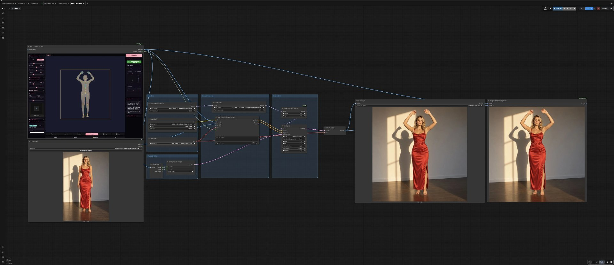
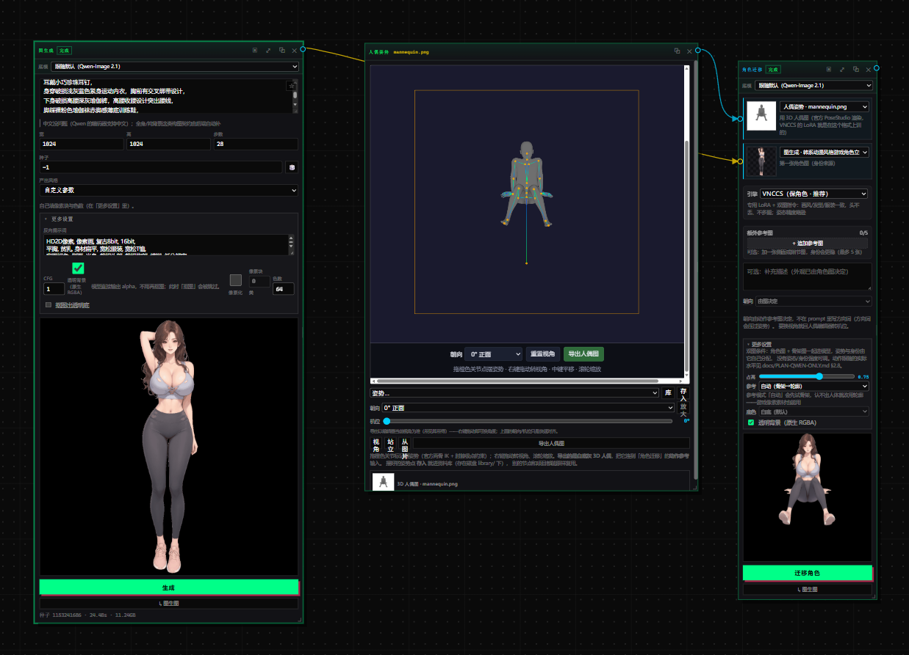
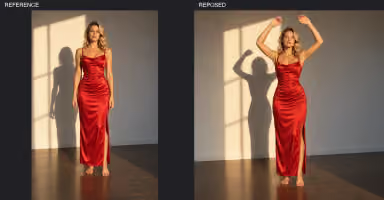
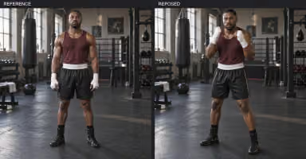

# 参考 VNCCS 人偶姿势实现「姿势迁移 + 人物一致性」原理解析

本项目把 VNCCS 的「3D 人偶姿势 → 角色迁移」能力移植到 Qwen-Image-2.1 管线。
下面讲清楚**底层原理**（它到底是怎么做到的），再给出工作流与效果。

## 一句话原理

用 VNCCS PoseStudio 的 3D 人偶编辑器摆出目标姿势，渲染成一张「姿势条件图」；
再给一张角色参考图当身份来源。两者一起喂给 Qwen-Image-2.1 + 专用 PoseStudio V1 LoRA，
出图时**只换姿势、保留脸 / 发型 / 服装**。多个动作共用同一个随机种子，保证角色一致。

## 底层原理：它到底是怎么做到的

### 1. 不是 ControlNet，是「参考图 + 指令」的图像编辑

Qwen-Image-2.1 本身是个**多模态图像生成 / 编辑模型**，能同时接收图片 + 文字指令。
VNCCS 的做法不是挂一条 ControlNet 分支，而是把两张图一起送进模型：

- **image1 = 人偶姿势图**（你摆好的目标姿态渲染）
- **image2 = 角色参考图**（要保留脸 / 发型 / 服装的那张）
- **固定指令**：`Draw character from image2`、
  或 `Replace the pose of image2 with the pose of image1. Keep the character of image2.`

模型据此从 image1 读出「姿势」，从 image2 读出「身份与服装」，合成新图。
姿势条件就是「一张被模型读懂的图」，而不是额外的网络分支。
（人偶图本身也能以干净的「ControlNet 风格」条件图形式喂给其他管线，但 VNCCS 自带的姿势控制走的是上面这条 LoRA + 双图指令的路。）

### 2. 姿势为什么用 3D 人偶，而不是 2D 骨架（OpenPose）

2D 骨架只有平面坐标、**没有深度**。社区文档（Fisher Pose，基于同一套 VNCCS 人偶 + LoRA）明确写道：
2D 骨骼缺深度，只能从每根骨头「视觉缩短的程度」去估深度，**估错时躯干和四肢会前后翻转**。

VNCCS 改用 **MakeHuman 3D 人偶**（正是训练 VNCCS PoseStudio QI2.1 LoRA 时用的同一躯体）渲染成图：

- 身体体积、左右遮挡关系、手姿、身材比例，都直接画进图里；
- **朝向（正面 / 侧面 / 背面）烘焙在相机机位中**，不用在 prompt 里写 `front/side/back`——
  那反而会把动作压回站立；
- 模型读这一张图就能还原 3D 姿态，远比 2D 骨架稳。

### 3. 专用 LoRA 在干什么

LoRA（低秩微调）的本质是：**把「这种人偶渲染格式 → 对应的身体布局」这一映射，教给基础模型。**
基础模型本来就有「看图 + 出图」的能力，LoRA 只是让它把这种特定的人偶图
**识别成「姿势控制信号」**——于是姿势贴合准、肢体摆位对、朝向也对。
LoRA 权重越小越灵活（通常几十到几百 MB），可以叠加、调强度。

### 4. 人物一致性怎么保证

三件事叠加，才做到「换姿势不换脸」：

- **身份来源是 image2**（参考图决定脸 / 发型 / 服装）；
- **指令要求保留 image2 的角色**；
- **整批共用同一个随机种子**，把画风、服装细节锚定住，避免每个姿势各漂各的。

同种子下改姿势，改动能明确归因，方便对比哪一处变了。

### 5. 为什么姿势要「用图给」，而不是用提示词写

Qwen 的指令式编辑对大部分改动都做得不错，但**「姿势」恰恰是最不擅长的地方**：
文本要求某个具体肢体角度、或让相机左转 40°，往往只得到原姿势，或一个僵硬的近似。
把姿势**画成一张图**交给模型，才精准可控。

## 工作流长这样

> 图：ComfyUI 工作流——参考角色（image2）+ PoseStudio 姿势（image1）→ Qwen + PoseStudio V1 LoRA → 出图。

姿势是在 PoseStudio 的骨架编辑节点里摆出来的（不是手画线框）：

> 图：ComfyUI 中的「人像编辑 / 骨架编辑」节点——中央是可拖拽的骨骼姿态（坐姿、双腿分开），
> 带橙色调节框与手柄；底部有「横向 / 0° 正视 / 垂直视角 / 导出人像」等按钮，导出即 image1。

## 怎么用（与官方一致）

- **参考角色（image2）**：干净正面图，清晰展示要保留的服装；多个动作用同一张参考，减少漂移。
- **PoseStudio 姿势（image1）**：摆关节、调相机 / 视场，经 VNCCS 工具桥发到 ComfyUI 当条件信号。
- **场景提示 + 风格**：简洁场景提示（位置 / 光照 / 相机感），保留身份提示（如「保留红裙细节」）。
- **采样细化**：先出一帧验证姿势与相似度；保持种子不变，快速迭代姿势与措辞。
- **导出升级**：锁定后导出，可走升级器出高清。

## 效果示例

> 左 `REFERENCE`、右 `REPOSED`：同一角色、服装、场景，只换姿势（双臂上举）。

> 男运动员：站姿 → 拳击防御姿势，健身房场景一致。

## 关键模型与资源（开源，本项目移植来源）

- **核心生成**：Qwen2.1-Image（多模态图像生成 / 编辑模型，接收图片 + 指令）
- **姿势 LoRA**：VNCCS PoseStudio V1 LoRA for Qwen Image 2.1 —
  https://huggingface.co/MIUProject/VNCCS_PoseStudio_QI2.1
- **工作流 / 工具桥**：AHEKOT/ComfyUI_VNCCS、AHEKOT/ComfyUI_VNCCS_Utils
- **原始仓库（本项目移植对象）**：https://github.com/AHEKOT/ComfyUI_VNCCS

## 本项目怎么接（简述）

- 前端内嵌官方 PoseStudio（iframe）导出白底灰人偶图，连到「角色迁移」节点的**动作参考（image1）**；
  角色图连**身份来源（image2）**。
- 后端 `qwen_pose_image()`：人偶图预处理（白底 / 等比居中 / 按人偶比例铺满）+ 双图 + 固定指令 + 该 LoRA——
  与上面的原理一一对应。
- 详尽源码落点：`docs/角色中心-剩余工作与做法.md`、`docs/VNCCS-REAL.md`。
